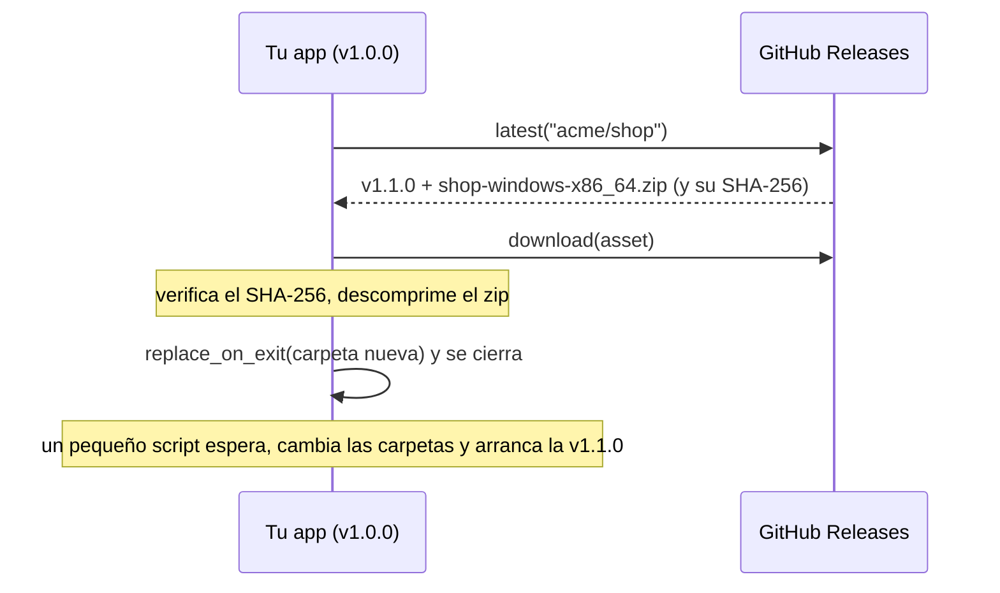

import { Aside, Steps } from '@astrojs/starlight/components';

`pyzed.updater` permite que una app hecha con `pyzed build` se actualice sola desde las **GitHub Releases** de su
repositorio: busca la versión más nueva, descarga la compilación para este sistema, la verifica y cambia la carpeta de
la app por la nueva cuando la app se reinicia. Pyzed Design se actualiza con este mismo módulo.



## Qué debe contener una versión

<Steps>

1. **Una etiqueta de versión** como `v1.1.0` (versiones preliminares: `v1.2.0-rc.1`, `v1.2.0-beta.2`...).

2. **Un zip por sistema**, llamado `<app>-<sistema>-<arq>.zip`:

   | Sistema | Ejemplo |
   | --- | --- |
   | Windows | `shop-windows-x86_64.zip` |
   | macOS | `shop-macos-arm64.zip`, `shop-macos-x86_64.zip` |
   | Linux | `shop-linux-x86_64.zip`, `shop-linux-aarch64.zip` |

   `updater.asset_name("shop")` devuelve el nombre para la máquina donde se ejecuta.

3. **Dentro de cada zip, exactamente una entrada**: la carpeta de la app tal como la creó `pyzed build` (`Shop/`), o
   `Shop.app` en macOS (comprímela con `ditto -c -k --keepParent` para conservar la firma del paquete).

</Steps>

La [página de CI](/pyzed/es/packaging/ci/#publicar-una-github-release) tiene un flujo que compila y sube estos zip.

<Aside type="caution" title="Cada descarga se verifica">
`updater.download` solo instala un archivo cuyo **SHA-256** coincide con el que publica GitHub para ese archivo de la
versión. Si falta o es distinto, lanza `UpdateError` y borra el archivo, así que nunca se instala una descarga dañada o
manipulada.
</Aside>

## Buscar, descargar, reiniciar

Las funciones bloquean mientras hablan con la red, así que ejecútalas fuera del hilo de la interfaz, por ejemplo con
`asyncio.to_thread` en una corrutina (mira [Async](/pyzed/es/guides/async/)). Una app completa:

```python title="src/shop/app.py"
import asyncio
import os

import pyzed as pz
from pyzed import ui, updater

__version__ = "1.0.0"   # mantenla igual que en pyproject.toml
REPO = "acme/shop"      # el repositorio de GitHub con las versiones
APP = "shop"            # la parte <app> de los nombres de los zip


class Shop(pz.App):
    title = "Shop"

    def __init__(self):
        self.release = None   # una versión más nueva, cuando la hay
        self.ready = None     # la versión nueva descargada, lista para cambiarla
        self.status = ""

    def on_start(self):
        if updater.is_frozen():          # solo una app empaquetada puede reemplazarse
            return self.check()

    async def check(self):
        try:
            release = await asyncio.to_thread(updater.latest, REPO)
        except updater.UpdateError as err:
            return ("status", f"No se pudo buscar actualizaciones: {err}")
        if updater.is_newer(release.version, __version__) and release.asset_for(updater.asset_name(APP)):
            return ("found", release)
        return ("status", "Tienes la última versión.")

    async def download(self):
        asset = self.release.asset_for(updater.asset_name(APP))
        self.status = f"Descargando {self.release.version}…"
        try:
            archive = await asyncio.to_thread(updater.download, asset)
            bundle = await asyncio.to_thread(updater.extract, archive)
        except updater.UpdateError as err:
            return ("status", f"La actualización falló: {err}")
        return ("ready", bundle)

    def restart(self):
        updater.replace_on_exit(self.ready)   # cambia las carpetas cuando este proceso termina...
        os._exit(0)                           # ...así que termínalo ya; la versión nueva arranca sola

    def update(self, message):
        kind, value = message
        if kind == "found":
            self.release, self.status = value, f"La versión {value.version} está disponible."
        elif kind == "ready":
            self.ready, self.status = value, "Reinicia para terminar la actualización."
        else:
            self.status = value

    def view(self):
        acciones = []
        if self.ready:
            acciones.append(ui.button("Reiniciar para actualizar", self.restart, variant="solid"))
        elif self.release:
            acciones.append(ui.button("Descargar e instalar", self.download, variant="solid"))
        return pz.column([ui.heading("Shop"), ui.muted(f"Versión {__version__}"), ui.label(self.status), *acciones],
                         spacing=10, padding=24)
```

{/* media: packaging/update-flow */}

## Las funciones

| Función | Qué hace |
| --- | --- |
| `latest(repo, prerelease=False)` | La `Release` más nueva de `"dueño/nombre"`. Con `prerelease=True` también cuentan las preliminares (un "canal preview"). |
| `release(repo, version)` | La versión indicada (`"1.1.0"` o `"v1.1.0"`). |
| `is_newer(candidata, actual)` | Compara versiones; una versión final es más nueva que sus preliminares (`1.2.0` > `1.2.0-rc.1`). |
| `asset_name(app)` | `"<app>-<sistema>-<arq>.zip"` para esta máquina. |
| `Release.asset_for(nombre)` | El archivo de la versión con ese nombre, o `None` si la versión no tiene compilación para este sistema. |
| `download(asset, progress=None)` | Descarga a una carpeta temporal, verifica el SHA-256 y devuelve la ruta. `progress` recibe la fracción completada, de 0 a 1. |
| `extract(archivo)` | Descomprime el zip y devuelve la app que contiene. |
| `replace_on_exit(bundle, relaunch=True, args=(), keep=())` | Arranca un pequeño script que espera a que la app se cierre, cambia la carpeta vieja por `bundle` (restaurando la vieja si falla) y arranca la versión nueva. `keep` lista archivos a conservar, como el desinstalador de un instalador (`"unins*"`). |
| `is_frozen()` | Si es una app empaquetada. |
| `install_dir()` | La carpeta (o `.app`) de la app en ejecución, `None` si corre desde Python. |
| `can_update_in_place()` | Si la app está empaquetada y su carpeta admite escritura, para que `replace_on_exit` funcione. |

Una `Release` tiene `version`, `tag`, `notes` (las notas de la versión en Markdown: muéstralas con
[`ui.markdown`](/pyzed/es/library/markdown/)), `url`, `published`, `prerelease` y `assets`. Los errores son
`UpdateError` con un mensaje legible ("could not reach GitHub", "rate limit"...): los problemas de red nunca cierran la
app.

## A tener en cuenta

- **Importa dónde vive la app.** La app solo puede reemplazar una carpeta en la que puede escribir. Comprueba
  `updater.can_update_in_place()` antes de ofrecer la actualización; si es `False` (por ejemplo una app en
  `C:\Program Files`), manda a la gente a la página de descarga. Las instalaciones por usuario
  (`%LOCALAPPDATA%\Programs` en Windows, `~/.local/share` en Linux, `/Applications` para administradores en macOS)
  funcionan.
- **Solo compilaciones en carpeta.** Una compilación `--onefile` no puede actualizarse así.
- **Las apps firmadas siguen firmadas** en macOS si el zip se creó con `ditto` a partir de una `.app` firmada (y
  notarizada).
- **La API de GitHub tiene límite** de 60 peticiones por hora por IP sin token: busca una vez al día, no en cada
  arranque.

<Aside type="caution" title="Recordar las búsquedas">
`updater.load_state()`, `save_state()` y `due()` guardan sus datos en un archivo compartido por todas las apps Pyzed
del equipo (la carpeta de ajustes de Pyzed), incluido Pyzed Design. Para tu app, guarda la hora de la última búsqueda
en tus propios ajustes.
</Aside>

<Aside type="note" title="Otras fuentes de actualizaciones">
La autoactualización solo lee GitHub Releases. Actualizar desde tu propio servidor, una tienda de apps o un gestor de
paquetes todavía no está soportado.
</Aside>
