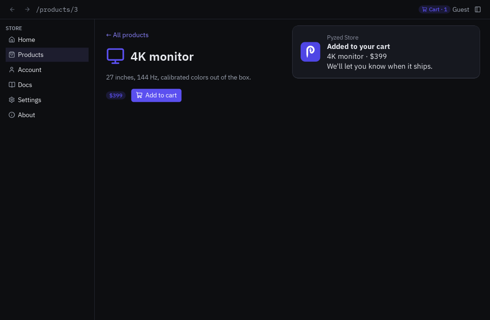

`pz.notify` muestra las notificaciones propias del sistema operativo: los toasts de Windows 10 y
11, el Centro de notificaciones de macOS y el servidor de notificaciones de Linux (GNOME, KDE,
Cinnamon, XFCE, dunst, mako...).

```python
import pyzed as pz

pz.notify("Pedido enviado", "Tu monitor está en camino", href="/orders/3")
```



Al hacer clic **trae la ventana al frente** y, con `href`, va a esa página.

## Botones

```python
pz.notify("Mensaje nuevo", "Ana: ¿seguimos con lo de hoy?",
          actions={"reply": "Responder", "/inbox": "Abrir la bandeja"},
          on_action=lambda action: print("pulsado", action))
```

`actions` es `{id: texto}` o una lista de textos. Un botón cuyo id es una dirección (`/inbox`,
`?tab=unread`) abre esa página por sí solo; los demás llaman a `on_action(id)`.

## Todas las opciones

| Opción | Qué hace |
| --- | --- |
| `title`, `body` | el texto |
| `icon`, `image` | una ruta o bytes PNG; `image` es una imagen más grande donde el sistema la muestra |
| `actions` | los botones |
| `href` | la página que abre un clic |
| `on_click(notification)`, `on_action(id)`, `on_close(reason)` | corren **en el hilo de la interfaz** |
| `urgency` | `"low"`, `"normal"` o `"critical"` (se queda hasta que se responda) |
| `sound` | `True` (el del sistema), `False`, o el nombre de un sonido |
| `timeout` | segundos en pantalla; `0` hasta que se cierre; `None` lo que diga el sistema |
| `tag` | una notificación nueva con la misma etiqueta reemplaza a la vieja |

`on_close` recibe `"expired"`, `"dismissed"`, `"closed"` o `"unknown"`.

## La notificación que devuelve

```python
progress = pz.notify("Descargando", "0 %", tag="download")
progress.update(body="60 %")
progress.close()
```

`notification.native` dice si la mostraron las notificaciones del sistema, `closed` si ya salió
de la pantalla y `reason` por qué.

## Con acciones y el router

El sitio habitual es el `on_done` de una [acción](/pyzed/es/routing/data/actions/), o la propia
acción:

```python
@pz.action(refresh=False)
async def add_to_cart(product):
    await api.place_order([product.id])
    cart.add(product.id)
    pz.notify("Añadido al carrito", product.name, actions={"/cart": "Ver el carrito"})
```

## Cada sistema

| Sistema | Cómo | Conviene saber |
| --- | --- | --- |
| Linux | `org.freedesktop.Notifications` por D-Bus | los botones, los clics y los motivos de cierre dependen del servidor; `pz.notifications.capabilities()` los lista |
| Windows 10/11 | toasts de WinRT | desde un script se ven como de PowerShell; una app empaquetada pone en `pz.notifications.app_id` su AppUserModelID |
| macOS | el Centro de notificaciones | desde un script se ven como de la terminal; una app empaquetada pone en `app_id` su bundle identifier. Un botón, o un menú de ellos |

`pz.notifications.app_name` es el nombre que se muestra (por defecto el título de la ventana) y
`pz.notifications.supported()` dice si aquí funcionan las notificaciones nativas. Donde no (una
sesión de Linux sin servidor de notificaciones, Android), `pz.notify` recurre a `notify-send`,
`osascript` o PowerShell: se ve el texto, sin botones ni clics.

## En Pyzed Design

El componente **Notificación** de la caja de herramientas (categoría Sistema) hace lo mismo sin
código: pon su título, su texto, sus botones (uno por línea) y la página que abre un clic, y
llama a `show()` desde un evento. Sus eventos `clicked`, `action` y `closed` siguen lo que hace
el usuario.
