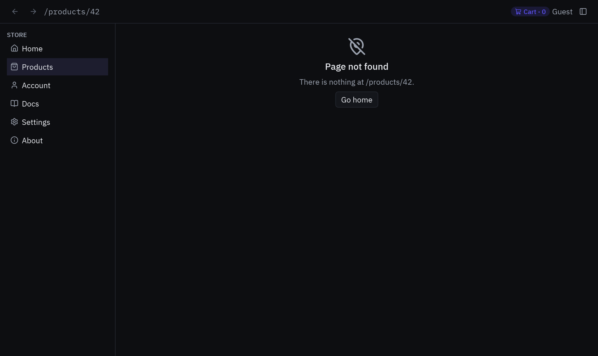

## error.py

`error.py` atrapa lo que falla por debajo: sus páginas, los layouts anidados, sus `load` y el
middleware de esas direcciones. `reset` descarta los datos fallidos y lo vuelve a intentar:

```python
# app/error.py
import pyzed as pz
from pyzed import ui


def error(error, reset):
    return pz.column([
        ui.heading("Algo salió mal", level=2),
        ui.label(str(error), color="text_muted"),
        ui.button("Reintentar", reset, icon="rotate-ccw"),
    ], spacing=12)
```


El error se ve **dentro de los layouts de encima**, así que la barra lateral sigue usable. Un
`error.py` no atrapa el layout de su propia carpeta: ese se atrapa un nivel más arriba, como en
Next.js. La traza también se imprime en la terminal.

La función también recibe `info`, un `pz.ErrorInfo` con el tipo, el mensaje y la traza del
error, para una tarjeta de error con detalles:

```python
def error(error, reset, info):
    return ui.error_card(info, actions=[ui.button("Reintentar", reset)])
```

## not_found.py

`not_found.py` se ve para las direcciones que no coinciden con ninguna página, y allí donde una
página, un `load` o un middleware llama a `pz.not_found()`. Gana el más cercano por encima:

```python
async def load(params):
    product = await api.product(params["id"])
    if product is None:
        pz.not_found()           # muestra el not_found.py más cercano
    return product
```



## Redirecciones

`pz.redirect("/login")` va a otra página en lugar de la que se está dibujando, reemplazando la
entrada del historial (`push=True` añade una). Funciona en páginas, layouts y `load`; para
comprobaciones que corren antes de cualquier página, usa [middleware](/pyzed/es/routing/advanced/middleware/).

```python
# app/settings/page.py: /settings muestra su primera pestaña
def page():
    pz.redirect("/settings/profile")
```

## Sin estos archivos

Pyzed muestra su propia tarjeta de error (con la traza en la terminal y un «Reintentar») y su
propio «Página no encontrada», en el idioma de la app.
