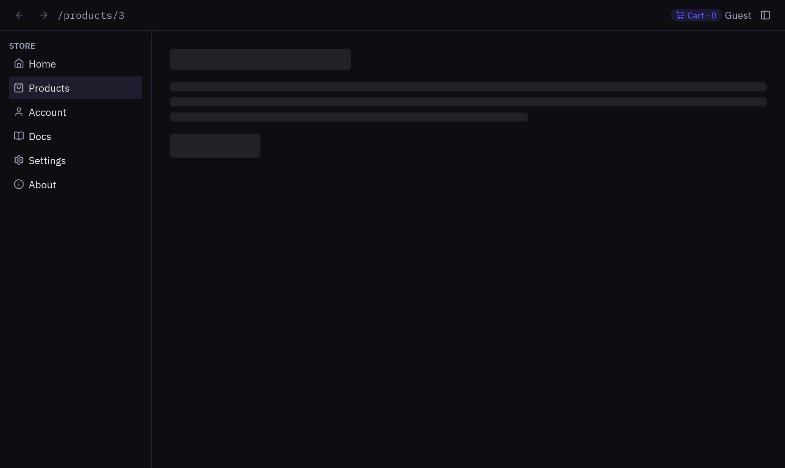
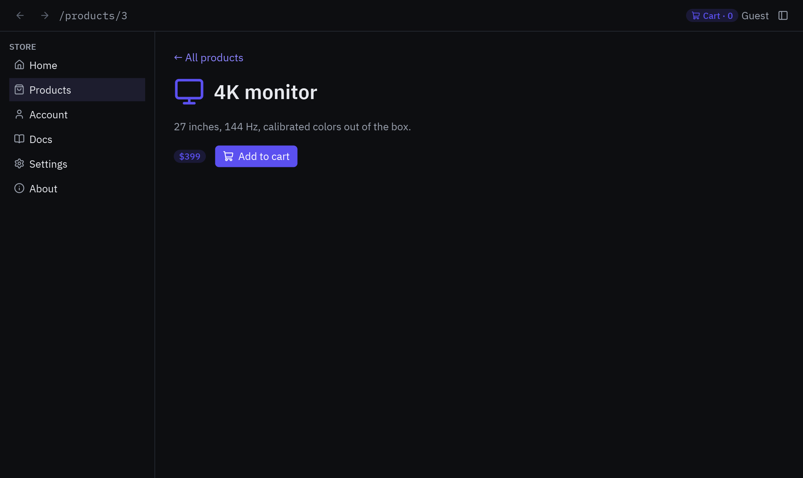

Una página que necesita datos de un servidor o de una base de datos los obtiene con `load`, una
función junto a la página. `load` corre **fuera del hilo de la interfaz**, así que la ventana
sigue respondiendo mientras viaja la petición. Lo que devuelve `load` llega a la página como
`data`:

```python
# app/(shop)/products/[id]/page.py
import pyzed as pz
from pyzed import ui

import api                      # api.py junto a app/


async def load(params):
    product = await api.product(params["id"])
    if product is None:
        pz.not_found()
    return product


def title(data):
    return data.name


def page(data):
    return pz.column([pz.link("/products", "← Todos los productos"), ui.heading(data.name)])
```


## async o no

| Escribes | Corre | Úsalo para |
| --- | --- | --- |
| `async def load(params)` | en el bucle asyncio de Pyzed, en segundo plano | clientes HTTP (`httpx.AsyncClient`, `aiohttp`), drivers de base de datos async |
| `def load(params)` | en un hilo de trabajo (hay 4) | `requests`, `sqlite3`, SQLAlchemy, leer archivos |

Los dos reciben solo los argumentos que nombran: `params`, `query`, `locals` (del
[middleware](/pyzed/es/routing/advanced/middleware/)) y `router`.

La función de la página no puede ser `async def`: los widgets se construyen en el hilo de la
interfaz, así que los `await` van en `load`. El mensaje de error lo dice si lo intentas.

### Con httpx

```python
# api.py
import httpx

client = httpx.AsyncClient(base_url="https://api.example.com", timeout=10)


async def product(product_id):
    response = await client.get(f"/products/{product_id}")
    if response.status_code == 404:
        return None
    response.raise_for_status()           # los demás errores van a error.py
    return response.json()
```

### Con una base de datos

```python
# api.py
import sqlite3

def product(product_id):
    with sqlite3.connect("shop.db") as db:
        return db.execute("select * from products where id = ?", (product_id,)).fetchone()

# app/products/[id]/page.py: un def normal, así que corre en un hilo de trabajo
def load(params):
    return api.product(int(params["id"]))
```

### Varias peticiones a la vez

`asyncio.gather` las hace en paralelo, así que la página espera a la más lenta y no a la suma:

```python
import asyncio

async def load(params):
    product, reviews = await asyncio.gather(api.product(params["id"]), api.reviews(params["id"]))
    return {"product": product, "reviews": reviews}
```

## Mientras carga

El `loading.py` más cercano por encima de la página ocupa su lugar mientras corre `load`,
**dentro de los layouts**, así que la barra lateral se queda quieta:

```python
# app/(shop)/products/loading.py
import pyzed as pz
from pyzed import ui


def loading():
    return pz.column([ui.skeleton(height=28, width=240), ui.skeleton(height=16), ui.skeleton(height=16)],
                     spacing=12)
```





Sin un `loading.py`, la página anterior se queda en pantalla hasta que la nueva está lista, como
hace Next.js.

## La caché

Los datos de una página se guardan, así que ir atrás y adelante los muestra al instante. Se
guardan por página, por sus `params` y por su query: `/products?sort=price` y
`/products?sort=name` son dos entradas.

| Cuándo | Qué pasa |
| --- | --- |
| vuelves antes de `stale_time` (30 s) | los datos guardados se ven al instante, sin petición |
| vuelves más tarde | `load` corre otra vez; mientras tanto se ve `loading.py` |
| `router.refresh()` | el `load` de la página actual corre otra vez, **los datos viejos siguen en pantalla** mientras tanto |
| `router.invalidate("/products")` | los datos de esa página se marcan como viejos: se cargan otra vez la próxima vez que se vea |
| termina una [`pz.action`](/pyzed/es/routing/data/actions/) | la página actual se refresca sola |

`stale_time` es una opción del router: `pz.Router("app", stale_time=60)`, o
`pz.RouterApp("app", stale_time=60)`.

Un layout también puede tener su propio `load`: sus datos se guardan mientras te mueves entre
las páginas de dentro, y solo se cargan otra vez cuando cambian sus propios `params`.

## Cargar antes del clic

Un enlace empieza el `load` de su página cuando el ratón pasa por encima, así que a menudo la
página está lista cuando se hace clic. `pz.link(..., prefetch=False)` lo desactiva, y
`router.prefetch(href)` lo hace desde el código (después de una búsqueda, por ejemplo, para el
primer resultado).

## Cuando falla

Una excepción en `load` va al [`error.py`](/pyzed/es/routing/basics/errors/) más cercano, cuyo
«Reintentar» vuelve a correr `load`. `pz.not_found()` y `pz.redirect()` también funcionan dentro
de `load`.

## En los tests

`router.wait()` espera a los `load` pendientes, así que un test puede comprobar la página con sus
datos:

```python
router = pz.Router("app", initial="/products/3")
router.view()
router.wait()
assert router.title == "4K monitor · Shop"
```
