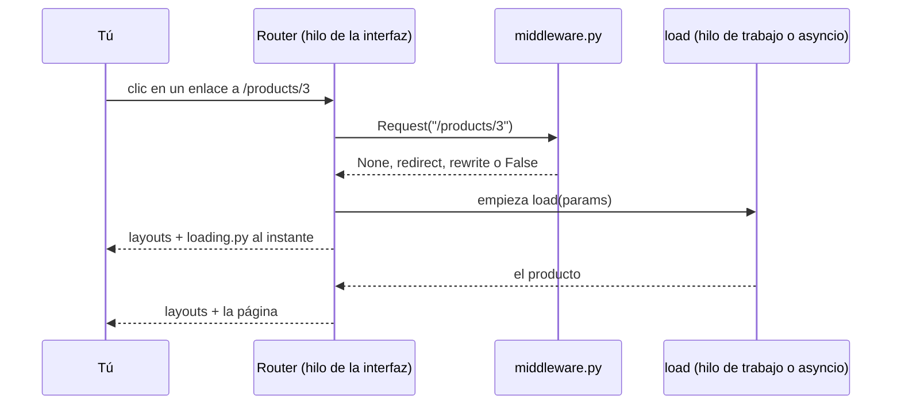

## De un clic a la pantalla



1. Corre el **middleware**, primero el de las carpetas exteriores. Puede dejar pasar la
   navegación, mandarla a otro sitio, mostrar otra ruta o pararla.
2. Cambian la dirección y el historial.
3. Cada `load` del camino (el de los layouts y el de la página) empieza **en segundo plano**. Si
   los datos están en caché y frescos, no se pide nada.
4. La ventana se dibuja al instante: los layouts, y el `loading.py` más cercano donde faltan
   datos (o la página anterior, si no hay `loading.py`).
5. Cuando `load` responde, la ventana se vuelve a dibujar con la página.

## El orden de los archivos

En cada carpeta, los archivos se envuelven así, de fuera hacia dentro, y la carpeta siguiente va
en el centro:

```text
layout.py
└── template.py
    └── error.py            atrapa lo que falla dentro
        └── loading.py      mientras faltan los datos de dentro
            └── not_found.py
                └── la carpeta siguiente… y al final page.py
```

Por eso un `error.py` no atrapa el layout de su carpeta (el layout está fuera), y por eso un
`loading.py` mantiene en pantalla los layouts de su carpeta.

## Hilos

| Corre en el hilo de la interfaz | Corre fuera de él |
| --- | --- |
| páginas, layouts, templates y cada `render()` | `load` |
| manejadores de eventos (`on_click`...) | las funciones `@pz.action` |
| `on_done`, `on_error`, clics en notificaciones | `async def middleware` |
| `middleware` síncrono | |

El hilo de la interfaz tiene que quedar libre: construir widgets es rápido, pero una petición ahí
congela la ventana. Todo lo que espera (la red, el disco, una base de datos, `time.sleep`) va en
`load` o en una acción.

## Qué se vuelve a dibujar

Pyzed construye la vista en cada mensaje (un clic, una tecla, un `load` que termina), pero
**reutiliza el último dibujo de cada componente cuyas entradas no cambiaron**, como `React.memo`.
Un componente se vuelve a dibujar solo cuando:

- cambiaron sus props o su propio `pz.state`,
- cambió un campo de un `pz.Store` que leyó su `render()`,
- cambió un valor que leyó con `pz.use_context`,
- cambiaron el tema, el idioma o el tamaño de la ventana.

Así, añadir al carrito vuelve a dibujar el contador que muestra `cart.count`, y no la lista de
productos. Las páginas y los layouts escritos como funciones corren otra vez en cada dibujo; no
pasa nada, solo construyen widgets. Pon una pieza lenta detrás de un componente para que se pueda
reutilizar.

## Dónde vive el estado

Cada layout, template y página guarda el estado de sus componentes en su propio sitio:

- un **layout** lo guarda mientras sigues debajo de su carpeta (y mientras no cambian sus `params`),
- un **template** empieza de cero en cada navegación,
- una **página** empieza de cero cuando cambian sus `params`, no cuando solo cambia su query.

Los componentes creados en un bucle guardan su estado por posición; dales `key=` cuando los
elementos se mueven.

## Reglas prácticas

- ✅ Lee en `load`, cambia con `@pz.action`, comparte con `pz.Store`.
- ✅ Guarda filtros y pestañas en la query, para que el historial y los enlaces los conserven.
- ✅ Devuelve rápido desde las páginas: se llaman a menudo.
- ❌ Nada de `requests.get`, `time.sleep` ni llamadas a la base de datos en una página, un layout o `render()`.
- ❌ Nada de `async def page`: pon los `await` en `load`.
- ❌ No copies `data` en un store «para guardarlo»: el router ya lo cachea.
