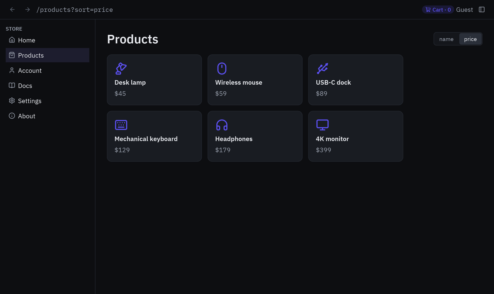

Cada valor de la pantalla vive en algún sitio. Elige el sitio según **quién lo necesita** y
**cuánto tiene que durar**:

| Valor | Dónde | Dura |
| --- | --- | --- |
| un texto que se escribe, un menú abierto | `pz.state` en el componente | mientras se ve el componente |
| un filtro, una pestaña, un número de página | la dirección (`?sort=price`) | en el historial, y en los enlaces |
| lo que una página muestra del servidor | `load` → `data` | en caché, se refresca tras los cambios |
| la barra lateral plegada, un scroll | `pz.state` en un `layout.py` | mientras sigues debajo de ese layout |
| un equipo, un proyecto que comparte una rama | `provide` + `pz.use_context` | mientras se ve ese layout |
| la sesión, el carrito, las preferencias | un `pz.Store` | toda la ejecución (o entre ejecuciones con `persist`) |
| un cambio que se está guardando | `pz.action` (`pending`, `error`) | hasta la siguiente llamada |

## Estado de componentes

```python
class Search(pz.Component):
    text = pz.state("")

    def render(self):
        return ui.input(self.text, on_input=lambda v: setattr(self, "text", v))
```

Cambiar `self.text` vuelve a dibujar el componente. El estado de un componente de página empieza
de cero cuando cambian sus `params`, y el de un layout se queda mientras navegas por debajo
([Páginas, layouts y templates](/pyzed/es/routing/basics/pages-and-layouts/)).

## La dirección como estado

Lo que el usuario debería poder recuperar va en la query: el botón atrás vuelve a ello y un
enlace o una notificación pueden abrir la página ahí.

```python
def page(query, router):
    sort = query.get("sort", "name")
    return ui.segmented(["name", "price"], sort, lambda v: router.replace(f"?sort={v}"))


async def load(query):              # la query forma parte de la clave de la caché
    return await api.products(sort=query.get("sort", "name"))
```



## Estado global: `pz.Store`

Un store guarda lo que comparten muchas páginas. Escribe una clase con sus campos, crea **una
instancia** en un módulo junto a `app/` e impórtala donde quieras:

```python
# state.py
import pyzed as pz


class Cart(pz.Store):
    items: list = []                 # cada instancia recibe su propia copia del valor por defecto
    coupon: str = ""

    @property
    def count(self):                 # los valores derivados son propiedades
        return len(self.items)

    def add(self, product_id):       # los cambios son métodos
        self.items = [*self.items, product_id]


cart = Cart()
```

```python
# app/layout.py
from state import cart

def layout(children):
    return pz.column([header(badge=cart.count), *children])
```

**Solo se vuelve a dibujar lo que leyó el store.** Pyzed anota qué stores leyó cada `render()`,
así que añadir al carrito vuelve a dibujar el contador de la cabecera y deja el resto de la
ventana como estaba. Un cambio hecho en otro hilo (un `load`, una acción, un temporizador)
también vuelve a dibujar la ventana.

| Llamada | Hace |
| --- | --- |
| `cart.items = [...]` | cambia un campo; quienes lo leen se vuelven a dibujar |
| `cart.update(items=[], coupon="")` | cambia varios, con un solo aviso |
| `with cart.batch(): ...` | agrupa cambios en uno |
| `cart.changed()` | tras cambiar una lista o un dict en su sitio (`cart.items.append(x)`) |
| `cart.subscribe(callback)` | `callback(cart)` tras cada cambio; devuelve una función que lo para |
| `cart.reset()` | vuelve a los valores por defecto |
| `cart.to_dict()` | los valores, como dict |
| `def setup(self)` | corre cuando los valores ya están puestos (abrir una conexión, empezar un temporizador) |

### Guardarlo entre ejecuciones

```python
class Preferences(pz.Store):
    persist = "preferences"          # se guarda como JSON en la carpeta de ajustes del usuario
    theme: str = "dark"
    recent: list = []
```

Se guarda tras cada cambio y se lee al arrancar la vez siguiente. Los valores que JSON no puede
guardar se omiten. `preferences.path` (en la instancia) dice dónde está el archivo.

### Reemplaza, no modifiques

`self.items = [*self.items, x]` avisa a todos a la vez. `self.items.append(x)` se ve en el
siguiente dibujo, pero los suscriptores y `persist` solo se enteran tras `changed()`.

## Contexto para una parte de la app

El `provide` de un layout comparte un valor con todo lo de debajo, sin un global:

```python
# app/teams/[team]/layout.py
async def load(params):
    return await api.team(params["team"])

def provide(data):
    return {"team": data}
```

```python
team = pz.use_context("team")       # en cualquier componente de debajo
```

## Qué no hacer

- No guardes datos del servidor en un store «para cachearlos»: `load` ya cachea, refresca tras
  una acción y muestra `loading.py`. Un store es para los valores propios del usuario (la sesión,
  el carrito).
- No pongas en un store un filtro que corresponde a la dirección.
- No crees un store dentro de `render()` o de una función de página: empezaría de cero en cada
  dibujo. Créalo una vez, en un módulo.
