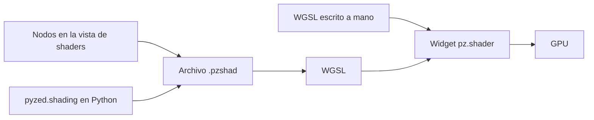

import { Aside } from '@astrojs/starlight/components';
import NavCards from '../../../../components/NavCards.astro';
import Media from '../../../../components/Media.astro';

Un **shader** es un programa pequeño que decide el color de cada píxel de un widget, muchas veces por segundo, en
la tarjeta gráfica. Así dibuja Pyzed fondos animados, efectos de brillo, radares y gráficos de juegos sin ralentizar
tu app. Si usaste los shaders visuales de Godot o el editor de materiales de Unreal Engine, los grafos de shaders
de Pyzed te van a resultar familiares.

<Media clip="shaders" alt="Seis shaders animados funcionando a la vez: plasma, un túnel, fuego, celdas de Voronoi, un sol synthwave y una nebulosa" caption="Seis shaders hechos con nodos funcionando a la vez, de <code>examples/showcase/shaders</code>." size="wide" />

## Empieza aquí

<NavCards
	items={[
		{ title: 'Tu primer shader', text: 'Crea un círculo brillante que late, con el ratón y en diez minutos, y úsalo en una app. Sin matemáticas.', href: '/pyzed/es/shading/getting-started/', icon: 'rocket', tag: 'Empieza aquí' },
		{ title: 'La vista Shader', text: 'El editor de nodos de Pyzed Design: pestañas, gestos, la barra lateral, variables y propiedades.', href: '/pyzed/es/shading/shader-designer/', icon: 'pencil', tag: 'Diseñador' },
		{ title: 'Recetas', text: 'Degradados, un brillo neón, plasma, nubes, celdas, una pantalla CRT, un foco, un spinner, fuego y rayas.', href: '/pyzed/es/shading/recipes/', icon: 'star', tag: '10 recetas' },
	]}
/>

## Todos los nodos

El [catálogo de nodos](/pyzed/es/shading/nodes/) describe todos los nodos de un grafo, por categoría, con sus
puertos, ajustes y un ejemplo para cada uno.

<NavCards
	min="13rem"
	items={[
		{ title: 'Entradas y constantes', text: 'UV, píxel, tamaño, tiempo, ratón, variables y valores fijos.', href: '/pyzed/es/shading/nodes/inputs/', icon: 'puzzle' },
		{ title: 'Matemáticas', text: 'Aritmética, sin y compañía, mezclar, limitar, paso suave, reasignar.', href: '/pyzed/es/shading/nodes/math/', icon: 'puzzle' },
		{ title: 'Vectores y UV', text: 'Componer, distancia, polar; repetir, desplazar, rotar, remolino, pixelar.', href: '/pyzed/es/shading/nodes/vectors-uv/', icon: 'puzzle' },
		{ title: 'Ruido y patrones', text: 'Perlin, fractal, Voronoi; tablero, franjas, cuadrícula, degradados, ondas.', href: '/pyzed/es/shading/nodes/noise-patterns/', icon: 'puzzle' },
		{ title: 'Formas', text: 'Círculo, rectángulo, anillo, polígono, estrella; unión y resta; relleno, contorno, resplandor.', href: '/pyzed/es/shading/nodes/shapes/', icon: 'puzzle' },
		{ title: 'Color y efectos', text: 'Degradado, paleta, tono, modos de fusión, capas, viñeta, líneas de barrido, texturas.', href: '/pyzed/es/shading/nodes/color-effects/', icon: 'puzzle' },
		{ title: 'Lógica y utilidades', text: 'Comparar, elegir, valores con nombre, tu propio WGSL, funciones shader, Salida.', href: '/pyzed/es/shading/nodes/logic-utility/', icon: 'puzzle' },
	]}
/>

## Tres formas de crear uno

| Forma | Para | Página |
| --- | --- | --- |
| **Nodos en la vista Shader** | Todo el mundo: conecta cajas con el ratón y ve el resultado en cada nodo. | [La vista Shader](/pyzed/es/shading/shader-designer/) |
| **`pyzed.shading` en Python** | Generar o editar grafos desde código, pruebas, herramientas. | [Grafos de shaders](/pyzed/es/shading/shader-graphs/) |
| **WGSL a mano** | Control total, portar shaders de otros sitios. | [Shaders en WGSL](/pyzed/es/shading/shaders/) |

Las tres acaban siendo el mismo código WGSL en la GPU, así que son igual de rápidas, y un `.pzshad` hecho con el
ratón se puede cambiar desde Python (y al revés).

<Media clip="shader-graph" alt="Nodos Voronoi y Palette arrastrados al grafo de la vista Shader y conectados a la Salida" caption="La primera forma: arrastra nodos al grafo y conéctalos; cada nodo muestra lo que produce." />

<Aside type="caution" title="Los shaders necesitan GPU">
En un equipo sin una tarjeta gráfica utilizable, un widget de shader dibuja su color o gradiente `fallback`. Dale
a cada shader un fallback razonable para que la interfaz se siga viendo bien.
</Aside>

## Míralos en acción

<NavCards
	items={[
		{ title: 'Galería de shaders', text: 'Plasma, una onda que sigue al ratón, un túnel y más, cada uno con su código.', href: '/pyzed/es/showcase/shaders/', icon: 'laptop' },
		{ title: 'El componente shader', text: 'Opciones, tamaños y ejemplos de <code>pz.shader</code> en la biblioteca de componentes.', href: '/pyzed/es/library/shader/', icon: 'puzzle' },
		{ title: 'API de pyzed.shading', text: 'Todas las clases y funciones para cargar, crear y editar grafos en código.', href: '/pyzed/es/reference/shading/', icon: 'list-format' },
	]}
/>

<Aside type="note" title="Estado de esta sección">
Los grafos de shaders son nuevos en Pyzed. Cada página describe lo que funciona hoy, y el catálogo de nodos se
genera a partir del código, así que siempre coincide con tu versión, con una captura de cada nodo. La mayoría de las
recetas muestran su grafo en la vista Shader; el resto se arma en un minuto siguiendo sus pasos.
</Aside>
