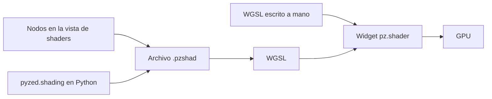

import { Aside } from '@astrojs/starlight/components';
import NavCards from '../../../../components/NavCards.astro';

Un **shader** es un programa pequeño que decide el color de cada píxel de un widget, muchas veces por segundo, en
la tarjeta gráfica. Así dibuja Pyzed fondos animados, efectos de brillo, radares y gráficos de juegos sin ralentizar
tu app. Si usaste los shaders visuales de Godot o el editor de materiales de Unreal Engine, los grafos de shaders
de Pyzed te van a resultar familiares.

## Tres formas de crear uno

<NavCards
	items={[
		{ title: 'Grafos de shaders', text: 'Shaders hechos de nodos, guardados como <code>.pzshad</code>. Dibújalos con <code>pz.shader</code> y cambia sus variables desde Python.', href: '/pyzed/es/shading/shader-graphs/', icon: 'puzzle', tag: 'Empieza aquí' },
		{ title: 'La vista de shaders', text: 'Conecta nodos en Pyzed Design con vista previa en cada nodo, como los shaders visuales de Godot.', href: '/pyzed/es/shading/shader-designer/', icon: 'pencil', tag: 'Diseñador' },
		{ title: 'Shaders en WGSL', text: 'Escribe tú la función <code>shade</code> para tener control total: uniforms, el ratón, el tiempo.', href: '/pyzed/es/shading/shaders/', icon: 'seti:shell', tag: 'Código' },
	]}
/>

<Aside type="caution" title="Los shaders necesitan GPU">
En un equipo sin una tarjeta gráfica utilizable, un widget de shader dibuja su color o gradiente `fallback`. Dale
a cada shader un fallback razonable para que la interfaz se siga viendo bien.
</Aside>

## Míralos en acción

<NavCards
	items={[
		{ title: 'Galería de shaders', text: 'Plasma, una onda que sigue al ratón, un túnel y más, cada uno con su código.', href: '/pyzed/es/showcase/shaders/', icon: 'laptop' },
		{ title: 'El componente shader', text: 'Opciones, tamaños y ejemplos de <code>pz.shader</code> en la biblioteca de componentes.', href: '/pyzed/es/library/shader/', icon: 'puzzle' },
		{ title: 'API de pyzed.shading', text: 'Todas las clases y funciones para cargar, crear y editar grafos en código.', href: '/pyzed/es/reference/shading/', icon: 'list-format' },
	]}
/>

## Próximamente

<NavCards
	items={[
		{ title: 'Catálogo de nodos', text: 'Cada nodo con una captura, sus entradas y salidas, y para qué sirve.', icon: 'list-format' },
		{ title: 'Recetas de shaders', text: 'Efectos paso a paso: fuego, agua, líneas de escaneo, un borde brillante, un spinner de carga.', icon: 'star' },
	]}
/>

<Aside type="note" title="Estado de esta sección">
Los grafos de shaders son nuevos en Pyzed. Las páginas de arriba describen lo que funciona hoy; el catálogo de
nodos y las recetas, con vistas previas animadas, llegarán en las próximas actualizaciones de esta sección.
</Aside>
