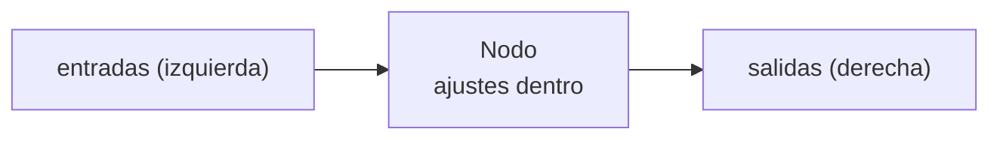

{/* Generated by docs/scripts/gen_shading_nodes.py from pyzed.shading and docs/scripts/shading_nodes_data.py. Do not edit. */}

import { Aside } from '@astrojs/starlight/components';
import NavCards from '../../../../../components/NavCards.astro';

Un grafo de shader se compone de **92 tipos de nodo** (y 137 entradas en la barra lateral de la vista
Shader, porque muchos nodos vienen en varias variantes: *Sumar*, *Multiplicar* y *Step* son todos el nodo
**Math**). Este catálogo describe cada uno: para qué sirve en palabras sencillas, sus puertos y ajustes, y un
ejemplo en Python.

<NavCards
	min="17rem"
	items={[
		{ title: "Entradas, parámetros y constantes", text: "Los nodos de los que parte todo shader: dónde está el píxel, el tiempo, el ratón, tus variables y valores fijos.", href: '/pyzed/es/shading/nodes/inputs/', icon: 'puzzle', tag: '15' },
		{ title: "Matemáticas", text: "Aritmética, funciones de un valor (sin, fract, abs...), mix, clamp, smoothstep y remap: el pegamento de todo grafo.", href: '/pyzed/es/shading/nodes/math/', icon: 'puzzle', tag: '7' },
		{ title: "Vectores y UV", text: "Crea y separa vectores, mide distancias y ángulos, y mueve, repite, gira, retuerce o curva las coordenadas.", href: '/pyzed/es/shading/nodes/vectors-uv/', icon: 'puzzle', tag: '19' },
		{ title: "Ruido y patrones", text: "Aleatoriedad orgánica (Perlin, simplex, fractal, Voronoi) y patrones regulares (damero, rayas, cuadrícula, puntos, degradados, ondas).", href: '/pyzed/es/shading/nodes/noise-patterns/', icon: 'puzzle', tag: '12' },
		{ title: "Formas", text: "Círculos, cajas, anillos, líneas, polígonos y estrellas como distancias con signo, combinadas y dibujadas con relleno, trazo y brillo.", href: '/pyzed/es/shading/nodes/shapes/', icon: 'puzzle', tag: '10' },
		{ title: "Color, efectos y texturas", text: "Degradados, paletas, tono, saturación, modos de fusión y capas, efectos de pantalla (viñeta, líneas de barrido, grano) e imágenes.", href: '/pyzed/es/shading/nodes/color-effects/', icon: 'puzzle', tag: '19' },
		{ title: "Lógica, variables y utilidades", text: "Comparaciones y si/si no, valores con nombre, desvíos, tu propio WGSL, otros shaders como funciones, comentarios y el nodo Salida.", href: '/pyzed/es/shading/nodes/logic-utility/', icon: 'puzzle', tag: '10' },
	]}
/>

## Cómo leer un nodo

- Las **entradas** están a la izquierda de un nodo y las **salidas** a la derecha. Un cable va de una salida a una
  entrada.
- Una entrada sin cable usa su **valor por defecto**: un número, un vector, un color o un valor de *contexto* como
  *UV* (la posición del píxel) o *Tiempo*. Puedes escribir otro valor directamente en el nodo.
- Los **ajustes** no son puertos: una operación, un tipo de ruido, un modo de fusión, las paradas de un degradado.
  Se cambian en el panel Propiedades (o como argumentos con nombre en Python).

### Tipos

| Tipo | Qué guarda | Ejemplo |
| --- | --- | --- |
| `float` | Un número | `0.5`, un brillo, un tiempo |
| `int` | Un número entero | `5` octavas |
| `bool` | Verdadero o falso | ¿está el ratón sobre el shader? |
| `vec2` | Dos números | una posición `(x, y)`, un tamaño |
| `vec3` | Tres números | un color `(r, g, b)` de 0 a 1 |
| `vec4` | Cuatro números | un color con alfa `(r, g, b, a)` |
| `texture` | Una imagen | una variable `texture` |
| `T` | Cualquiera de los tipos numéricos | nodos de matemáticas: el tipo más ancho que se les conecta |

Los valores se convierten por el camino: un `float` rellena todos los componentes de un vector (`0.5` pasa a ser
`(0.5, 0.5, 0.5)`) y un `vec3` se vuelve un color con alfa 1. Un cable que nunca puede funcionar, como una textura
hacia un número, se rechaza.

<Aside type="tip" title="Números de 0 a 1">
En los shaders, los colores y la mayoría de las máscaras van de **0 a 1**, no de 0 a 255: `(1, 0.5, 0)` es naranja,
`0` es negro y `1` es blanco. Muchos nodos devuelven 0..1 para que puedas multiplicarlos entre sí, como apilar
plantillas.
</Aside>

## Todos los nodos

|  |  |
| --- | --- |
| **Entrada** | [UV](/pyzed/es/shading/nodes/inputs/#uv), [Píxel](/pyzed/es/shading/nodes/inputs/#píxel), [Tamaño](/pyzed/es/shading/nodes/inputs/#tamaño), [Tiempo](/pyzed/es/shading/nodes/inputs/#tiempo), [Ratón](/pyzed/es/shading/nodes/inputs/#ratón), [UV centrado](/pyzed/es/shading/nodes/inputs/#uv-centrado) |
| **Parámetros** | [Parámetro](/pyzed/es/shading/nodes/inputs/#parámetro) |
| **Constantes** | [Decimal](/pyzed/es/shading/nodes/inputs/#decimal), [Entero](/pyzed/es/shading/nodes/inputs/#entero), [Booleano](/pyzed/es/shading/nodes/inputs/#booleano), [Vector2](/pyzed/es/shading/nodes/inputs/#vector2), [Vector3](/pyzed/es/shading/nodes/inputs/#vector3), [Vector4](/pyzed/es/shading/nodes/inputs/#vector4), [Color](/pyzed/es/shading/nodes/inputs/#color), [Constantes matemáticas](/pyzed/es/shading/nodes/inputs/#constantes-matemáticas) |
| **Matemáticas** | [Matemáticas](/pyzed/es/shading/nodes/math/#matemáticas-1), [Función](/pyzed/es/shading/nodes/math/#función), [Mezclar](/pyzed/es/shading/nodes/math/#mezclar), [Limitar](/pyzed/es/shading/nodes/math/#limitar), [Paso suave](/pyzed/es/shading/nodes/math/#paso-suave), [Reasignar rango](/pyzed/es/shading/nodes/math/#reasignar-rango), [Multiplicar y sumar](/pyzed/es/shading/nodes/math/#multiplicar-y-sumar) |
| **Vector** | [Componer](/pyzed/es/shading/nodes/vectors-uv/#componer), [Descomponer](/pyzed/es/shading/nodes/vectors-uv/#descomponer), [Reordenar](/pyzed/es/shading/nodes/vectors-uv/#reordenar), [Producto escalar](/pyzed/es/shading/nodes/vectors-uv/#producto-escalar), [Producto vectorial](/pyzed/es/shading/nodes/vectors-uv/#producto-vectorial), [Longitud](/pyzed/es/shading/nodes/vectors-uv/#longitud), [Distancia](/pyzed/es/shading/nodes/vectors-uv/#distancia), [Normalizar](/pyzed/es/shading/nodes/vectors-uv/#normalizar), [Reflejar](/pyzed/es/shading/nodes/vectors-uv/#reflejar), [Polar](/pyzed/es/shading/nodes/vectors-uv/#polar) |
| **UV** | [Repetición y desplazamiento](/pyzed/es/shading/nodes/vectors-uv/#repetición-y-desplazamiento), [Desplazar](/pyzed/es/shading/nodes/vectors-uv/#desplazar), [Rotar](/pyzed/es/shading/nodes/vectors-uv/#rotar), [Remolino](/pyzed/es/shading/nodes/vectors-uv/#remolino), [Pixelar](/pyzed/es/shading/nodes/vectors-uv/#pixelar), [Barril](/pyzed/es/shading/nodes/vectors-uv/#barril), [Caleidoscopio](/pyzed/es/shading/nodes/vectors-uv/#caleidoscopio), [Voltear](/pyzed/es/shading/nodes/vectors-uv/#voltear), [Repetir](/pyzed/es/shading/nodes/vectors-uv/#repetir) |
| **Ruido** | [Ruido](/pyzed/es/shading/nodes/noise-patterns/#ruido-1), [Ruido fractal](/pyzed/es/shading/nodes/noise-patterns/#ruido-fractal), [Voronoi](/pyzed/es/shading/nodes/noise-patterns/#voronoi), [Ruido blanco](/pyzed/es/shading/nodes/noise-patterns/#ruido-blanco), [Aleatorio](/pyzed/es/shading/nodes/noise-patterns/#aleatorio) |
| **Patrones** | [Tablero](/pyzed/es/shading/nodes/noise-patterns/#tablero), [Franjas](/pyzed/es/shading/nodes/noise-patterns/#franjas), [Cuadrícula](/pyzed/es/shading/nodes/noise-patterns/#cuadrícula), [Puntos](/pyzed/es/shading/nodes/noise-patterns/#puntos), [Degradado lineal](/pyzed/es/shading/nodes/noise-patterns/#degradado-lineal), [Degradado radial](/pyzed/es/shading/nodes/noise-patterns/#degradado-radial), [Onda](/pyzed/es/shading/nodes/noise-patterns/#onda) |
| **Formas** | [Círculo](/pyzed/es/shading/nodes/shapes/#círculo), [Rectángulo](/pyzed/es/shading/nodes/shapes/#rectángulo), [Anillo](/pyzed/es/shading/nodes/shapes/#anillo), [Segmento](/pyzed/es/shading/nodes/shapes/#segmento), [Polígono](/pyzed/es/shading/nodes/shapes/#polígono), [Estrella](/pyzed/es/shading/nodes/shapes/#estrella), [Combinar formas](/pyzed/es/shading/nodes/shapes/#combinar-formas), [Relleno](/pyzed/es/shading/nodes/shapes/#relleno), [Contorno](/pyzed/es/shading/nodes/shapes/#contorno), [Resplandor](/pyzed/es/shading/nodes/shapes/#resplandor) |
| **Color** | [HSV a RGB](/pyzed/es/shading/nodes/color-effects/#hsv-a-rgb), [RGB a HSV](/pyzed/es/shading/nodes/color-effects/#rgb-a-hsv), [Desplazar tono](/pyzed/es/shading/nodes/color-effects/#desplazar-tono), [Saturación](/pyzed/es/shading/nodes/color-effects/#saturación), [Brillo y contraste](/pyzed/es/shading/nodes/color-effects/#brillo-y-contraste), [Luminancia](/pyzed/es/shading/nodes/color-effects/#luminancia), [Escala de grises](/pyzed/es/shading/nodes/color-effects/#escala-de-grises), [Invertir](/pyzed/es/shading/nodes/color-effects/#invertir), [Gamma](/pyzed/es/shading/nodes/color-effects/#gamma), [Posterizar](/pyzed/es/shading/nodes/color-effects/#posterizar), [Fusionar](/pyzed/es/shading/nodes/color-effects/#fusionar), [Paleta](/pyzed/es/shading/nodes/color-effects/#paleta), [Degradado](/pyzed/es/shading/nodes/color-effects/#degradado), [RGBA](/pyzed/es/shading/nodes/color-effects/#rgba), [Capa](/pyzed/es/shading/nodes/color-effects/#capa) |
| **Efectos** | [Viñeta](/pyzed/es/shading/nodes/color-effects/#viñeta), [Líneas de barrido](/pyzed/es/shading/nodes/color-effects/#líneas-de-barrido), [Grano de película](/pyzed/es/shading/nodes/color-effects/#grano-de-película) |
| **Textura** | [Muestrear textura](/pyzed/es/shading/nodes/color-effects/#muestrear-textura) |
| **Lógica** | [Comparar](/pyzed/es/shading/nodes/logic-utility/#comparar), [Elegir](/pyzed/es/shading/nodes/logic-utility/#elegir), [Lógica](/pyzed/es/shading/nodes/logic-utility/#lógica-1) |
| **Variables** | [Guardar valor](/pyzed/es/shading/nodes/logic-utility/#guardar-valor), [Leer valor](/pyzed/es/shading/nodes/logic-utility/#leer-valor) |
| **Utilidades** | [Desvío](/pyzed/es/shading/nodes/logic-utility/#desvío), [Expresión](/pyzed/es/shading/nodes/logic-utility/#expresión), [Función shader](/pyzed/es/shading/nodes/logic-utility/#función-shader), [Comentario](/pyzed/es/shading/nodes/logic-utility/#comentario) |
| **Salida** | [Salida](/pyzed/es/shading/nodes/logic-utility/#salida-1) |

<Aside type="note" title="Estado del catálogo">
Cada nodo tendrá una captura de su vista previa tal como se ve en la vista Shader; mientras tanto, ejecuta su
ejemplo con `pyzed run` o pégalo en un grafo para verlo. Los puertos y valores por defecto se generan desde el
código, así que siempre están al día.
</Aside>
