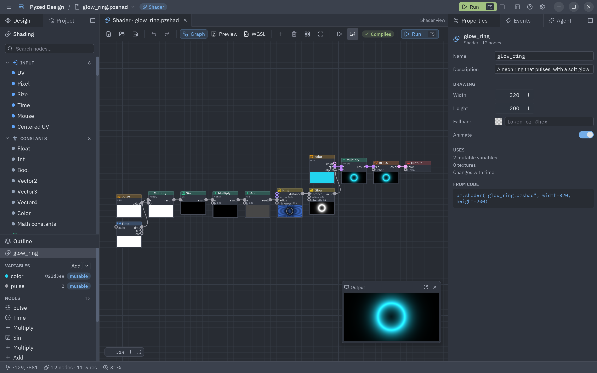
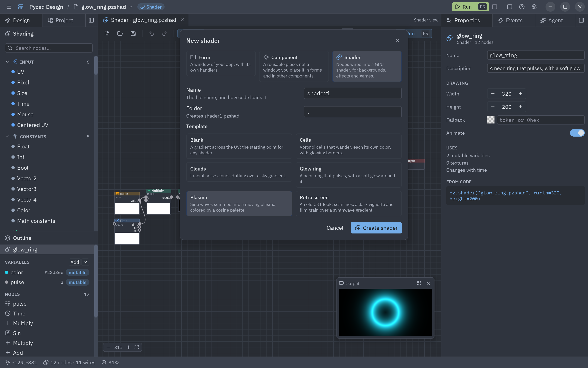
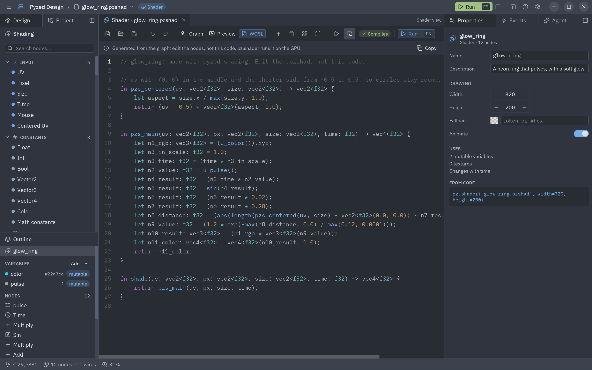
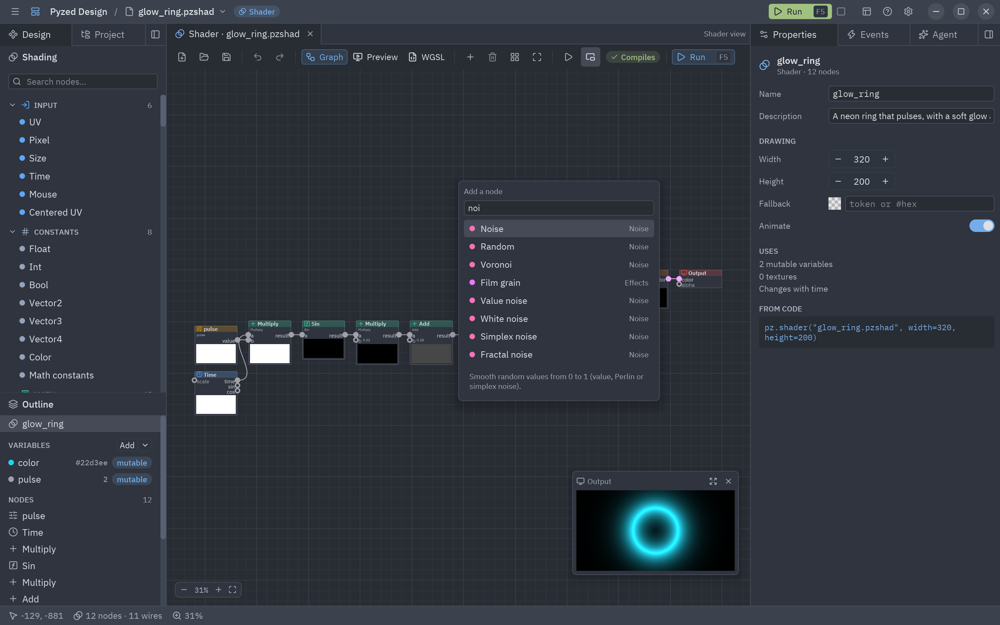
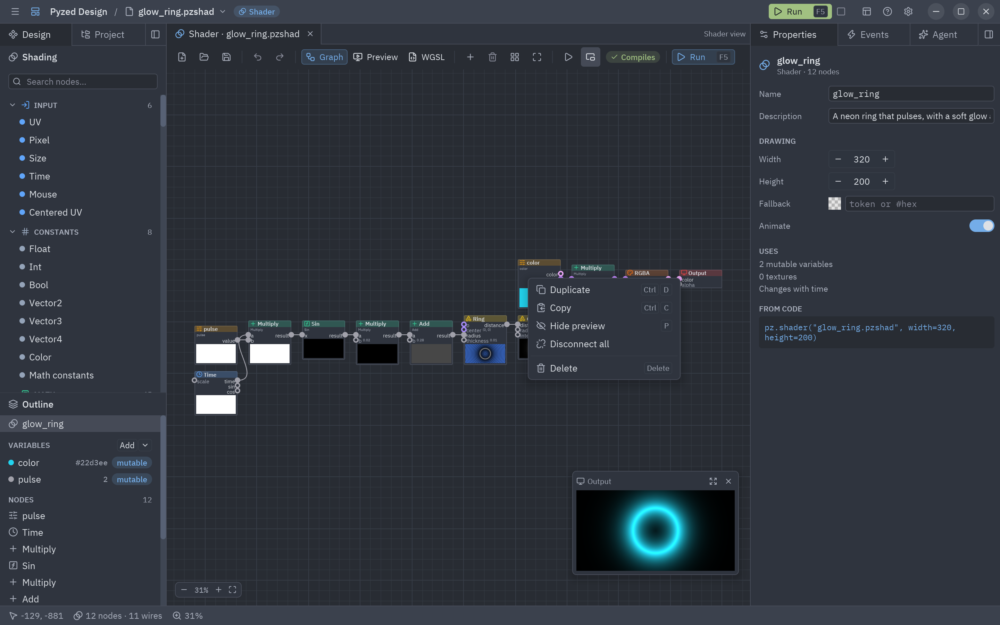
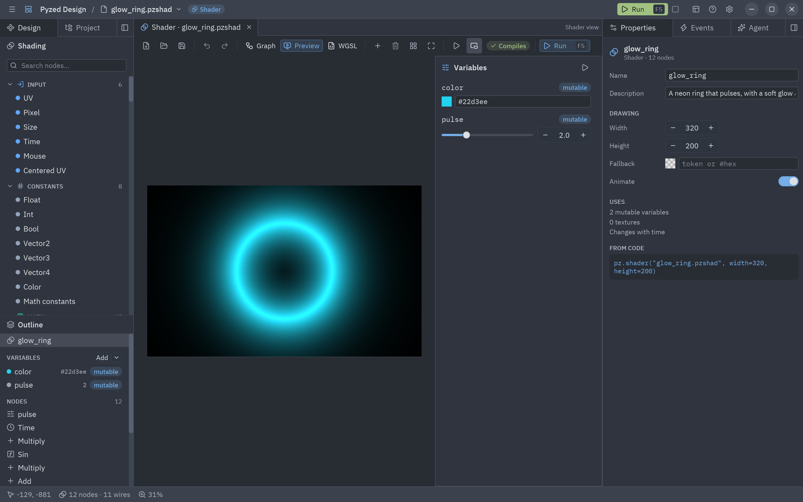
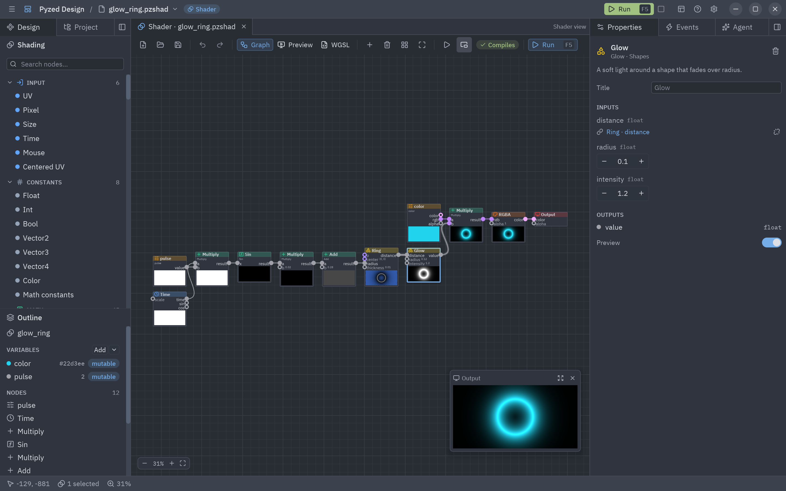
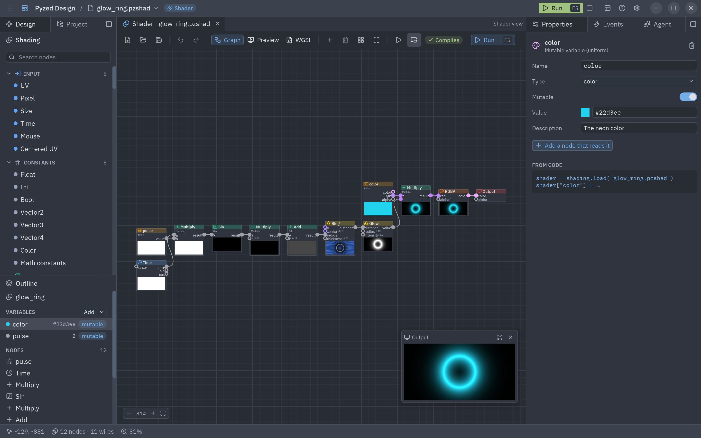

:::tip[¿Nuevo en los shaders?]
Empieza por [Tu primer shader](/pyzed/es/shading/getting-started/): un recorrido de diez minutos por esta vista que
crea un círculo brillante paso a paso. Esta página es la referencia completa de la vista.
:::

El diseñador tiene un tercer tipo de documento: los **shaders**. En vez de escribir WGSL, conectas nodos en un
grafo, como en los visual shaders de Godot o el editor de shaders de Blender. Cada nodo muestra una vista previa
en vivo de lo que produce, el nodo **Output** es el shader terminado, y el grafo se guarda como un archivo
`.pzshad` que `pz.shader` dibuja en la GPU.



No hay WGSL que escribir ni Rust: el diseñador compila el grafo a WGSL mientras lo editas, lo comprueba con el
compilador de la GPU y señala el nodo cuando algo está mal.

## Crear uno

Pulsa **New** (Ctrl+N) y elige la tarjeta **Shader**. Ponle un nombre y una carpeta y elige una plantilla:
**Blank** (un degradado), **Plasma**, **Clouds**, **Glow ring**, **Cells** o **Retro screen**. **Create shader** lo
guarda y lo abre. También puedes abrir un archivo `.pzshad` directamente:



```bash
pyzed design efectos/fuego.pzshad     # se crea al guardar si no existe
pyzed run efectos/fuego.pzshad        # el shader ocupando una ventana
```

## La vista de shaders

Un shader se abre en la **vista de shaders** (Shader view), con tres pestañas en su barra de herramientas:

| Pestaña | Qué muestra |
| --- | --- |
| **Graph** | Los nodos en un lienzo que desplazas y amplías. Cada nodo tiene una vista previa de su primera salida; la ventanita **Output** de la esquina muestra el shader terminado. |
| **Preview** | El shader terminado, en grande, sobre un tablero (para que se vea la transparencia), con un deslizador por cada variable. |
| **WGSL** | El código al que se compila el grafo, de solo lectura, con los mensajes del compilador en sus líneas. **Copy** lo copia al portapapeles. |

La barra también tiene **Add a node** (Shift+A), **Delete**, **Arrange nodes in columns** (Ctrl+L), **Fit
everything** (F), **Stop time** (congela todas las vistas previas en un instante), **Small preview** y **Run** (F5),
que abre el shader en una ventana propia que sigue tus cambios. Una insignia dice **Compiles** o cuántos problemas
hay; pasa el ratón por encima para leerlos.



### Trabajar en el lienzo

| Gesto | Qué hace |
| --- | --- |
| Arrastrar de una salida a una entrada | Las conecta. La conexión toma el color del tipo del valor. |
| Arrastrar una conexión sobre un nodo | La conecta a la primera entrada (o salida) que la acepte. |
| Soltar una conexión en un hueco | Abre el buscador de nodos; el nodo que elijas se añade ahí, ya conectado. |
| Arrastrar desde una entrada conectada | Vuelve a tomar la conexión, para moverla o soltarla (desconectar). |
| Doble clic o clic derecho en el lienzo | El buscador de nodos, donde está el puntero. |
| Arrastrar un nodo | Lo mueve (con el resto de la selección). |
| Arrastrar en un hueco | Selecciona los nodos del recuadro. |
| Rueda | Amplía alrededor del puntero. |
| Botón central, o Espacio + arrastrar | Desplaza la vista. |
| Clic derecho en un nodo | Duplicar, copiar, mostrar u ocultar su vista previa, desconectar todo, eliminar. |
| Doble clic en un nodo | Muestra sus ajustes; en un nodo **Shader function**, abre ese `.pzshad`. |

El teclado funciona como en los formularios: Ctrl+Z / Ctrl+Shift+Z, Supr, Ctrl+C / Ctrl+X / Ctrl+V (los nodos
viajan entre shaders y ventanas), Ctrl+D, Ctrl+A, flechas para desplazar, **P** para mostrar u ocultar las vistas
previas de los nodos seleccionados, Ctrl+0 para el 100 % y Ctrl+= / Ctrl+- para ampliar.





### Valores en el nodo

Una entrada sin conectar muestra su valor en el propio nodo: un campo numérico, un interruptor o una muestra de
color. Entradas como `uv`, `p` o `px` usan por defecto un valor de **contexto** (el UV del píxel, su posición
centrada, sus coordenadas en píxeles); el panel de propiedades las cambia entre eso y un valor fijo.

## La barra Shading

El panel **Design** del panel izquierdo muestra la barra **Shading** en lugar de la caja de herramientas de
formularios. Sus entradas se agrupan por categoría; haz clic en una para añadirla en el centro del grafo, o
arrástrala al grafo. El buscador encuentra títulos, categorías y palabras clave en inglés y en el idioma del
diseñador.

| Categoría | Nodos |
| --- | --- |
| **Input** | UV, Pixel, Size, Time, Mouse, Centered UV |
| **Parameters** | Parameter (lee una variable) |
| **Constants** | Float, Int, Bool, Vector2/3/4, Color, constantes matemáticas |
| **Math** | Sumar, restar, multiplicar, dividir, módulo, potencia, mínimo, máximo, Step, Atan2, Snap; Abs, Floor, Fract, Sqrt, Sin, Cos, Exp, Log y las demás funciones de un valor; Mix, Clamp, Smoothstep, Remap, Multiply add |
| **Vector** | Compose, Decompose, Swizzle, Dot, Cross, Length, Distance, Normalize, Reflect, Polar |
| **UV** | Tiling and offset, Scroll, Rotate, Twirl, Pixelate, Barrel, Kaleidoscope, Flip, Repeat |
| **Noise** | Ruido de valor, Perlin y simplex, ruido fractal (fBm), Voronoi, ruido blanco, Random |
| **Patterns** | Checker, Stripes, Grid, Dots, degradados lineal y radial, ondas (seno, triangular, cuadrada, diente de sierra) |
| **Shapes** | Circle, Box, Ring, Segment, Polygon, Star (distancias con signo), unión, resta e intersección (también suaves), Fill, Stroke, Glow |
| **Color** | HSV ↔ RGB, Hue shift, Saturation, brillo y contraste, Luminance, Grayscale, Invert, Gamma, Posterize, Blend (12 modos de capa), Palette, Gradient (rampa de color), RGBA, Layer |
| **Effects** | Vignette, Scanlines, Film grain |
| **Texture** | Sample texture |
| **Logic** | Compare, Select (si/si no), And/Or/Xor/Not |
| **Variables** | Set value, Get value (valores con nombre dentro del grafo) |
| **Utility** | Reroute, Expression (tu propio WGSL), Shader function (otro `.pzshad`), Comment |
| **Output** | Output: el color de cada píxel (y su alfa) |

Cada nodo, con sus puertos, ajustes y un ejemplo, se describe en el [catálogo de nodos](/pyzed/es/shading/nodes/).

Los puertos tienen tipo, como en Godot: `float`, `int`, `bool`, `vec2`, `vec3`, `vec4` y `texture`. La mayoría de
los nodos matemáticos son genéricos: toman el tipo más amplio que les conectes (un `float` por un `vec3` es un
`vec3`), y los valores se convierten por el camino (un `float` llena todos los componentes, un `vec3` se convierte
en un color con alfa 1). Una conexión que nunca puede funcionar (una textura en un número) se rechaza con un
mensaje.

## Variables en el esquema

El **Outline** debajo de la barra lista las **variables** del shader, sus **valores con nombre** (de los nodos Set
value) y todos los nodos. **Add** crea una variable; su flecha elige el tipo (`float`, `int`, `bool`, `vec2`,
`vec3`, `vec4`, `color` o `texture`). Arrastra una variable al grafo para añadir un nodo que la lea.



| Tipo | Qué es | Desde código |
| --- | --- | --- |
| **Mutable** | Un uniform: la GPU lo lee en cada frame, así que cambiarlo no cuesta nada ni recompila. | `shader["speed"] = 2` o `pz.shader("x.pzshad", uniforms={"speed": 2})` |
| **Constante** | Se escribe en el código generado como un literal. Cambiarla vuelve a generar el código. | `shader.set(steps=8)` |

Una variable tiene un valor, un rango (para los deslizadores) y una descripción. Una variable `texture` es un
archivo de imagen; un nodo **Sample texture** lee su color en un UV. En un shader caben hasta 32 variables mutables
y 8 texturas.

## Propiedades

El panel de propiedades muestra lo seleccionado:

- **Un nodo**: su descripción, su título, sus ajustes (operación, tipo de ruido, modo de fusión, paradas del
  degradado, el código de una Expression...), cada entrada con su tipo (un enlace al nodo conectado, o su valor)
  y sus salidas. Los problemas que encuentra el compilador se muestran aquí y en el nodo, en rojo.
- **Una variable**: nombre, tipo, mutable o constante, valor, rango y descripción, y la línea de Python que la
  cambia.
- **Nada**: el propio shader: su nombre y descripción, el tamaño de las ventanas Preview y Run, el color
  **fallback** que se dibuja donde no hay GPU y si se anima.





## Reutilizar shaders

Un `.pzshad` es un archivo como una imagen: úsalo donde quieras.

- **En código**: `pz.shader("shaders/fuego.pzshad", uniforms={"speed": 2})`, o cárgalo con
  `pyzed.shading.load` y cambia sus variables. Mira [Grafos de shaders](/pyzed/es/shading/shader-graphs/).
- **En formularios**: el control **Shader** de la caja de herramientas (en Display) dibuja un `.pzshad`. Su
  propiedad **Shader file** es la ruta, y **variables** (`{"speed": 2}`) cambia sus variables, desde el panel de
  propiedades o desde un manejador.
- **En otros shaders**: el nodo **Shader function** ejecuta otro `.pzshad` como una función. Sus variables
  mutables se convierten en entradas del nodo, y su entrada `uv` lo mueve, lo repite o lo deforma.
- **En juegos**: los fondos del [showcase](/pyzed/es/showcase/) (nebulosa, synthwave, brasas, manchas de color,
  el radar) son archivos `.pzshad` en `examples/showcase/shaders`; abre uno para ver cómo está hecho.

Una app en marcha recarga un `.pzshad` cuando el archivo cambia, así que guardar en el diseñador la actualiza.
