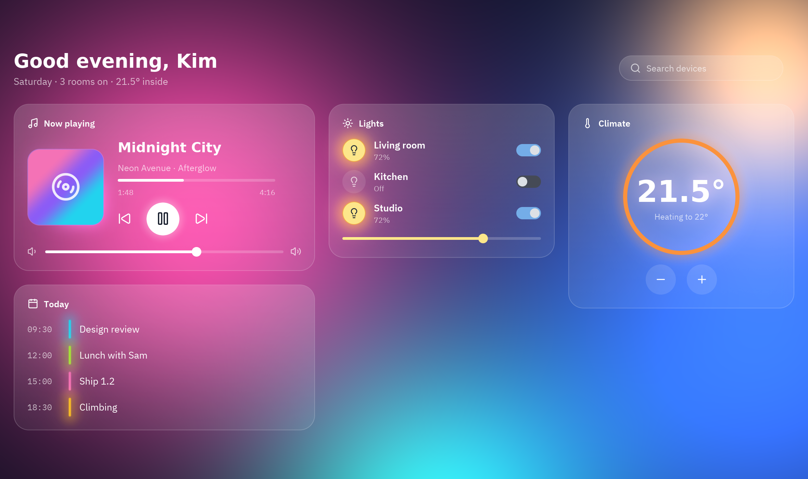

import { Code } from '@astrojs/starlight/components';
import source from '../../../../../../examples/showcase/glass_dashboard.py?raw';

Un centro de control domótico con el estilo de cristal esmerilado de los sistemas operativos modernos. Las manchas de color detrás de las tarjetas son un shader, así que el desenfoque que ves a través de cada tarjeta se mueve con ellas.



```sh
python examples/showcase/glass_dashboard.py
```

## Cómo está hecho

### Desenfoque real del fondo

`glass` desenfoca lo que hay detrás de la tarjeta; no es un degradado falso.

```python
GLASS = {"tint": "#ffffff", "strength": 0.10, "blur": 28}
card.style(glass=GLASS, radius=22, padding=20)
```

### Detalles vivos

La portada gira mientras suena la música; las bombillas encendidas brillan con bloom.

```python
cover.animate("spin", duration=12000)
```

### Controles reales

Los sliders y switches cambian el estado como en cualquier app de Pyzed.

```python
pz.slider(0, 100, self.volume, on_change=self.set_volume)
```

## Código completo

<Code code={source} lang="py" title="examples/showcase/glass_dashboard.py" />
