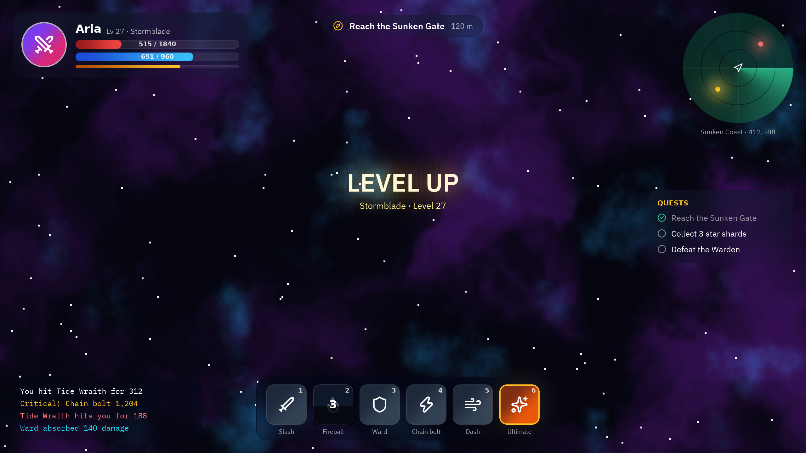
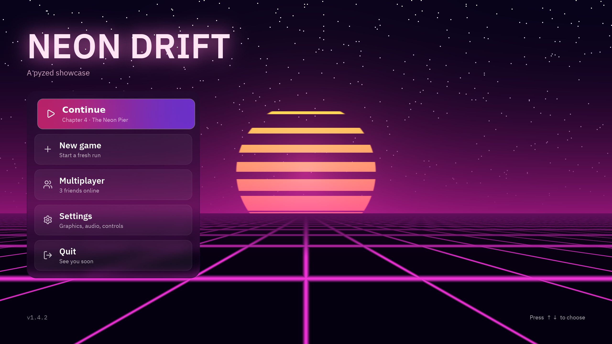

:::note[Más demos en camino]
Se están añadiendo demos de formularios, utilidades y shaders, cada una con un tutorial que explica cómo está hecha. Los juegos tienen sus propias páginas en esta sección.
:::

Pyzed dibuja con la GPU, así que una app de escritorio en Python puede verse como un videojuego o un sistema operativo modernos: desenfoque real del fondo (`glass`), luz que desborda de las partes brillantes (`bloom`), rotación, transparencia y tus propios shaders WGSL (`pz.shader`). Cada demo es un archivo de [`examples/showcase`](https://github.com/albakore/pyzed/tree/main/examples/showcase); ejecútala y luego lee cómo está hecha.

## [HUD de videojuego](/pyzed/es/showcase/hud/)

Un HUD de videojuego en Python: barras de vida y maná, un minimapa de radar hecho con un shader, una barra de habilidades con enfriamientos y paneles de cristal.

## [Menú principal de videojuego](/pyzed/es/showcase/main-menu/)

Un menú principal synthwave en Python con un fondo de shader que sigue al ratón, un título brillante y botones de cristal que se elevan en hover.

## [Inventario de RPG](/pyzed/es/showcase/inventory/)

Una pantalla de inventario de RPG en Python donde la rareza de los objetos brilla con glow y bloom, con un panel de detalles de cristal animado sobre un shader de brasas.

## [Centro de control de cristal](/pyzed/es/showcase/glass-dashboard/)

Un panel profesional de cristal esmerilado en Python: reproductor, luces, clima y agenda con desenfoque real del fondo sobre colores en movimiento.

## [Galería de shaders](/pyzed/es/showcase/shaders/)

Seis shaders de GPU escritos en WGSL y mostrados como widgets de Pyzed: plasma, ondas que siguen al ratón, un túnel, una pantalla CRT, celdas de Voronoi y fuego.

Aprende las piezas en [Animación y efectos](/pyzed/es/guides/animation/) y [Shaders](/pyzed/es/shading/shaders/).
