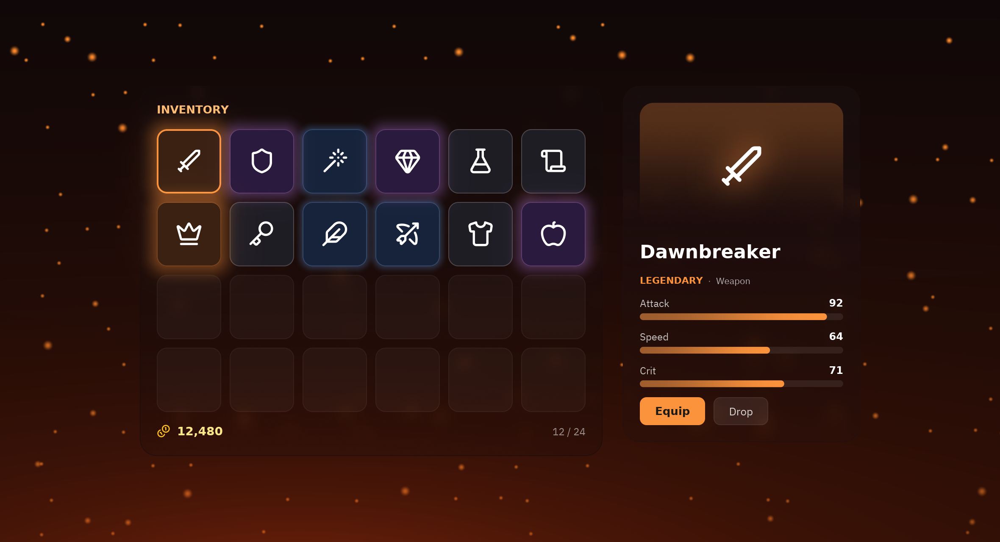

import { Code } from '@astrojs/starlight/components';
import source from '../../../../../../examples/showcase/inventory.py?raw';

Un inventario donde la rareza es luz: los objetos raros tienen glow, los épicos y legendarios bloom, y los legendarios palpitan. Al hacer clic en un objeto, `presence` cambia el panel de detalles de cristal y sus barras crecen con `transition(width=...)`.



```sh
python examples/showcase/inventory.py
```

## Cómo está hecho

### La rareza como luz

Glow para los raros; bloom para épicos y legendarios.

```python
style.update(bloom=(color, 0.8))
tile.animate("glow_pulse", repeat="infinite", duration=2000)
```

### Estadísticas animadas

El ancho de las barras es una propiedad de layout, así que se anima sin descolocar nada.

```python
bar.transition(width=240 * value, duration=320, easing="ease_out_cubic")
```

### Cambio de panel

`pz.presence` saca el panel anterior y hace entrar el nuevo.

```python
pz.presence(panel, key=self.selected, enter="fade_in_right", exit="fade_out")
```

## Código completo

<Code code={source} lang="py" title="examples/showcase/inventory.py" />
