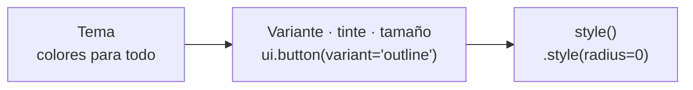

import { Aside } from '@astrojs/starlight/components';
import Media from '../../../../components/Media.astro';
import variantsShot from '../../../../assets/theming/button-variants-dark.png';

Antes de escribir un estilo, mira si el componente ya tiene el aspecto que buscas. La mayoría de los componentes de
[`pyzed.ui`](/pyzed/es/library/) vienen en **variantes**, **tintes** y **tamaños** que siguen el tema. Cuando ninguno
encaja, `style()` cambia cualquier cosa, como en CSS.



Cada paso solo sobrescribe lo que fija: el tema da los colores, la variante elige cuáles usa un componente y `style()`
tiene la última palabra.

## Variantes

Una **variante** es un aspecto listo del mismo componente.

### Botones

```python
ui.button("Guardar", guardar, variant="solid")      # relleno con el acento: la acción principal
ui.button("Cancelar", cancelar)                     # "filled" (por defecto): un botón relleno neutro
ui.button("Detalles", detalles, variant="outline")  # transparente con borde
ui.button("Más", mas, variant="ghost")              # sin fondo hasta pasar el puntero
ui.button("Omitir", omitir, variant="subtle")       # como ghost, con texto atenuado
ui.button("Archivar", archivar, variant="tinted")   # un acento translúcido
```

| Variante | Fondo | Úsala para |
| --- | --- | --- |
| `filled` (por defecto) | `element` | La mayoría de los botones. |
| `solid` | el acento (o el tinte) | La acción principal de una pantalla, una por zona. |
| `tinted` | un acento (o tinte) translúcido | Acciones secundarias que deben destacar un poco. |
| `outline` | ninguno, con `border` | Barras de herramientas, acciones secundarias sobre superficies cargadas. |
| `ghost` | ninguno hasta pasar el puntero (`ghost_hover`) | Barras de herramientas, menús, botones de icono. |
| `subtle` | como `ghost`, con `text_muted` | Acciones de poca prioridad. |

<Media src={variantsShot} alt="Botones en cada variante, tinte y tamaño, e insignias en cada variante" caption="Variantes de botón, botones solid en cada tinte, los cuatro tamaños y las variantes de insignia (One Dark)." />

### Insignias

```python
ui.badge("Nuevo")                               # "soft" (por defecto): fondo translúcido
ui.badge("Pagado", tint="success", variant="solid")
ui.badge("Falló", tint="error", variant="outline")
```

`ui.icon_button` también acepta `variant` (`"ghost"` por defecto), y muchos componentes tienen sus propias opciones,
como `borderless=True` y `mono=True` en `ui.input`. La página de cada componente en la
[Biblioteca](/pyzed/es/library/) muestra sus variantes.

## Tintes

Un **tinte** colorea un componente con uno de los [tokens de estado](/pyzed/es/theming/tokens/#estado): `"accent"`,
`"error"`, `"warning"`, `"success"`, `"info"` (y `"hint"` en los avisos):

```python
ui.button("Eliminar", eliminar, variant="solid", tint="error")
ui.button("Eliminar", eliminar, variant="error")          # atajo: un botón tintado de error
ui.callout("Guardado", "Todo está al día.", tint="success")
ui.progress(0.4, tint="warning")
ui.spinner(tint="info")
ui.count_badge(3, tint="error")
```

Como los tintes son tokens, siguen el tema: el mismo botón rojo es un rojo más suave en un tema claro.

## Tamaños

```python
ui.button("Mínimo", al_pulsar, size="xs")   # 18 px de alto
ui.button("Pequeño", al_pulsar, size="sm")  # 22 px
ui.button("Normal", al_pulsar)              # "md": 28 px
ui.button("Grande", al_pulsar, size="lg")
ui.input(self.nombre, self.fijar_nombre, size="lg")
ui.select(opciones, self.eleccion, self.elegir, size="sm")
```

## style() en cualquier componente

Todos los widgets, incluidos todos los componentes de `pyzed.ui`, tienen un método `style()` con propiedades tipo CSS
([la lista completa](/pyzed/es/theming/styles/#propiedades)). Se aplica encima del aspecto propio del componente:

```python
ui.button("Cuadrado", al_pulsar).style(radius=0, border=(2, "accent"))
ui.card(cuerpo, title="Uso").style(shadow=("#0006", (0, 8), 24), radius=16)
ui.label("Total").style(size=20, weight="bold", color="success")
```

`ui.button` también acepta directamente los colores de bajo nivel del botón (`bg`, `hover_bg`, `pressed_bg`, `color`),
para un botón totalmente propio que sigue comportándose como un botón:

```python
ui.button("Comprar", comprar, bg="#16a34a", hover_bg="#15803d", pressed_bg="#166534", color="#ffffff")
```

## Reutilizar un aspecto: estilos con nombre

Dale un nombre a un estilo una vez y úsalo en cualquier parte. Los estilos con nombre son las "clases CSS" de Pyzed:

```python
pz.define_style("tarjeta", background="surface", border=(1, "border_variant"), radius=12, padding=16)
pz.define_style("peligro", color="error", weight="semibold")

pz.column([...]).style("tarjeta")
ui.label("El pago falló").style("peligro")
pz.column([...]).style("tarjeta", shadow=("#0005", (0, 4), 12))   # un nombre más propiedades extra
```

Un objeto `pz.Style` hace lo mismo sin un nombre global, y los estilos se combinan con `|` (gana el de la derecha):

```python
TARJETA = pz.Style(background="surface", radius=12, padding=16)
ELEVADA = TARJETA | pz.Style(shadow=("#0006", (0, 8), 24))
```

## Otro tema para un componente

Todos los componentes de `pyzed.ui` aceptan `theme=` para dibujar solo ese componente con otro tema, y un bloque
`with tema:` cambia el tema de todo lo que se construye dentro:

```python
ui.button("Claro", al_pulsar, theme=pz.themes.ONE_LIGHT)

with pz.themes.ONE_DARK.with_accent("#f97316"):
    zona_aviso = pz.column([ui.button("Ir", ir, variant="solid"), ui.progress(0.3)])
```

## Tus propios componentes

Un [componente](/pyzed/es/guides/components/) propio también debería tomar sus colores del tema, para encajar en
cualquier tema sin cambios. Usa nombres de tokens, o lee el tema con `pz.theme.current()` en `render()`:

```python
class Etiqueta(pz.Component):
    texto: str = ""
    tint: str = "accent"

    def render(self):
        t = pz.theme.current()
        return pz.text(self.texto, size=12).style(
            color=self.tint,
            background=pz.Paint(self.tint, opacity=0.15),
            radius=t.radius_sm,
            padding=(2, 8),
        )


Etiqueta(texto="beta", tint="warning")
Etiqueta(texto="nuevo", style={"weight": "bold"})   # todo componente acepta también style=
```

Los componentes hechos en la vista de componentes del diseñador siguen las mismas reglas; mira
[Estilo de formularios en el diseñador](/pyzed/es/theming/forms/).

<Aside type="tip" title="¿Cuál uso?">
Primero variante o tinte; un estilo con nombre cuando el mismo aspecto se repite; `style()` para cambios puntuales; un
tema propio cuando el cambio está en todas partes (por ejemplo, esquinas cuadradas en toda la app: `radius=0` en el
tema, no en cada botón).
</Aside>
