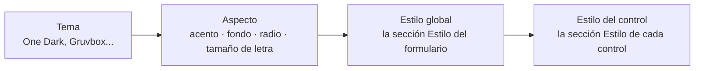

import { Aside, Steps } from '@astrojs/starlight/components';
import Media from '../../../../components/Media.astro';
import shot_form_look from '../../../../../screenshots/designer-light.png';

Los formularios hechos en [Pyzed Design](/pyzed/es/editor/) usan los mismos temas y estilos que el código. Los fijas
en el panel **Propiedades** en lugar de escribir Python, y se guardan en el archivo `.pzform`.

El aspecto de un formulario se construye en capas, de lo general a lo concreto; cada capa solo cambia lo que fija:



## 1. El tema y el aspecto del formulario

Haz clic en un hueco del lienzo para seleccionar el formulario y abre **Propiedades → Aspecto**:

| Campo | Qué hace | Se guarda como |
| --- | --- | --- |
| **Tema** | Cualquier tema registrado: los incluidos y los que registre tu código. | `"theme": "Gruvbox Dark"` |
| **Acento** | Un color predefinido, **×** para el del tema o **Acento propio** con cualquier `#rrggbb`. Colorea botones principales, foco, enlaces y selección (`with_accent`). | `"accent": "#e11d48"` |
| **Fondo** | El fondo de la ventana; vacío mantiene el del tema. | `"background": "#101418"` |
| **Radio de esquina** | El radio que usan todos los controles; `0` para esquinas rectas. | `"radius": 0` |
| **Tamaño de letra** | El tamaño base de todo el texto. | `"font_size": 15` |

<Media src={shot_form_look} alt="Un formulario en Pyzed Design con el tema Gruvbox Light y un acento propio" />

El tema del formulario es independiente del tema del propio editor (Ajustes → Apariencia): puedes diseñar un
formulario claro en un editor oscuro.

## 2. El estilo global del formulario

Con el formulario seleccionado, su sección **Estilo** es el estilo global de la ventana (lo mismo que `App.style` en
código):

- **Color del texto, fuente, peso, cursiva, tamaño de letra e interlineado** se aplican a todo texto que no fije los
  suyos. Una fuente serif aquí cambia de golpe cada etiqueta, botón y campo del formulario.
- **Fondo, color del borde, radio de esquina y relleno** pasan a ser los de la ventana.

## 3. El estilo de un control

Selecciona un control y usa su propia sección **Estilo**: fondo (un color, un degradado o un relleno con máscara, con
el selector de color), color del texto, fuente, peso, bordes, radio de esquina, sombra, relleno, margen y alineación.
Los campos vacíos mantienen el aspecto propio del componente y **Restablecer estilo** los borra todos. La página
[Estilos y temas](/pyzed/es/editor/styles-and-themes/) del diseñador describe cada campo y el selector de color.

Algunos controles también tienen propiedades de **variante**, **tinte** y **tamaño**, las mismas que en código (mira
[Estilo de componentes](/pyzed/es/theming/components/)): prueba la variante de un botón antes de darle estilo a mano.

<Aside type="tip" title="Conserva colores que siguen el tema">
El selector de color trabaja con colores concretos. Para conservar un color que cambia con el tema, escribe un token
(`accent`, `text_muted`, `surface`...) en el campo junto a la muestra. Así el formulario se ve bien si más adelante lo
pasas a un tema claro.
</Aside>

## Qué guarda el archivo .pzform

Todo esto es JSON simple dentro del archivo del formulario, así que es fácil de revisar en Git o de cambiar a mano:

```json title="ui/main.pzform (extracto)"
{
  "format": "pyzed.form/1",
  "form": {
    "name": "Main",
    "theme": "Gruvbox Dark",
    "accent": "#fe8019",
    "background": null,
    "radius": 4,
    "font_size": 14.0,
    "style": { "font": "serif", "color": "text" }
  },
  "controls": [
    {
      "name": "guardar",
      "type": "button",
      "props": { "text": "Guardar" },
      "style": { "radius": 0, "border_color": "accent", "border_width": 2 }
    }
  ]
}
```

`style` guarda las mismas propiedades que [`style()`](/pyzed/es/theming/styles/#propiedades), escritas como lo hace
`Style.to_dict()` (un degradado se vuelve `{"type": "linear", "angle": ..., "stops": [...]}`).

## Usar tu propio tema en un formulario

La lista **Tema** muestra todos los temas registrados. Para usar uno tuyo:

<Steps>

1. Regístralo en el archivo de código del formulario (el `.py` junto al formulario, que Pyzed carga antes de abrirlo):

   ```python title="ui/main.py"
   import pyzed as pz

   pz.themes.register(pz.Theme.generate("Acme", background="#16131f", text="#ece9f5", accent="#a78bfa"))


   def guardar_click(form, event):
       ...
   ```

2. Escribe su nombre en el archivo del formulario (`"theme": "Acme"`), o elígelo en **Propiedades → Aspecto → Tema**
   cuando el diseñador lo liste.

3. Ejecuta el formulario (**Ejecutar**, o `pyzed run`). Usa el tema Acme.

</Steps>

<Aside type="caution" title="Vista previa en el lienzo">
Un formulario cuyo nombre de tema no está registrado usa **One Dark**. Si el lienzo muestra One Dark en vez de tu
tema, el módulo que lo registra todavía no se cargó en el diseñador; la app en ejecución usa el tema correcto en cuanto
importa ese módulo.
</Aside>

## Cambiar el aspecto mientras el formulario corre

<Aside type="caution" title="Aún no está soportado">
Los manejadores de un formulario pueden cambiar sus controles (`form.guardar.text = "Guardado"`,
`form.estado.color = "error"`), pero no su tema: el tema se elige al abrir el formulario. Para una app cuyo tema cambia
el usuario mientras corre, escribe esa ventana en código con `pz.App` (mira
[Elegir un tema](/pyzed/es/theming/themes/#cambiar-de-tema-mientras-la-app-corre)), o colorea controles concretos
desde los manejadores con tokens del tema.
</Aside>
