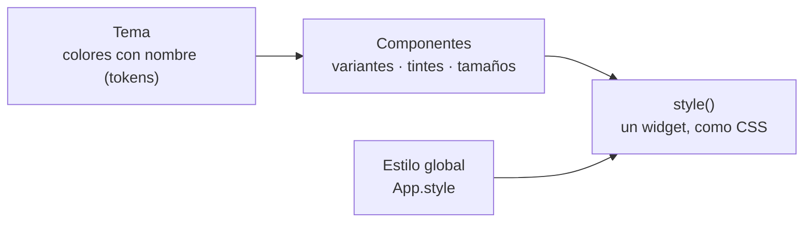

import { Aside, Tabs, TabItem } from '@astrojs/starlight/components';
import NavCards from '../../../../components/NavCards.astro';
import Media from '../../../../components/Media.astro';
import ayu from '../../../../assets/editor/form-view-ayu.png';
import gruvbox from '../../../../assets/editor/form-view-gruvbox.png';
import oneLight from '../../../../assets/editor/form-view-light.png';

Pyzed separa **qué** muestra tu interfaz de **cómo se ve**. Todos los componentes leen sus colores del **tema**
actual, un conjunto de colores con nombre llamados tokens (`background`, `text`, `border`, `accent`...). Cambia el
tema y toda la app lo sigue; cambia un widget con `style()` y solo cambia ese widget.

<Media clip="themes" alt="La galería de componentes cambiando entre Pyzed Dark, Pyzed Light, One Dark, Ayu Mirage, Gruvbox Dark y Gruvbox Light" caption="Una app, seis temas incluidos: cada componente sigue al tema, sin cambiar su código." eager />

```python
import pyzed as pz
from pyzed import ui


class Notas(pz.App):
    theme = "Gruvbox Dark"  # cualquier nombre de pz.themes.names()

    def view(self):
        tarjeta = pz.Style(background="elevated", border=(1, "border"), radius=10, padding=16)
        return pz.column([
            ui.heading("Notas"),
            pz.container(ui.label("Con estilo como CSS, con los colores del tema.")).style(tarjeta),
        ])
```

## Cómo encaja todo



- **Tema**: la paleta de toda la app. Elige uno incluido, sigue el modo claro u oscuro del sistema o crea el tuyo a
  partir de tres colores.
- Los **componentes** toman sus colores del tema. Sus **variantes** y **tintes** (`variant="outline"`,
  `tint="error"`) eligen cuáles de esos colores usan.
- **`style()`** cambia un widget, como CSS; los estilos con nombre reutilizan un aspecto; `App.style` fija la fuente y
  los colores de toda la ventana.

## Pyzed Design también lo sigue

El diseñador visual es una app de Pyzed, así que también tiene temas: elige uno en **Ajustes → Apariencia → Tema** y
todo el editor cambia a la vez. Cada formulario conserva su propio tema, que se fija en sus propiedades de
**Aspecto** (ver [Estilo de formularios](/pyzed/es/theming/forms/)), así que el editor y la app que diseñas pueden
verse distintos.

<Media clip="designer-themes" alt="Pyzed Design cambiando de aspecto al elegir distintos temas en Ajustes" caption="Pyzed Design cambiando de tema desde Ajustes." />

<Tabs>
	<TabItem label="Ayu">
		<Media src={ayu} alt="Pyzed Design con el tema Ayu y el formulario de inicio de sesión abierto" />
	</TabItem>
	<TabItem label="Gruvbox">
		<Media src={gruvbox} alt="Pyzed Design con el tema Gruvbox y el formulario de inicio de sesión abierto" />
	</TabItem>
	<TabItem label="Pyzed Light">
		<Media src={oneLight} alt="Pyzed Design con el tema Pyzed Light y el formulario de inicio de sesión abierto" />
	</TabItem>
</Tabs>

## En esta sección

<NavCards
	items={[
		{ title: 'Elegir un tema', text: 'Los temas incluidos, oscuro, claro o según el sistema, y cambiar de tema mientras la app corre.', href: '/pyzed/es/theming/themes/', icon: 'moon', tag: 'Empieza aquí' },
		{ title: 'Tokens del tema', text: 'Cada color de un tema y qué pinta, con los valores de One Dark y One Light.', href: '/pyzed/es/theming/tokens/', icon: 'list-format' },
		{ title: 'Crear temas', text: 'Cambia el acento, deriva, genera a partir de tres colores, escribe un tema en JSON, importa temas de Zed.', href: '/pyzed/es/theming/custom-themes/', icon: 'pencil' },
		{ title: 'Estilos', text: 'Fondos, bordes, radio, sombras, degradados y efectos para cualquier widget, y el estilo global.', href: '/pyzed/es/theming/styles/', icon: 'seti:css' },
		{ title: 'Estilo de componentes', text: 'Variantes, tintes y tamaños, <code>style()</code> en componentes, estilos con nombre y componentes que siguen el tema.', href: '/pyzed/es/theming/components/', icon: 'puzzle' },
		{ title: 'Estilo de formularios', text: 'Tema, acento, radio y fuentes de un formulario en Pyzed Design, y qué guarda el archivo <code>.pzform</code>.', href: '/pyzed/es/theming/forms/', icon: 'laptop', tag: 'Diseñador' },
		{ title: 'Iconos y fuentes', text: 'Unos 2000 iconos incluidos, iconos por tipo de archivo y cargar tus propias fuentes.', href: '/pyzed/es/theming/icons-fonts/', icon: 'star' },
		{ title: 'Recetario de temas', text: 'Seis temas completos para copiar: marca, alto contraste, terminal retro, vidrio, pastel y mixto.', href: '/pyzed/es/theming/cookbook/', icon: 'rocket', tag: 'Ejemplos' },
		{ title: 'API de temas', text: '<code>Theme</code>, <code>themes</code> y las funciones de color, método por método.', href: '/pyzed/es/reference/theme/', icon: 'document' },
	]}
/>

<Aside type="tip" title="Usa tokens, no colores hex">
Escribe `"accent"` o `"border"` en vez de `"#3a7bc8"` siempre que puedas. Los colores de los tokens cambian con el
tema, así que tu app se sigue viendo bien en modo claro y oscuro.
</Aside>

<Aside type="note" title="Estado de esta sección">
Todo lo que describen estas páginas funciona hoy, en código y en Pyzed Design. Se están añadiendo capturas de cada
tema incluido en claro y oscuro. Los temas para móvil y web llegarán con esas plataformas, que están planificadas
pero todavía no disponibles.
</Aside>
