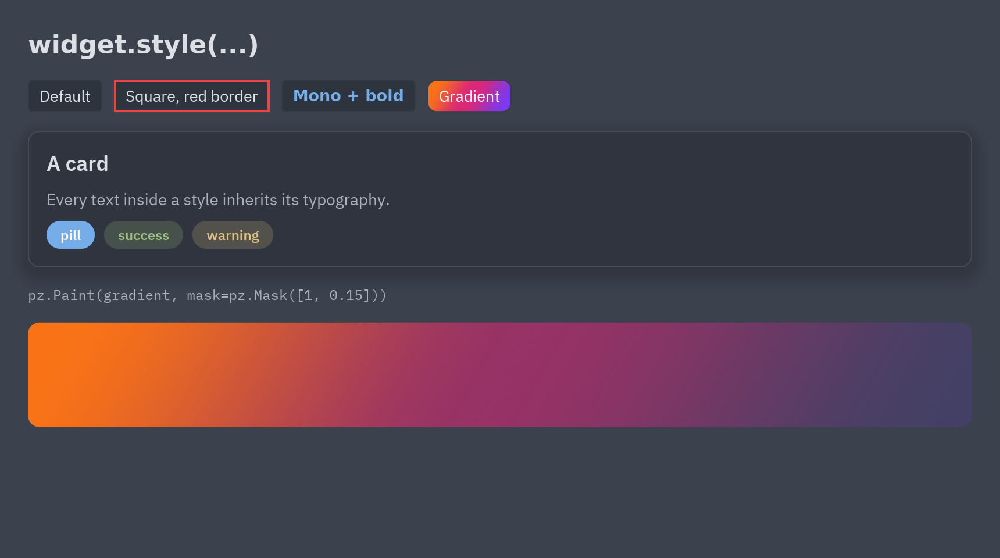
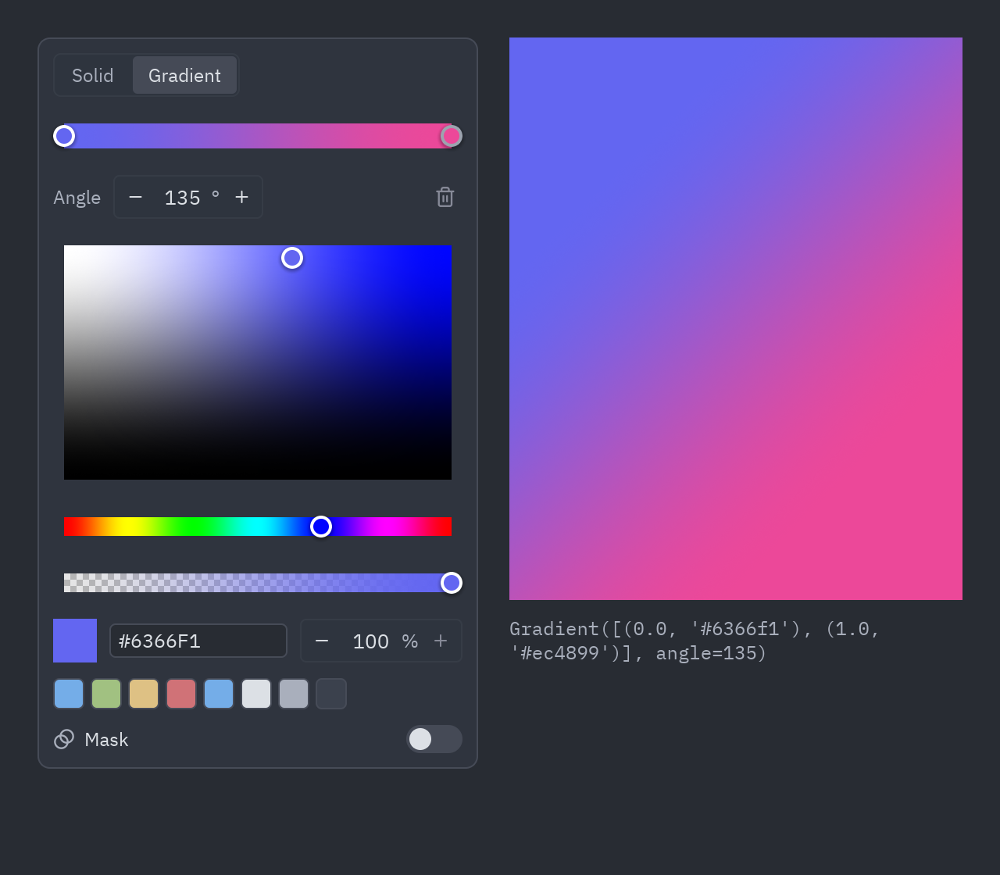

Todo widget tiene un método `style()` que le da estilo como en CSS: fondo, bordes, radio,
sombra, padding, margen, tamaño y tipografía.



```python
ui.button("Guardar", self.guardar).style(radius=0, border=(2, "#ef4444"))
pz.text("Título").style(size=20, weight="bold", color="accent")
pz.column([...]).style(background="panel", padding=16, radius=10, shadow=("#00000055", (0, 6), 18))
```

En un botón o un contenedor, `style()` cambia el propio widget (un botón cuadrado sigue siendo
un botón). Los demás widgets reciben una caja alrededor que lleva el estilo.

## Propiedades

| Propiedad | Valores |
| --- | --- |
| `background` | Un color, un `pz.Gradient` o un `pz.Paint`. |
| `color` | Color del texto. |
| `font` | `"sans"`, `"mono"`, `"serif"` o una familia cargada con `pz.load_font`. |
| `weight` | `"light"`, `"normal"`, `"medium"`, `"semibold"`, `"bold"`… o de 100 a 900. |
| `italic`, `size`, `line_height` | Tipografía. |
| `border_color`, `border_width` | El borde; `border=(ancho, color)` fija ambos. |
| `radius` | Un número, o `(arriba_izq, arriba_der, abajo_der, abajo_izq)`. |
| `shadow` | `(color, (x, y), desenfoque)`. |
| `padding`, `margin` | Un número, `(vertical, horizontal)` o `(arriba, derecha, abajo, izquierda)`. |
| `width`, `height` | Píxeles, `"fill"`, `"shrink"` o `"fill:N"`; `max_width`, `max_height` en píxeles. |
| `align_x`, `align_y` | Dónde se coloca el contenido dentro de la caja. |
| `clip` | Recorta el contenido a la caja. |
| `opacity`, `translate`, `scale`, `rotate` | Desvanecen, desplazan, escalan o giran cómo se dibuja el widget, sin cambiar el layout. |
| `blur`, `backdrop_blur` | Desenfocan el widget o lo que tiene detrás. |
| `glow`, `bloom`, `glass` | Efectos visuales: un halo, luz que desborda de las partes brillantes y un panel esmerilado. Ver [Animación y efectos](/pyzed/es/guides/animation/#efectos). |

Los colores pueden ser textos hex (con alfa, `"#3b82f680"`), tuplas `(r, g, b[, a])` o tokens
del tema como `"accent"`, `"panel"` o `"text_muted"`, así que los estilos siguen al tema.

Las propiedades de texto se aplican a **todos los textos de dentro** del widget, también a las
etiquetas de los componentes de `pyzed.ui`. Gana el estilo más cercano.

## Reutilizar estilos

```python
tarjeta = pz.Style(background="elevated", border=(1, "border"), radius=10, padding=16)
pz.column([...]).style(tarjeta)
pz.column([...]).style(tarjeta | pz.Style(shadow=("#0006", (0, 4), 12)))   # gana el de la derecha

pz.define_style("pill", radius=999, padding=(4, 12), size=12, weight="semibold")
pz.text("nuevo").style("pill", background="accent")
```

`widget.style(a, b, color=...)` combina en orden, y volver a llamar a `style()` combina con lo
que el widget ya tiene. Pasar `None` en una propiedad la quita. `Style.to_dict()` y
`Style.from_dict()` convierten un estilo en datos aptos para JSON y viceversa.

Los componentes también aceptan `style=`: `Rating(value=3, style="card")`.

## Gradientes, opacidad y máscaras

```python
atardecer = pz.Gradient(["#f97316", "#db2777", "#7c3aed"], angle=120)
caja.style(background=atardecer)
caja.style(background=pz.Paint("success", opacity=0.2))                 # un token translúcido
caja.style(background=pz.Paint(atardecer, mask=pz.Mask([1, 0.15])))     # se desvanece
```

- `pz.Gradient(paradas, angle=180)`: colores repartidos por igual o pares `(posición, color)`.
  Los ángulos siguen CSS (0 arriba, 90 derecha). Hasta 8 paradas.
- `pz.Mask(paradas)`: opacidades en la dirección del relleno (sobre un color liso, en su propio
  `angle`).
- `pz.Paint(relleno, opacity=, mask=)`: un color o gradiente con opacidad general y máscara.

## Selector de color

`ui.ColorPicker` edita cualquiera de ellos: un color con alfa, un gradiente (un clic en la barra
añade una parada, las paradas se arrastran y la papelera quita la seleccionada) o una máscara.
Devuelve un texto hex, un `pz.Gradient` o un `pz.Paint`, listos para `background`:

```python
ui.ColorPicker(value=self.fill, on_change=lambda e: setattr(self, "fill", e.value))
```



`alpha=False`, `gradients=False` y `masks=False` ocultan esas partes; `swatches=[...]` fija los
colores rápidos. `ui.color_swatch(valor)` muestra un valor como un cuadrito. Ver
[`examples/color_picker.py`](https://github.com/albakore/pyzed/blob/main/examples/color_picker.py).

## El estilo global

`App.style` da estilo a toda la ventana, y `pz.set_style(...)` fija un estilo para todas las
ventanas (el `style` de cada ventana va encima):

```python
class MiApp(pz.App):
    style = pz.Style(font="serif", size=15, color="#e6e1cf", radius=2)
```

Sus propiedades de texto completan lo que los textos no fijan, y su `color`, `size`,
`background`, `border_color` y `radius` también se vuelven los tokens `text`, `ui_font_size`,
`background`, `border` y `radius` del tema, así que los componentes de `pyzed.ui` los siguen.
Cambia `self.style` cuando quieras para cambiar el estilo de la app. Para otros colores del
tema, deriva un tema: `self.theme = themes.get("One Dark").with_accent("#ff6b6b")` (ver
[Temas](/pyzed/es/theming/themes/)).

Ver [`examples/styles.py`](https://github.com/albakore/pyzed/blob/main/examples/styles.py).
