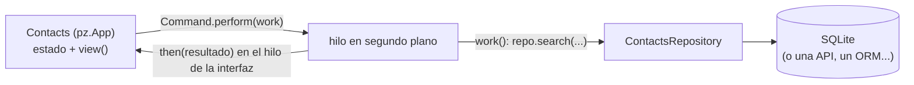

import { Aside, Code, Steps } from '@astrojs/starlight/components';
import Media from '../../../../../components/Media.astro';
import NavCards from '../../../../../components/NavCards.astro';
import Run from '../../../showcase/_run.mdx';
import finished from '../../../../../assets/tutorials/contacts-backend.png';
import source from '../../../../../../../examples/tutorial/contacts_backend.py?raw';

Pyzed es el **frontend**: dibuja ventanas y reacciona al usuario. Tus datos viven en otro sitio: una base de datos,
una API REST, archivos. Este tutorial conecta las dos partes como lo hacen las apps grandes, con una **capa de
backend** delgada con la que habla la ventana, y cada llamada lenta fuera del hilo de la interfaz para que la
ventana nunca se congele.

| Objetivo | Tiempo | Nivel | Necesitas |
| --- | --- | --- | --- |
| Una app de contactos sobre SQLite | 40 minutos | Avanzado · Python | [Tareas en segundo plano](/pyzed/es/tutorials/intermediate/background-tasks/) |

## Qué vas a aprender

- Poner todo el acceso a datos en una clase **repositorio** sin interfaz, fácil de probar y de reemplazar.
- Ejecutar consultas en un **hilo en segundo plano** con `Command.perform(work, then)`.
- Mostrar un **spinner** mientras corre una consulta, y convertir las excepciones en un mensaje en lugar de un
  cierre.
- Recargar la vista después de un cambio (añadir, borrar, buscar).

<Media src={finished} alt="La app de contactos: un buscador, un formulario para añadir un contacto y una lista de cuatro contactos" caption="Cada consulta corre en un hilo; la ventana sigue respondiendo incluso con una base de datos lenta." eager />

## La forma de la app



## Pasos

<Steps>

1. **El repositorio.** Python normal, sin importar Pyzed. Abre una conexión por llamada, así se puede usar desde
   cualquier hilo:

   ```python
   class ContactsRepository:
       def __init__(self, path=DEFAULT_DB):
           self.path = Path(path)
           with self.connect() as db:
               db.execute("CREATE TABLE IF NOT EXISTS contacts (id INTEGER PRIMARY KEY, name TEXT, email TEXT)")

       def connect(self):
           return sqlite3.connect(self.path)

       def search(self, text=""):
           with self.connect() as db:
               rows = db.execute("SELECT id, name, email FROM contacts WHERE name LIKE ? ORDER BY name",
                                 (f"%{text}%",)).fetchall()
           return [{"id": i, "name": n, "email": e} for i, n, e in rows]
   ```

2. **Nunca consultes en el hilo de la interfaz.** Una consulta de 300 ms congelaría la ventana 300 ms.
   `Command.perform(work, then)` ejecuta `work()` en un hilo y llama a `then(resultado)` de vuelta en el hilo de la
   interfaz, donde es seguro cambiar el estado:

   ```python
   def reload(self):
       return pz.Command.perform(lambda: self.repo.search(self.query), self.loaded)

   def loaded(self, contacts):
       self.contacts = contacts
   ```

3. **Ocupado y errores.** Una pequeña función envuelve cada llamada: marca `self.busy` (la vista muestra un
   spinner) y atrapa las excepciones para que se conviertan en un aviso:

   ```python
   def background(self, work, then=None):
       self.busy, self.error = True, None

       def guarded():
           try:
               return ("ok", work())
           except Exception as exc:
               return ("error", str(exc))

       def done(outcome):
           self.busy = False
           kind, value = outcome
           if kind == "error":
               self.error = value
           elif then is not None:
               return then(value)

       return pz.Command.perform(guarded, done)
   ```

4. **Carga al empezar, recarga después de cambios.** `on_start` se ejecuta una vez al abrir la ventana. Añadir o
   borrar recarga la lista al terminar:

   ```python
   def on_start(self):
       return self.reload()

   def add(self):
       name, email = self.name, self.email
       self.name = self.email = ""
       return self.background(lambda: self.repo.add(name, email), lambda _: self.reload())
   ```

5. **Prueba el backend solo.** Como el repositorio no tiene interfaz, una prueba son tres líneas:

   ```python
   repo = ContactsRepository(tmp_path / "contacts.db")
   repo.add("Grace Hopper", "grace@example.com")
   assert [c["name"] for c in repo.search("grace")] == ["Grace Hopper"]
   ```

</Steps>

<Aside type="tip" title="Bibliotecas async">
Si tu cliente es async (`httpx.AsyncClient`, `aiosqlite`, la `AsyncSession` de SQLAlchemy), pasa un `async def` a
`Command.perform`, o devuelve una corrutina desde un callback: corre en el loop de asyncio de Pyzed. Mira
[Async y suscripciones](/pyzed/es/guides/async/).
</Aside>

<Aside type="caution" title="No toques self desde el hilo">
`work()` corre en otro hilo: deja que devuelva un valor y cambia `self` en `then`. Cambiar el estado desde el hilo
de trabajo puede chocar con el dibujado.
</Aside>

## Código completo

<Code code={source} lang="python" title="examples/tutorial/contacts_backend.py" />

<Run file="examples/tutorial/contacts_backend.py" lang="es" />

## Backends reales

El mismo patrón con bibliotecas reales, cada uno un proyecto completo en
[`examples/integrations`](https://github.com/albakore/pyzed/tree/main/examples/integrations):

<NavCards
	items={[
		{ title: 'SQLAlchemy', text: 'Sesiones en hilos o una AsyncSession, y 20.000 filas en una tabla virtual.', href: '/pyzed/es/integrations/sqlalchemy/', icon: 'database' },
		{ title: 'FastAPI', text: 'Un cliente de escritorio para una API: servidor aparte, embebido o en el mismo proceso.', href: '/pyzed/es/integrations/fastapi/', icon: 'server' },
		{ title: 'Django', text: 'El tutorial de encuestas manejado desde una ventana con el ORM o por HTTP.', href: '/pyzed/es/integrations/django/', icon: 'puzzle' },
		{ title: 'httpx', text: 'Peticiones concurrentes y descargas en streaming con progreso.', href: '/pyzed/es/integrations/httpx/', icon: 'external' },
	]}
/>

## Eventos de este tutorial

| Origen | Evento | Handler |
| --- | --- | --- |
| La app | `on_start` | Carga los contactos del backend en segundo plano. |
| `ui.input` | `on_input` | Guarda el texto de cada campo. |
| `ui.input` (email) | `on_submit` | `self.add`: manda el contacto nuevo al backend. |

### Prueba más eventos

```python
def row(self, contact):
    return ui.list_item(contact.name, None, icon="user",
                        on_double_press=lambda: setattr(self, "editing", contact),  # editarlo
                        on_right_press=lambda: setattr(self, "deleting", contact))  # pedir borrarlo

def on_key(self, combo):
    if combo == "f5":                       # recargar desde el backend
        return self.on_start()
```

## Siguiente

- [Empaqueta tu app](/pyzed/es/tutorials/advanced/packaging/) para Windows, macOS y Linux.
- [Integraciones](/pyzed/es/integrations/overview/): dónde corre tu código y cómo los formularios muestran errores
  del servidor.
