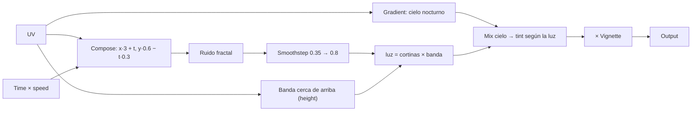

import { Aside, Code, Steps } from '@astrojs/starlight/components';
import Media from '../../../../../components/Media.astro';
import Run from '../../../showcase/_run.mdx';
import finished from '../../../../../assets/tutorials/aurora.png';
import source from '../../../../../../../examples/tutorial/aurora_graph.py?raw';

En [el tutorial intermedio de shaders](/pyzed/es/tutorials/intermediate/shader-effect/) editaste una plantilla en la
vista de shader. Aquí construyes un shader desde cero, **en Python**, con el mismo grafo que edita la vista de
shader: una aurora, cortinas de luz verde que flotan sobre un cielo nocturno, con deslizadores para su velocidad,
su altura y su color.

| Objetivo | Tiempo | Nivel | Necesitas |
| --- | --- | --- | --- |
| Una aurora animada hecha de nodos, con controles en vivo | 40 minutos | Avanzado · Python | [Un efecto de shader](/pyzed/es/tutorials/intermediate/shader-effect/) |

## Qué vas a aprender

- Crear un `shading.Graph`, añadir nodos llamándolos y elegir sus salidas.
- Usar aritmética sobre las salidas (`+`, `-`, `*`) para que se añadan nodos Math por ti.
- Combinar **ruido fractal**, **smoothstep** y un **degradado** en una imagen.
- Añadir **variables mutables** (uniforms) y cambiarlas en cada fotograma desde deslizadores.
- Guardar el grafo como `.pzshad` y seguir editándolo visualmente en Pyzed Design.

<Media src={finished} alt="Una aurora verde sobre un cielo oscuro con un panel de cristal con deslizadores" caption="La aurora, con sus controles en un panel de cristal." eager />

## Cómo piensa un shader

Un shader responde a una pregunta, para todos los píxeles a la vez: *¿de qué color es este píxel ahora mismo?*
Sabe dónde está el píxel (**UV**: de 0,0 arriba a la izquierda a 1,1 abajo a la derecha) y el **tiempo**. Todo lo
demás son operaciones sobre esas dos cosas. El grafo es esa matemática, dibujada como cajas y cables:



## Pasos

<Steps>

1. **Un grafo y sus variables.** `g.uniform` añade una variable *mutable* (la GPU la lee en cada fotograma, así que
   cambiarla no cuesta nada) y devuelve un nodo que la lee:

   ```python
   from pyzed import shading

   g = shading.Graph("aurora")
   speed = g.uniform("speed", "float", 0.3, min=0, max=2)
   height = g.uniform("height", "float", 0.55, min=0.2, max=0.9)
   tint = g.uniform("tint", "color", "#34d399")
   ```

2. **Entradas.** Llamar a un tipo de nodo sobre el grafo añade ese nodo. `node["nombre"]` elige una salida, y la
   aritmética añade nodos Math:

   ```python
   uv = g.uv()
   t = g.time()["time"] * speed       # un nodo Multiply
   ```

3. **Las cortinas.** Estira las coordenadas a lo ancho y muévelas con el tiempo, y luego toma **ruido fractal**
   (capas de ruido, cada una más fina que la anterior; el aspecto clásico de nubes y humo):

   ```python
   p = g.compose(uv["x"] * 3.0 + t, uv["y"] * 0.6 - t * 0.3)["vector"]
   curtains = g.fbm(p, scale=2.5, octaves=5)
   ```

4. **Mantenlas en una banda.** `smoothstep(a, b, x)` vale 0 por debajo de `a`, 1 por encima de `b` y sube suave
   entre medio: la versión de shader de "aparecer gradualmente". Dos de ellos forman una banda cerca de arriba,
   controlada por `height`:

   ```python
   band = g.smoothstep(height - 0.35, height, 1.0 - uv["y"]) * g.smoothstep(1.0, height, 1.0 - uv["y"])
   light = g.smoothstep(0.35, 0.8, curtains["value"]) * band
   ```

5. **Dale color.** Un nodo **Gradient** hace el cielo; **Mix** pasa del cielo al tinte donde hay luz;
   **Vignette** oscurece las esquinas; **Output** es el color final:

   ```python
   sky = g.gradient(uv["y"], stops=[[0.0, "#020617"], [1.0, "#0f172a"]])
   glow = g.mix(sky["rgb"], tint * 1.4, light)
   g.output(g.rgba(glow * g.vignette(strength=0.6), 1.0)["color"])
   g.arrange()   # ordena los nodos en columnas, como el botón Arrange de la vista de shader
   ```

6. **Muéstralo.** `pz.shader` recibe el grafo, lo compila a WGSL una vez y lo ejecuta en la GPU. `uniforms=` fija
   las variables mutables por nombre, así que los deslizadores cambian la imagen sin recompilar nada:

   ```python
   pz.shader(AURORA, uniforms={"speed": self.speed, "height": self.height, "tint": TINTS[self.tint]},
             width="fill", height="fill", fallback=pz.Gradient(["#020617", "#064e3b"], angle=180))
   ```

7. **Ábrelo en el diseñador.** Ejecuta el ejemplo con `--save` para escribir
   `examples/tutorial/shaders/aurora.pzshad`, y luego `pyzed design examples/tutorial/shaders/aurora.pzshad`: cada
   nodo que creaste en código está en el lienzo, con su vista previa en vivo, listo para ajustarlo con el mouse.

</Steps>

<Aside type="tip" title="Cuando necesitas WGSL directo">
Un nodo **Expression** guarda tu propio WGSL (`g.add("expression", code="sin(a * 10.0) * b", a=..., b=...)`), así
que nunca tienes que salir del grafo por una fórmula especial. Para un shader entero en WGSL, mira
[Shaders](/pyzed/es/shading/shaders/).
</Aside>

<Aside type="caution" title="Los errores de compilación señalan el nodo">
`g.compile()` devuelve el WGSL y los problemas por nodo (`.errors`); un tipo que no encaja (una textura en un
número) se rechaza con un `GraphError` en el momento de conectarlo. En la vista de shader el nodo con el problema se
pone rojo.
</Aside>

## Código completo

<Code code={source} lang="python" title="examples/tutorial/aurora_graph.py" />

<Run file="examples/tutorial/aurora_graph.py" lang="es" />

## Siguiente

- [Grafos de shader](/pyzed/es/shading/shader-graphs/): toda la API de `pyzed.shading` y el formato `.pzshad`.
- La sección [Shading](/pyzed/es/shading/): cada nodo, con ejemplos.
- [Conectar un backend](/pyzed/es/tutorials/advanced/backend/).
