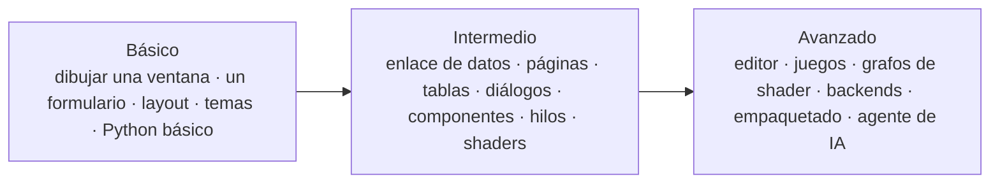

import { Aside } from '@astrojs/starlight/components';
import NavCards from '../../../../components/NavCards.astro';
import Run from '../../showcase/_run.mdx';

Cada tutorial termina en un programa que puedes ejecutar, y su código completo está en la carpeta
[`examples`](https://github.com/albakore/pyzed/tree/main/examples) del repositorio. Cada uno dice qué vas a
construir, cuánto tarda, qué necesitas saber antes y qué vas a aprender.

<Aside type="tip" title="¿Nunca programaste?">
Empieza por **Tu primera ventana en Pyzed Design**: la dibujas con el mouse y la ejecutas con <kbd>F5</kbd>, sin
código. Cada tutorial siguiente añade un poco de Python y explica cada línea.
</Aside>

## Básicos

De un lienzo vacío a tus primeras apps, con el diseñador y en código.

<NavCards
	items={[
		{ title: 'Tu primera ventana en Pyzed Design', text: 'Arrastra controles, cambia sus propiedades, ánclalos y ejecuta con F5. Sin código.', href: '/pyzed/es/tutorials/basic/first-window/', icon: 'pencil', tag: 'Empieza aquí' },
		{ title: 'Un formulario que hace algo', text: 'Un formulario de contacto: campos, un botón Send conectado a Python, un contador en vivo y la consola.', href: '/pyzed/es/tutorials/basic/first-form/', icon: 'document' },
		{ title: 'Bases del diseño de pantallas', text: 'Filas, columnas, relleno, separaciones y cuadrículas, en código y con los contenedores flexibles del diseñador.', href: '/pyzed/es/tutorials/basic/layout-basics/', icon: 'list-format' },
		{ title: 'Cambia el tema', text: 'Temas incluidos, colores de acento, claro/oscuro según el sistema y tu propio tema.', href: '/pyzed/es/tutorials/basic/themes/', icon: 'moon' },
		{ title: 'Tutorial en 5 pasos', text: 'De una ventana vacía a una app de notas con Markdown, trabajo async y una segunda ventana, en Python puro.', href: '/pyzed/es/tutorials/basic/step-by-step/', icon: 'rocket' },
		{ title: 'Lista de tareas', text: 'Tu primera app completa en código: estado, un formulario, una lista, filtros y atajos.', href: '/pyzed/es/tutorials/basic/todo-app/', icon: 'approve-check' },
	]}
/>

## Intermedios

Datos reales, varias pantallas y tus propias piezas reutilizables.

<NavCards
	items={[
		{ title: 'Enlace de datos y validación', text: 'Enlaza controles a form.data y añade reglas en el diseñador; valida en una línea.', href: '/pyzed/es/tutorials/intermediate/data-binding/', icon: 'approve-check-circle', tag: 'Diseñador' },
		{ title: 'Una app con varias vistas', text: 'Una barra lateral que cambia de página, pestañas, migas de pan y atajos.', href: '/pyzed/es/tutorials/intermediate/navigation/', icon: 'bars' },
		{ title: 'Listas y tablas con datos', text: 'Buscar, ordenar, elegir una fila y mostrar sus detalles.', href: '/pyzed/es/tutorials/intermediate/lists-tables/', icon: 'list-format' },
		{ title: 'Diálogos, notificaciones y validación', text: 'Errores de campo, un diálogo de confirmación y toasts que se van solos.', href: '/pyzed/es/tutorials/intermediate/dialogs-feedback/', icon: 'comment-alt' },
		{ title: 'Un componente propio', text: 'Dibuja una valoración con estrellas reutilizable, con propiedades, enlaces y un evento propio.', href: '/pyzed/es/tutorials/intermediate/custom-component/', icon: 'puzzle', tag: 'Diseñador' },
		{ title: 'Tareas en segundo plano', text: 'Descargas con progreso, trabajo bloqueante en un hilo y notificaciones.', href: '/pyzed/es/tutorials/intermediate/background-tasks/', icon: 'random' },
		{ title: 'Un efecto de shader desde la vista de shader', text: 'Un fondo de GPU brillante hecho de nodos, detrás de un formulario cuyos botones lo cambian.', href: '/pyzed/es/tutorials/intermediate/shader-effect/', icon: 'star', tag: 'GPU' },
	]}
/>

## Avanzados

Aplicaciones completas, juegos y cómo publicarlas.

<NavCards
	items={[
		{ title: 'Un mini editor de código', text: 'Un workspace con árbol de archivos, pestañas, resaltado de sintaxis y paleta de comandos.', href: '/pyzed/es/tutorials/advanced/code-editor/', icon: 'seti:python' },
		{ title: 'Un bucle de juego', text: 'Dodge: un bucle por fotograma, teclas mantenidas, colisiones, brillo, partículas y temblor.', href: '/pyzed/es/tutorials/advanced/game-loop/', icon: 'laptop', tag: 'Juego' },
		{ title: 'Un grafo de shader propio', text: 'Una aurora construida nodo a nodo en Python, con deslizadores para sus variables.', href: '/pyzed/es/tutorials/advanced/shader-graph/', icon: 'star', tag: 'GPU' },
		{ title: 'Conectar un backend', text: 'Una clase repositorio sobre SQLite, consultas en hilos, un spinner y errores amables.', href: '/pyzed/es/tutorials/advanced/backend/', icon: 'database' },
		{ title: 'Empaqueta tu app', text: 'Una app de doble clic para Windows, macOS y Linux, y compilaciones de las tres desde CI.', href: '/pyzed/es/tutorials/advanced/packaging/', icon: 'rocket' },
		{ title: 'Construye una app con el agente de IA', text: 'Describe una app, sigue el plan del agente, revisa sus cambios y sigue mejorándola.', href: '/pyzed/es/tutorials/advanced/ai-agent/', icon: 'comment-alt', tag: 'IA' },
	]}
/>

## Ejecutar los ejemplos

Clona el repositorio (o descárgalo como zip) y ejecuta cualquier ejemplo desde su carpeta con la herramienta que
uses. `uv` crea el entorno por ti; con `pip`, primero crea y activa un entorno virtual. Cada tutorial tiene un bloque
como este con su propio archivo:

<Run file="examples/todo.py" lang="es" />

Los formularios hechos con el diseñador (`.pzform`) se ejecutan con `pyzed run` en lugar de `python`:

<Run file="examples/tutorial/designer/hello.pzform" form lang="es" />

<Aside type="note" title="Sobre esta sección">
Los tutoriales están probados: cada app de ejemplo de `examples/tutorial` se importa, se dibuja fuera de pantalla y
se ejercita en la suite de tests, así que el código de estas páginas funciona con la versión actual de Pyzed. Se
están añadiendo grabaciones cortas de cada tutorial.
</Aside>

<Aside type="tip">
¿Nuevo en Python? Lee primero [Instalación](/pyzed/es/getting-started/installation/) y el
[Inicio rápido](/pyzed/es/getting-started/quickstart/) para ver una primera ventana en cinco minutos. ¿Buscas apps
terminadas para estudiar? Mira el [Showcase](/pyzed/es/showcase/).
</Aside>
