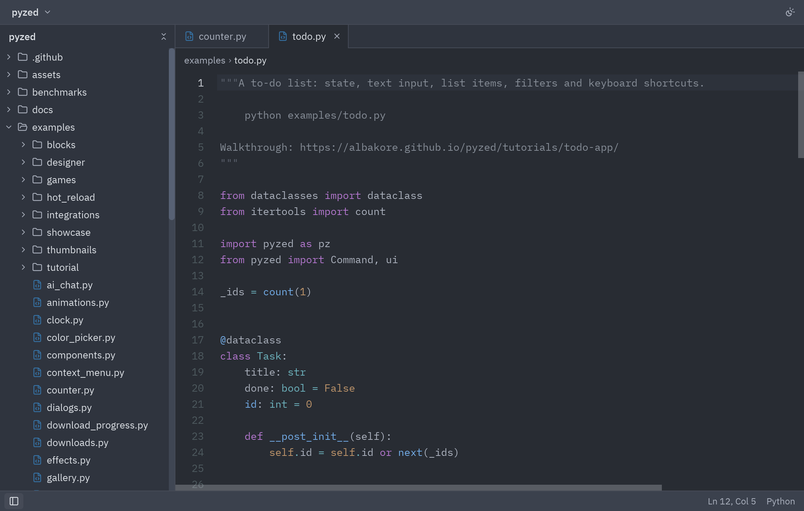
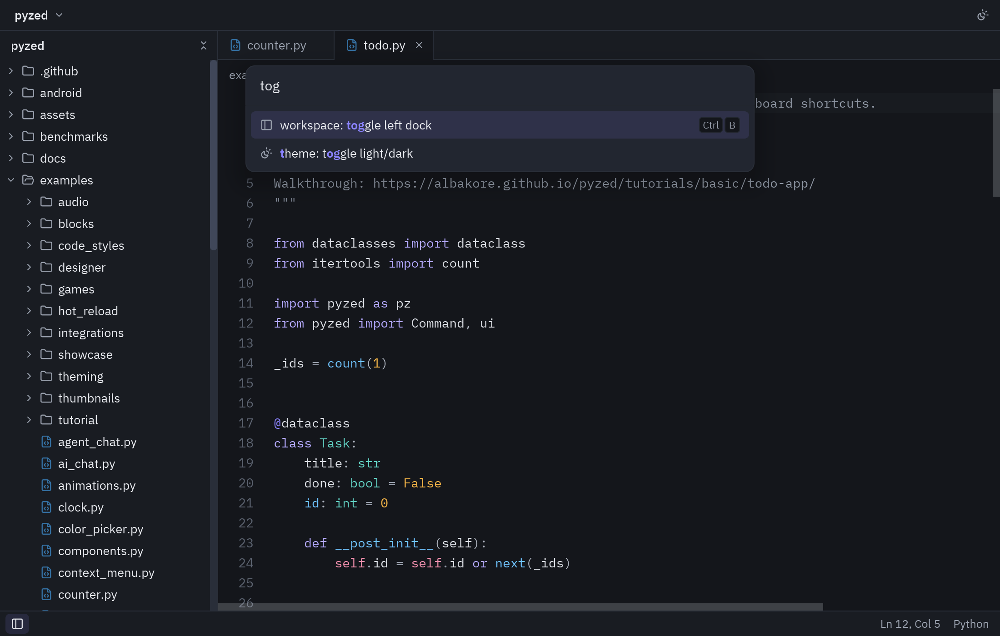

import { Code, Steps } from '@astrojs/starlight/components';
import source from '../../../../../../examples/mini_editor.py?raw';

Vamos a construir un editor al estilo de Zed en unas 150 líneas: abre una carpeta real, muestra
el árbol de archivos, abre pestañas, edita con resaltado de sintaxis, guarda con
<kbd>Ctrl</kbd>+<kbd>S</kbd> y tiene paleta de comandos.



<Steps>

1. **Leer la carpeta.** `TreeNode.from_paths` convierte una lista de rutas en el árbol del panel
   de proyecto. Saltamos carpetas pesadas como `.git` o `node_modules`:

   ```python
   def scan(self):
       files = []
       for folder, dirs, names in os.walk(self.root):
           dirs[:] = [d for d in dirs if d not in IGNORED]
           rel = Path(folder).relative_to(self.root)
           files += [(rel / n).as_posix() for n in names]
       return files

   self.nodes = ui.TreeNode.from_paths(self.scan())
   self.expanded = set()          # carpetas abiertas
   ```

2. **Abrir y cerrar pestañas.** El estado son las rutas abiertas, la activa y el texto de cada
   una. El id de cada pestaña es su ruta:

   ```python
   def open_file(self, path):
       if path not in self.texts:
           self.texts[path] = (self.root / path).read_text(encoding="utf-8")
       if path not in self.open_tabs:
           self.open_tabs.append(path)
       self.active = path
   ```

3. **El editor.** Usamos la ruta como `id` del editor: así cada archivo conserva su cursor y su
   historial de deshacer al cambiar de pestaña. `on_change` marca el archivo como modificado:

   ```python
   ui.editor(self.active, self.texts[self.active], path=self.active,
             on_change=self.edited,
             on_cursor=lambda line, col: setattr(self, "cursor", (line, col)))

   def edited(self, text):
       self.texts[self.active] = text
       self.dirty.add(self.active)       # la pestaña muestra un punto
   ```

4. **El workspace.** `ui.workspace` coloca la barra de título, el dock izquierdo, el centro y la
   barra de estado. Pasar `None` en `left` oculta el panel:

   ```python
   ui.workspace(
       self.center(),
       title_bar=ui.title_bar([ui.title_button(self.root.name, chevron=True)]),
       left=project if self.show_left else None,
       status_bar=ui.status_bar([...], [ui.status_item(f"Ln {line}, Col {col}")]),
   )
   ```

5. **Atajos.** Normalizamos <kbd>Cmd</kbd> a <kbd>Ctrl</kbd> para que funcione igual en macOS:

   ```python
   def on_key(self, combo):
       combo = combo.replace("cmd-", "ctrl-")
       if combo == "ctrl-s":
           self.save()
       elif combo == "ctrl-b":
           self.toggle_left()
   ```

6. **Paleta de comandos.** Se abre con <kbd>Ctrl</kbd>+<kbd>Shift</kbd>+<kbd>P</kbd>, enfoca su
   campo y flota sobre el workspace con `ui.layer`:

   ```python
   if combo == "ctrl-shift-p":
       self.palette_open, self.query = True, ""
       return Command.focus("command-palette")

   # al final de view():
   palette = ui.command_palette(self.query, lambda q: setattr(self, "query", q), self.commands(),
                                on_submit=self.run_first_match) if self.palette_open else None
   return ui.layer(layout, palette, on_dismiss=lambda: setattr(self, "palette_open", False))
   ```

   

</Steps>

## Código completo

<Code code={source} lang="py" title="examples/mini_editor.py" />

```bash
python examples/mini_editor.py ruta/a/una/carpeta
```

Para una versión más completa (buscador de archivos, panel de terminal, outline, temas, marcadores
de git) mira [`examples/zed_editor.py`](https://github.com/albakore/pyzed/blob/main/examples/zed_editor.py).
