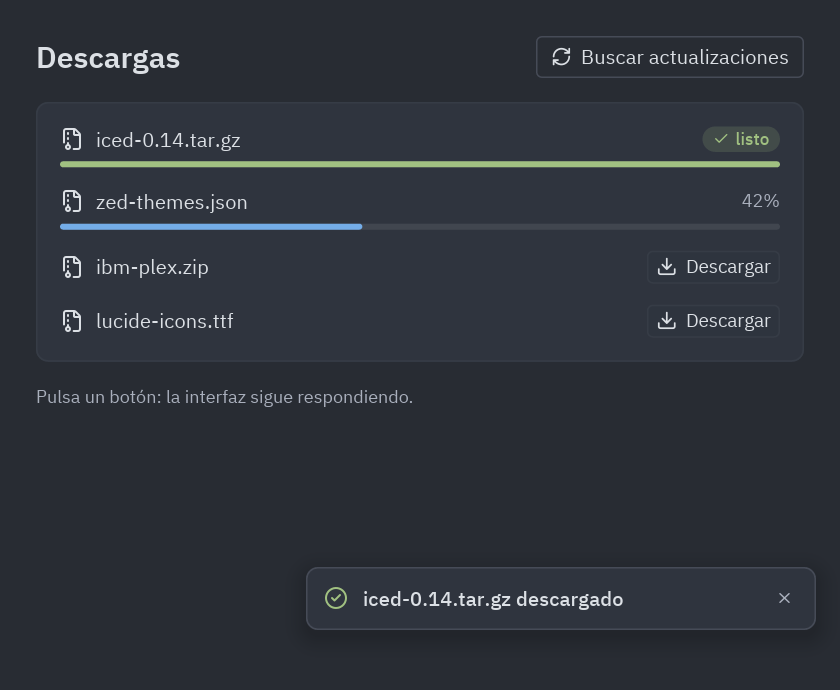
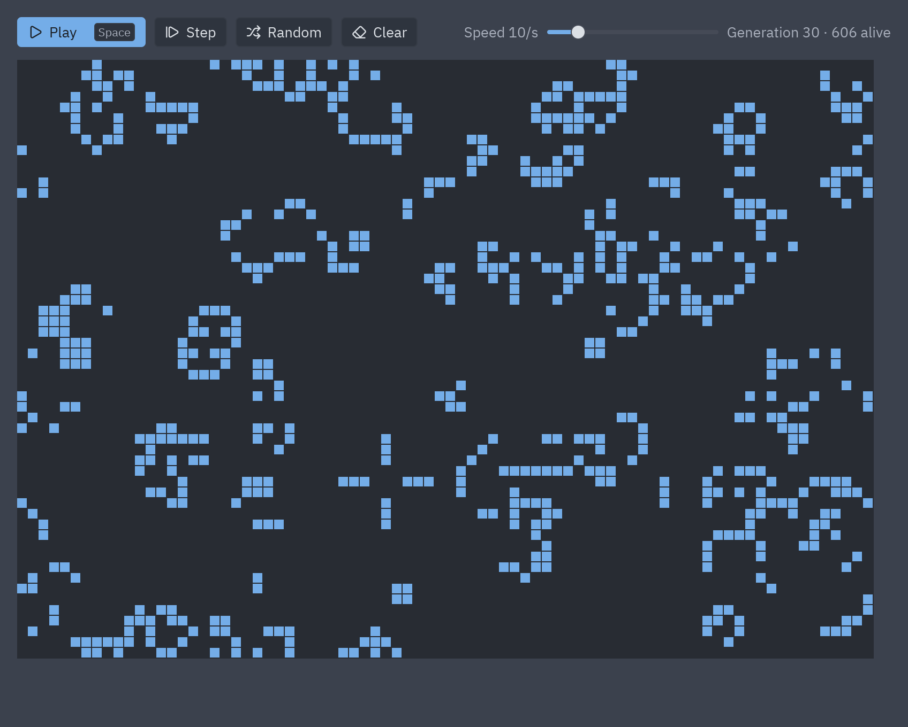
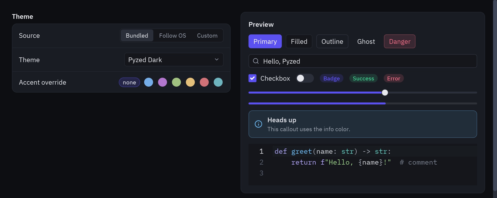
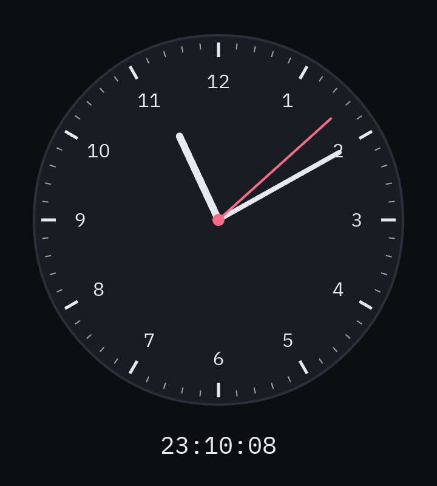
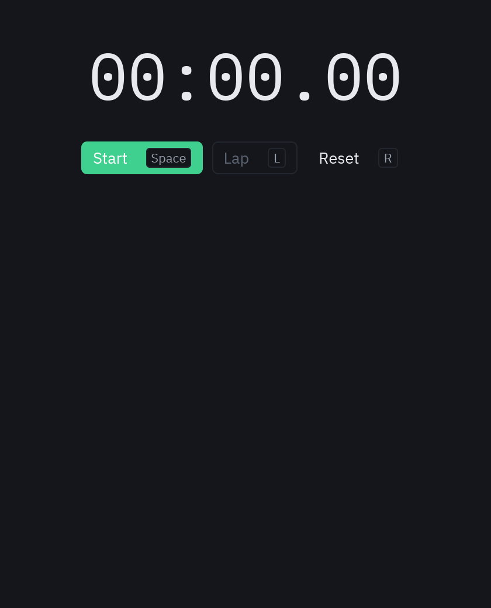
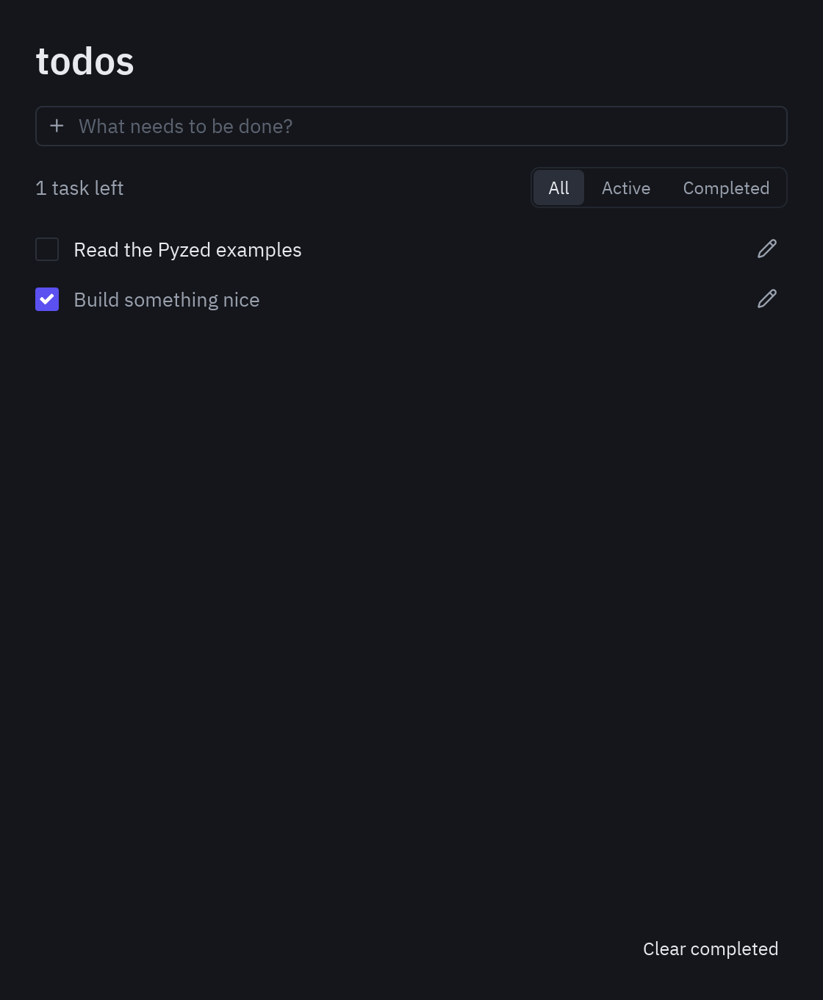
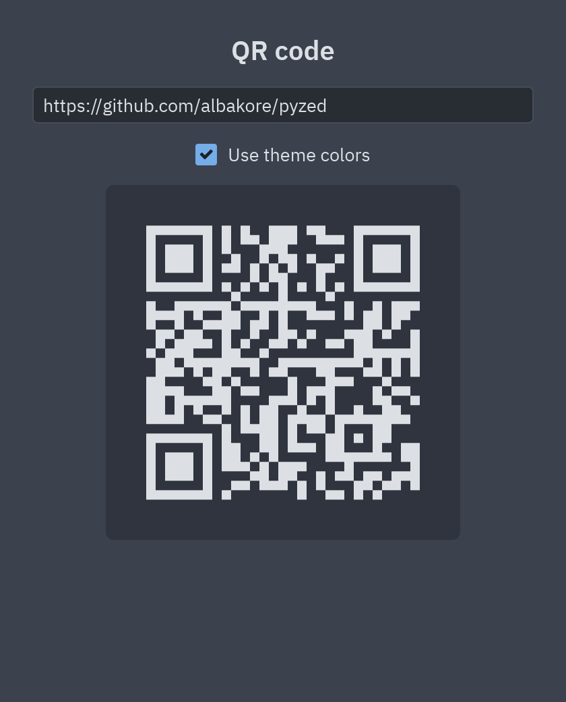
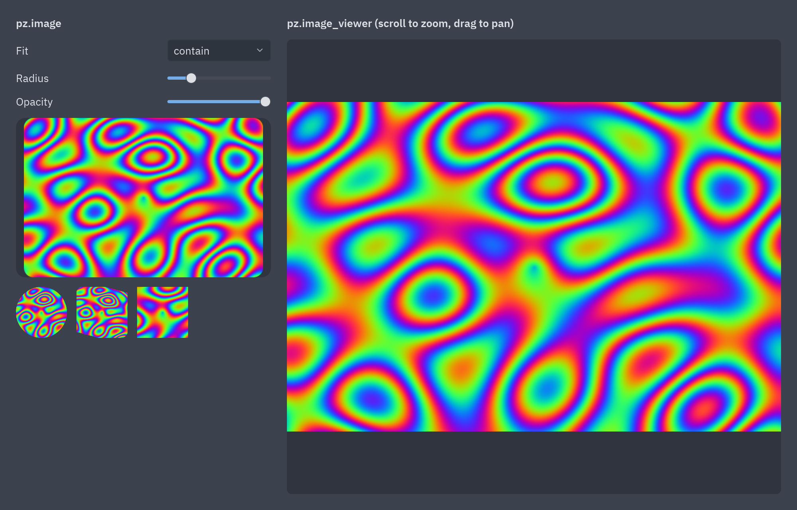
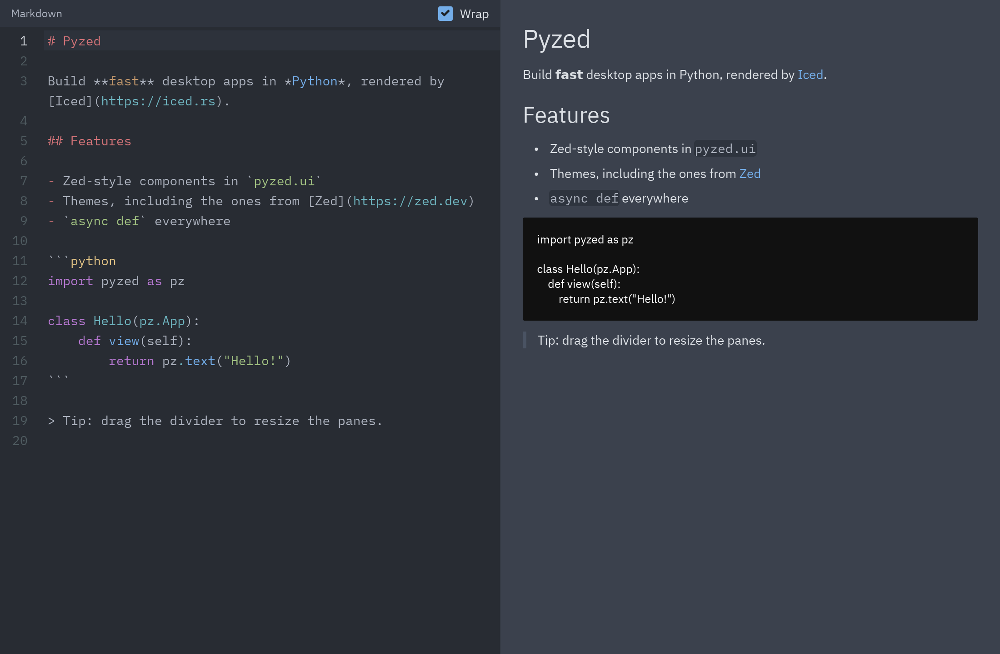
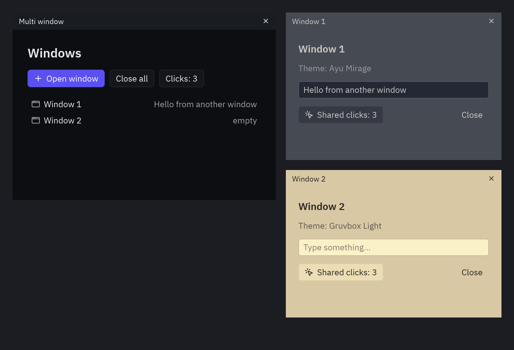

import Commands from '../../components/Commands.astro';

All examples live in [`examples/`](https://github.com/albakore/pyzed/tree/main/examples).
Run them from the repository root:

<Commands
	uv={`uv run python examples/<name>.py`}
	pip={`
		{venv}
		{activate}
		pip install pyzed-ui
		python examples/<name>.py
	`}
	python={`
		{py} -m pip install pyzed-ui
		{py} examples/<name>.py
	`}
/>

| Example | What it shows | Tutorial |
| --- | --- | --- |
| [`counter.py`](https://github.com/albakore/pyzed/blob/main/examples/counter.py) | The bare minimum: state, messages and callables. | [Quickstart](/pyzed/getting-started/quickstart/) |
| [`todo.py`](https://github.com/albakore/pyzed/blob/main/examples/todo.py) | Forms, lists, filters, focus and shortcuts. | [To-do list](/pyzed/tutorials/basic/todo-app/) |
| [`downloads.py`](https://github.com/albakore/pyzed/blob/main/examples/downloads.py) | `Command.perform`, `pz.post` from threads, progress and notifications. | [Background tasks](/pyzed/tutorials/intermediate/background-tasks/) |
| [`mini_editor.py`](https://github.com/albakore/pyzed/blob/main/examples/mini_editor.py) | A code editor with a file tree and tabs in ~150 lines. | [Mini editor](/pyzed/tutorials/advanced/code-editor/) |
| [`gallery.py`](https://github.com/albakore/pyzed/blob/main/examples/gallery.py) | Every component, interactive, with a theme picker. | [Components](/pyzed/components/overview/) |
| [`zed_editor.py`](https://github.com/albakore/pyzed/blob/main/examples/zed_editor.py) | Full editor: file finder, palette, docks, terminal, themes and git markers. | |
| [`tutorial/`](https://github.com/albakore/pyzed/tree/main/examples/tutorial/) | Five steps: window, state, layout and themes, async, notes app. | [5-step tutorial](/pyzed/tutorials/basic/step-by-step/) |
| [`todos.py`](https://github.com/albakore/pyzed/blob/main/examples/todos.py) | Iced's *todos*: add, edit, complete, filter and save. |  |
| [`game_of_life.py`](https://github.com/albakore/pyzed/blob/main/examples/game_of_life.py) | `pz.canvas` with thousands of cells and `pz.every` as the engine. | [Canvas](/pyzed/guides/canvas/) |
| [`games/snake.py`](https://github.com/albakore/pyzed/blob/main/examples/games/snake.py) | Snake on a fixed timer, key queue and a glass game-over card. | [Snake](/pyzed/games/snake/) |
| [`games/breakout.py`](https://github.com/albakore/pyzed/blob/main/examples/games/breakout.py) | 60 fps loop with `pz.frames`, held keys, collisions, particles and shake. | [Breakout](/pyzed/games/breakout/) |
| [`games/neon_invaders.py`](https://github.com/albakore/pyzed/blob/main/examples/games/neon_invaders.py) | A space shooter: pixel-art sprites, neon glow and a HUD with glass and bloom. | [Neon Invaders](/pyzed/games/neon-invaders/) |
| [`clock.py`](https://github.com/albakore/pyzed/blob/main/examples/clock.py) | Analog clock drawn on a canvas. | [Canvas](/pyzed/guides/canvas/) |
| [`stopwatch.py`](https://github.com/albakore/pyzed/blob/main/examples/stopwatch.py) | Stopwatch with laps and shortcuts. | [Async](/pyzed/guides/async/) |
| [`download_progress.py`](https://github.com/albakore/pyzed/blob/main/examples/download_progress.py) | Concurrent downloads with `async` generators and progress. | [Async](/pyzed/guides/async/) |
| [`websocket_stream.py`](https://github.com/albakore/pyzed/blob/main/examples/websocket_stream.py) | Live data with `pz.listen` and an `async` generator. | [Async](/pyzed/guides/async/) |
| [`multi_window.py`](https://github.com/albakore/pyzed/blob/main/examples/multi_window.py) | Several `pz.Window` with shared state and different themes. | [Multiple windows](/pyzed/guides/windows/) |
| [`styling.py`](https://github.com/albakore/pyzed/blob/main/examples/styling.py) | Theme picker, system mode, `Theme.generate` and accents. | [Themes](/pyzed/theming/themes/) |
| [`image_viewer.py`](https://github.com/albakore/pyzed/blob/main/examples/image_viewer.py) | `pz.image` and the zoomable `pz.image_viewer`. | [Content](/pyzed/components/content/#images) |
| [`markdown_viewer.py`](https://github.com/albakore/pyzed/blob/main/examples/markdown_viewer.py) | Markdown editor with live preview. | [Content](/pyzed/components/content/) |
| [`qr_code.py`](https://github.com/albakore/pyzed/blob/main/examples/qr_code.py) | Generates a QR code as you type. | [Content](/pyzed/components/content/) |
| [`panes.py`](https://github.com/albakore/pyzed/blob/main/examples/panes.py) | Resizable panes with nested `ui.split`. | [Content](/pyzed/components/content/#resizable-panels) |
| [`context_menu.py`](https://github.com/albakore/pyzed/blob/main/examples/context_menu.py) | Context menu with `ui.popover` and `ui.menu`. | [Content](/pyzed/components/content/#popover) |
| [`screenshots.py`](https://github.com/albakore/pyzed/blob/main/examples/screenshots.py) | Regenerates the documentation screenshots. | [Tests and screenshots](/pyzed/guides/testing/) |

## Integrations

[`examples/integrations/`](https://github.com/albakore/pyzed/tree/main/examples/integrations) holds
desktop apps built on backend and data libraries. Each one is a uv project: `cd` into it and run
`uv run main.py`.

| Example | Libraries | Tutorial |
| --- | --- | --- |
| [`fastapi_heroes`](https://github.com/albakore/pyzed/tree/main/examples/integrations/fastapi_heroes) | FastAPI, SQLModel, httpx | [FastAPI](/pyzed/integrations/fastapi/) |
| [`django_polls`](https://github.com/albakore/pyzed/tree/main/examples/integrations/django_polls) | Django, httpx | [Django](/pyzed/integrations/django/) |
| [`sqlalchemy_quickstart`](https://github.com/albakore/pyzed/tree/main/examples/integrations/sqlalchemy_quickstart) | SQLAlchemy 2.0, aiosqlite | [SQLAlchemy](/pyzed/integrations/sqlalchemy/) |
| [`sqlalchemy_contacts`](https://github.com/albakore/pyzed/tree/main/examples/integrations/sqlalchemy_contacts) | SQLAlchemy 2.0 | [SQLAlchemy](/pyzed/integrations/sqlalchemy/#many-rows-the-contacts-demo) |
| [`sqlmodel_heroes`](https://github.com/albakore/pyzed/tree/main/examples/integrations/sqlmodel_heroes) | SQLModel | [SQLModel](/pyzed/integrations/sqlmodel/) |
| [`sqlmodel_inventory`](https://github.com/albakore/pyzed/tree/main/examples/integrations/sqlmodel_inventory) | SQLModel, Pydantic | [SQLModel](/pyzed/integrations/sqlmodel/#one-model-for-the-form-and-the-table-the-inventory-demo) |
| [`httpx_pypi`](https://github.com/albakore/pyzed/tree/main/examples/integrations/httpx_pypi) | httpx, Pydantic | [httpx](/pyzed/integrations/httpx/) |
| [`httpx_download`](https://github.com/albakore/pyzed/tree/main/examples/integrations/httpx_download) | httpx | [httpx](/pyzed/integrations/httpx/#streaming-downloads-with-progress) |
| [`pydantic_signup`](https://github.com/albakore/pyzed/tree/main/examples/integrations/pydantic_signup) | Pydantic | [Pydantic](/pyzed/integrations/pydantic/) |
| [`aiosqlite_journal`](https://github.com/albakore/pyzed/tree/main/examples/integrations/aiosqlite_journal) | aiosqlite | [Other libraries](/pyzed/integrations/other-libraries/#aiosqlite) |

## Code editor

<Commands
	uv={`uv run python examples/zed_editor.py .`}
	pip={`python examples/zed_editor.py .`}
	python={`{py} examples/zed_editor.py .`}
/>

Shortcuts: <kbd>Ctrl</kbd>+<kbd>Shift</kbd>+<kbd>P</kbd> palette, <kbd>Ctrl</kbd>+<kbd>P</kbd>
file finder, <kbd>Ctrl</kbd>+<kbd>S</kbd> save, <kbd>Ctrl</kbd>+<kbd>B</kbd>,
<kbd>Ctrl</kbd>+<kbd>J</kbd> and <kbd>Ctrl</kbd>+<kbd>Alt</kbd>+<kbd>B</kbd> docks.

| Command palette | File finder (Gruvbox) |
| --- | --- |
|  |  |

## Component gallery

<Commands
	uv={`uv run python examples/gallery.py`}
	pip={`python examples/gallery.py`}
	python={`{py} examples/gallery.py`}
/>

## Downloads

## Iced demos

Python recreations of the [Iced demos](https://github.com/iced-rs/iced/tree/master/examples).

| Game of Life | Styling |
| --- | --- |
|  |  |

| Clock | Stopwatch |
| --- | --- |
|  |  |

| Todos | QR code |
| --- | --- |
|  |  |

| Image viewer | Markdown |
| --- | --- |
|  |  |

### Multiple windows

## AI and Blocks

| Example | What it shows | Page |
| --- | --- | --- |
| [`ai_chat.py`](https://github.com/albakore/pyzed/blob/main/examples/ai_chat.py) | A streaming AI chat over any OpenAI-compatible API, with a demo mode that needs no network. | [Building AI apps](/pyzed/ai/ai-apps/) |
| [`pomodoro.py`](https://github.com/albakore/pyzed/blob/main/examples/pomodoro.py) | The timer an agent builds with the MCP tools in the prompting guide. | [Prompting guide](/pyzed/ai/prompting/) |
| [`blocks/`](https://github.com/albakore/pyzed/tree/main/examples/blocks) | Nine ready-made screens: login, dashboard, settings, data table, chat, IDE, onboarding, music player, kanban. | [Blocks](/pyzed/blocks/) |

The screenshots on this page are generated with `python docs/scripts/example_shots.py`.
