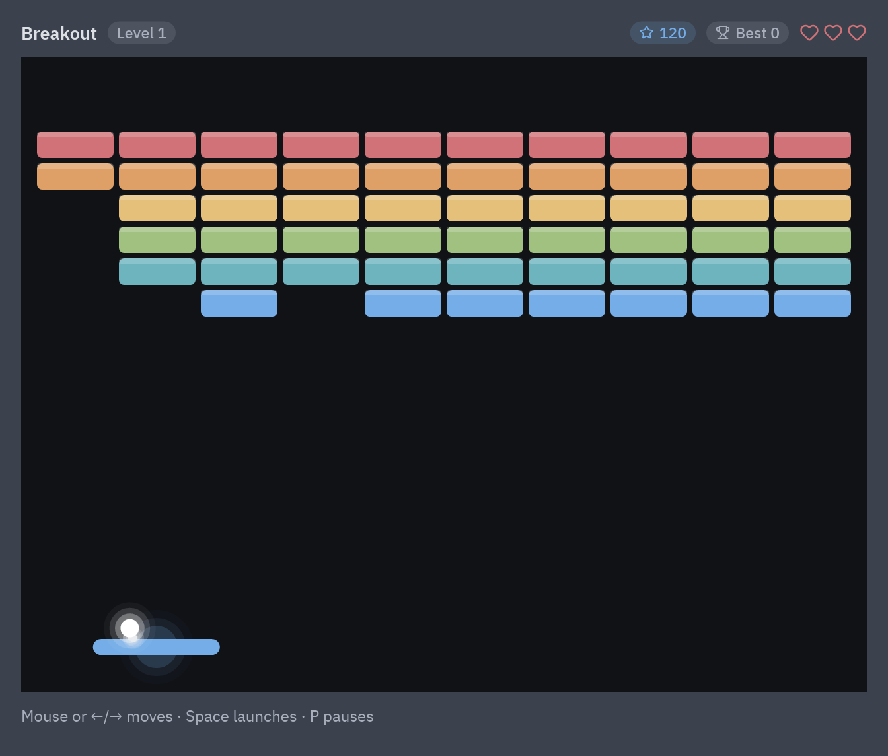

import { Code, Steps, Aside } from '@astrojs/starlight/components';
import source from '../../../../../examples/games/breakout.py?raw';

Breakout needs smooth movement, so instead of a timer it uses `pz.frames`: a callback that
runs once per displayed frame with the time since the previous one. You will learn the
frame loop, continuous input with `pz.pressed()`, collisions with `pyzed.game`, and the
small touches that make a game feel good: particles, combos and screen shake.



<Steps>

1. **Bricks as boxes.** `game.Rect` is a box with collision helpers. Each brick keeps its
   rectangle, color, points and how many hits it takes:

   ```python
   from pyzed import draw, game, ui

   def build_level(self):
       self.bricks = []
       for row in range(BRICK_ROWS):
           for col in range(BRICK_COLS):
               rect = game.Rect(left + col * (BRICK_W + BRICK_GAP),
                                BRICK_TOP + row * (BRICK_H + BRICK_GAP), BRICK_W, BRICK_H)
               hits = 2 if self.level > 1 and row < self.level - 1 else 1
               self.bricks.append({"rect": rect, "color": ROW_COLORS[row], "hits": hits,
                                   "points": (BRICK_ROWS - row) * 10})
   ```

2. **The frame loop.** Return `pz.frames(self.tick)` and Pyzed calls `tick(dt)` before
   every frame. Everything moves by *speed × dt*, so the game runs at the same speed on a
   60 Hz laptop and a 144 Hz monitor:

   ```python
   def subscriptions(self):
       return [pz.frames(self.tick)]

   def tick(self, dt):
       self.sparks.update(dt)
       self.shake.update(dt)
       if self.paused or self.over:
           return
       move = game.axis(("left", "a"), ("right", "d"))    # -1, 0 or 1 from held keys
       self.paddle_x = game.clamp(self.paddle_x + move * 520 * dt, PADDLE_W / 2, W - PADDLE_W / 2)
       ...
   ```

   `game.axis` reads `pz.pressed()`, the set of keys held right now. That is what makes
   movement continuous: `on_key` would only fire on presses (and on the keyboard's repeat).

3. **The mouse too.** The canvas reports the pointer in its own coordinates, so the paddle
   can follow it and a click can launch the ball:

   ```python
   pz.canvas(shapes, width=W, height=H, on_move=self.mouse,
             on_press=lambda x, y: self.launch(), cursor="crosshair")

   def mouse(self, x, y):
       self.paddle_x = game.clamp(x, PADDLE_W / 2, W - PADDLE_W / 2)
   ```

4. **Moving the ball without tunneling.** A fast ball could jump over a thin brick in one
   frame. Splitting the frame into sub-steps no longer than the ball's radius fixes it:

   ```python
   steps = max(1, math.ceil(self.speed * dt / BALL_R))
   for _ in range(steps):
       if self.advance(dt / steps):     # True when the ball was lost
           break
   ```

5. **Bouncing.** `game.circle_rect` says whether a circle touches a box and from which side,
   as a direction `(nx, ny)`. Bouncing is then one line per axis. On the paddle, the point
   of contact chooses the angle, which is what lets the player aim:

   ```python
   for brick in self.bricks:
       normal = game.circle_rect(self.ball_x, self.ball_y, BALL_R, brick["rect"])
       if normal:
           nx, ny = normal
           if nx:
               self.vx = abs(self.vx) * nx
           if ny:
               self.vy = abs(self.vy) * ny
           ...

   if self.vy > 0 and game.circle_rect(self.ball_x, self.ball_y, BALL_R, self.paddle):
       offset = (self.ball_x - self.paddle_x) / (PADDLE_W / 2)      # -1 … 1
       angle = math.radians(-90 + 60 * game.clamp(offset, -1, 1))
       self.vx, self.vy = math.cos(angle) * self.speed, math.sin(angle) * self.speed
   ```

6. **Juice: particles, combos and shake.** `game.Particles` is a tiny particle system:
   `burst` when something happens, `update(dt)` every frame, `shapes()` to draw. A combo
   multiplies the points of bricks broken without touching the paddle, and `game.Shake`
   moves the whole scene a few pixels on every hit:

   ```python
   self.sparks = game.Particles(gravity=420, drag=1.5)
   self.shake = game.Shake()

   # when a brick breaks:
   self.combo += 1
   self.score += brick["points"] * self.combo
   self.sparks.burst(cx, cy, count=22, color=[brick["color"], "#ffffff"])
   self.shake.kick(2 + min(self.combo, 6))

   # in the scene, the translate goes first so everything after it shakes:
   shapes = [draw.background("#101216"), *self.shake.shapes()]
   ...
   shapes += self.sparks.shapes(glow=True)
   shapes += game.glow(self.ball_x, self.ball_y, BALL_R, "#ffffff", layers=3)
   ```

7. **HUD.** Lives are three `heart` icons, the combo is a badge that only appears from ×2,
   and the "Level 1 · Space to launch" banner is a `glass` card stacked over the canvas:

   ```python
   hearts = pz.row([pz.icon("heart", size=15, color="#d07277" if i < self.lives else t.border)
                    for i in range(3)], spacing=3)
   board = pz.stack([self.scene(t), self.banner()], width=W, height=H)
   ```

</Steps>

<Aside type="tip">
Logic that only depends on `dt` is easy to test: create the app, call `tick(1 / 60)` a few
hundred times and check the score, lives or bricks left. No window is needed.
</Aside>

## Full code

<Code code={source} lang="py" title="examples/games/breakout.py" />

```bash
python examples/games/breakout.py
```
