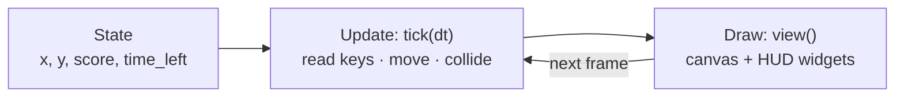

import { Aside, Code, Steps, LinkCard } from '@astrojs/starlight/components';
import Media from '../../../components/Media.astro';
import Run from '../showcase/_run.mdx';
import source from '../../../../../examples/games/coin_chase.py?raw';

A game is a program that **keeps running whether you press a key or not**. Every few milliseconds it looks at
the keys, moves things a little and draws everything again. In this first step of the path you build
*Coin Chase*: a glowing orb you steer with the arrows, a coin to grab, a 30-second clock and a score. It is
small, but it has every part a real game has.

<Media clip="game-first" alt="A cyan orb gliding over a dark grid toward a spinning gold coin; when it touches the coin a ring pops and the coin reappears somewhere else" caption="Coin Chase: the orb is steered with held keys, and the score and the clock are ordinary widgets." eager />

| Goal | Time | Level | You need |
| --- | --- | --- | --- |
| A complete game with a loop, held keys, a timer and a score | 25 minutes | Beginner | Python installed and Pyzed ([Installation](/pyzed/getting-started/installation/)); no game experience |

## What you'll learn

- The three parts of every game: **state**, **update** and **draw**.
- Run code **once per frame** with `pz.frames(self.tick)`.
- Move things by **speed × `dt`**, so the game runs at the same speed on every screen.
- Read the keys that are **held down** (`game.vector`) and the ones that are **pressed once** (`on_key`).
- Pause the game (and the CPU) by returning no subscriptions.

Play it first:

<Run file="examples/games/coin_chase.py" />

## The three parts



Pyzed calls `tick(dt)` before every frame the screen shows (60, 120 or 144 times a second), then calls `view()`
to draw. You never write the loop yourself; you only say what happens in one frame.

<Steps>

1. **The state.** Everything the game needs to remember lives in attributes of the app. `reset()` sets them, so
   the same method starts the first round and every new one:

   ```python
   W, H = 560, 380
   SPEED = 260          # pixels per second
   PLAYER_R = 14
   COIN_R = 9
   ROUND = 30.0         # seconds per round

   class CoinChase(pz.App):
       def __init__(self, seed=None):
           self.random = random.Random(seed)
           self.held = None        # the keys held down; None reads the keyboard
           self.best = 0
           self.reset()

       def reset(self):
           self.x, self.y = W / 2, H / 2
           self.score = 0
           self.time_left = ROUND
           self.paused = self.over = False
           self.pops = []          # [x, y, age]: rings that grow and fade where a coin was taken
           self.clock = 0.0
           self.coin = self.new_coin()
   ```

   `held` is for tests and demos: they set it to `{"right"}` to steer without a keyboard. When it is `None`
   the game reads the real keys.

2. **Turn the loop on.** `subscriptions()` returns what should be running right now. `pz.frames(self.tick)`
   means "call `tick` on every frame". Pyzed asks again after every change, so returning nothing pauses the
   game, and the CPU rests:

   ```python
   def subscriptions(self):
       if self.paused or self.over:
           return []
       return [pz.frames(self.tick)]
   ```

3. **Move by speed × dt.** `dt` is the number of seconds since the last frame (about `0.0167` at 60 Hz). If
   you moved by a fixed 4 pixels per frame, the orb would go twice as fast on a 120 Hz screen. Multiplying by
   `dt` gives *pixels per second* instead:

   ```python
   def tick(self, dt):
       self.clock += dt
       self.time_left = max(0.0, self.time_left - dt)

       dx, dy = game.vector(held=self.held)          # arrows / WASD, diagonals normalized
       self.x = game.clamp(self.x + dx * SPEED * dt, PLAYER_R, W - PLAYER_R)
       self.y = game.clamp(self.y + dy * SPEED * dt, PLAYER_R, H - PLAYER_R)
   ```

   `game.vector()` turns the arrow keys and WASD into a direction: `(1, 0)` for right, `(0.71, -0.71)` for
   up-right (so diagonals are not faster). `game.clamp` keeps the orb inside the board.

4. **Did it touch the coin?** Two circles touch when the distance between their centers is smaller than their
   two radii added together. `math.hypot` measures that distance:

   ```python
   cx, cy = self.coin
   if math.hypot(cx - self.x, cy - self.y) < PLAYER_R + COIN_R:
       self.score += 1
       self.pops.append([cx, cy, 0.0])
       self.coin = self.new_coin()

   for pop in self.pops:
       pop[2] += dt
   self.pops = [p for p in self.pops if p[2] < 0.4]

   if self.time_left <= 0:
       self.over = True
       self.best = max(self.best, self.score)
   ```

   Each "pop" is a ring that lives for 0.4 seconds. Effects like this are the cheapest way to make a game
   feel good; the [tips page](/pyzed/games/tips/#juice) has more.

5. **Keys pressed once.** Holding a key moves the orb; *pressing* one does something once. `on_key` receives
   every press as a string:

   ```python
   def on_key(self, combo):
       if combo == "space" and not self.over:
           self.paused = not self.paused
       elif combo == "enter" and self.over:
           self.reset()
   ```

6. **Draw the frame.** `view()` turns the state into a picture. The board is a `pz.canvas` with shapes from
   `pyzed.draw`; the coin squashes its width with `cos` so it seems to spin, and `game.glow` adds a soft light:

   ```python
   def board(self):
       shapes = [draw.background("#0b0e14")]
       ...
       for x, y, age in self.pops:
           k = age / 0.4                             # 0 -> 1 over the ring's life
           shapes.append(draw.circle(x, y, COIN_R + k * 26, stroke=game.rgba("#fde68a", 1 - k), width=3))
       shapes += game.glow(self.x, self.y, PLAYER_R, "#22d3ee", layers=4, strength=0.5)
       return pz.canvas(shapes, width=W, height=H)
   ```

7. **The HUD is just widgets.** The score, the clock and the pause card are regular Pyzed components stacked
   over the canvas with `pz.stack`, so they get the theme, icons and the `glass` effect for free:

   ```python
   hud = pz.row([
       ui.label("Coin Chase", weight="semibold"),
       pz.hspace(),
       ui.badge(f"{self.score} coins", icon="circle-dollar-sign", tint="warning"),
       ui.badge(f"{math.ceil(self.time_left)} s", icon="timer",
                tint="error" if self.time_left < 5 else "accent"),
   ], spacing=8, align="center")
   play = pz.stack([self.board(), self.overlay()], width=W, height=H)
   ```

</Steps>

<Aside type="tip" title="Why not move 4 pixels per frame?">
Many first games do, and they run at half speed on a 30 fps laptop and double speed on a 144 Hz monitor.
Always multiply speeds by `dt`. Pyzed also caps `dt` at a quarter of a second, so a breakpoint or a dragged
window never makes the orb teleport.
</Aside>

<Aside type="note" title="What about frames per second?">
`pz.frames` follows the screen's refresh rate (vsync). Where the display cannot wait for vsync, it stops at
`max_fps` (240 by default): `pz.frames(self.tick, max_fps=60)` caps it lower.
</Aside>

## Try this

- Make the orb faster for a second after each coin (a `boost` timer that counts down in `tick`).
- Add a second, rarer coin worth 5 points that disappears after 3 seconds.
- Save the best score to a file; [step 8](/pyzed/games/high-scores/) shows how.

## Full code

<Code code={source} lang="py" title="examples/games/coin_chase.py" />

## Next

<LinkCard title="2. Sprites and animation" href="/pyzed/games/sprites-animation/" description="Pixel-art characters from text, frame animation, flipping and tweens." />
