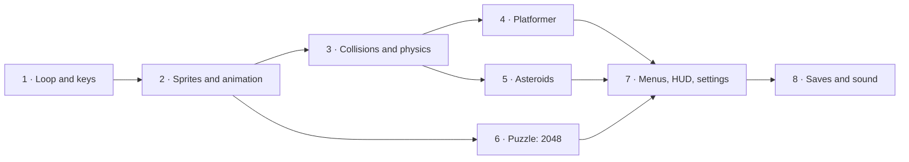

import { Aside, CardGrid, LinkCard } from '@astrojs/starlight/components';
import NavCards from '../../../components/NavCards.astro';
import ClipGallery from '../../../components/ClipGallery.astro';
import Run from '../showcase/_run.mdx';

Pyzed is a UI library, but everything a 2D game needs is already in it: a GPU-drawn
`pz.canvas`, a loop that runs once per displayed frame, the keys held down right now, and
the whole widget library to build menus and HUDs on top of the action. Every game on these
pages is a complete, playable program in
[`examples/games/`](https://github.com/albakore/pyzed/tree/main/examples/games), tested by the
test suite on every change.

<ClipGallery
	items={[
		{ clip: 'game-platformer', title: 'Pixel Run', href: '/pyzed/games/platformer/', alt: 'A hero running and jumping through a scrolling level with coins and slimes' },
		{ clip: 'game-asteroids', title: 'Rock Storm', href: '/pyzed/games/asteroids/', alt: 'A ship shooting rocks that split into sparks' },
		{ clip: 'game-2048', title: '2048', href: '/pyzed/games/puzzle-2048/', alt: 'Numbered tiles sliding and merging on a 4 by 4 board' },
		{ clip: 'game-menus', title: 'Orb Rush menus', href: '/pyzed/games/menus-hud/', alt: 'A title menu, a glass HUD, a pause menu and a settings panel' },
		{ clip: 'game-high-scores', title: 'Target Rush', href: '/pyzed/games/high-scores/', alt: 'Clicking targets, entering a name and a leaderboard' },
		{ clip: 'game-sprites', title: 'Walker', href: '/pyzed/games/sprites-animation/', alt: 'A pixel-art hero walking, jumping and collecting coins' },
		{ clip: 'game-jump-arc', title: 'Jump Lab', href: '/pyzed/games/collisions-physics/', alt: 'A box jumping between platforms with its jump arc traced' },
		{ clip: 'game-first', title: 'Coin Chase', href: '/pyzed/games/first-game/', alt: 'An orb collecting coins' },
		{ clip: 'neon-invaders', title: 'Neon Invaders', href: '/pyzed/games/neon-invaders/', alt: 'Waves of neon invaders, shots and explosions' },
		{ clip: 'breakout', title: 'Breakout', href: '/pyzed/games/breakout/', alt: 'A ball breaking a wall of colored bricks' },
		{ clip: 'snake', title: 'Snake', href: '/pyzed/games/snake/', alt: 'A snake growing as it eats' },
	]}
/>

## Learn to make games

A path from zero to complete games. Each step is a tutorial with a goal, the time it takes, what you need to
know first, the full code and ideas to keep going. If you have never written a game, start at 1; if you have,
jump to what you need.



<NavCards
	items={[
		{ title: '1. Your first game', text: 'Coin Chase: the frame loop, speed × dt, held keys, a timer, a score and a pause.', href: '/pyzed/games/first-game/', icon: 'rocket', tag: 'Start here' },
		{ title: '2. Sprites and animation', text: 'Pixel art from text, sprite sheets played frame by frame, flipping and tweens with easing.', href: '/pyzed/games/sprites-animation/', icon: 'seti:image', tag: 'Beginner' },
		{ title: '3. Collisions and physics', text: 'Velocity, gravity, box and circle collisions, coyote time and a debug view.', href: '/pyzed/games/collisions-physics/', icon: 'puzzle' },
		{ title: '4. A platformer', text: 'A tile map in text, a camera with parallax, slimes to stomp, coins, lives and a flag.', href: '/pyzed/games/platformer/', icon: 'laptop' },
		{ title: '5. Asteroids and particles', text: 'Rotation and thrust, wrap-around space, splitting rocks and particles everywhere.', href: '/pyzed/games/asteroids/', icon: 'star' },
		{ title: '6. A puzzle: 2048', text: 'Rules as testable functions, tweened tiles, swipes and a loop that sleeps between moves.', href: '/pyzed/games/puzzle-2048/', icon: 'seti:xls' },
		{ title: '7. Menus, HUD and settings', text: 'Scenes, transitions, keyboard menus, a glass HUD, pause and a settings screen.', href: '/pyzed/games/menus-hud/', icon: 'setting' },
		{ title: '8. High scores and saves', text: 'A leaderboard saved safely, name entry, sound effects, and shipping the game.', href: '/pyzed/games/high-scores/', icon: 'document' },
		{ title: 'Game dev tips', text: 'Fixed timesteps, performance, input buffering, juice, organizing state and testing.', href: '/pyzed/games/tips/', icon: 'information' },
	]}
/>

<Aside type="tip" title="Never programmed a game?">
Start with [1. Your first game](/pyzed/games/first-game/): it explains every line, and the game is playable after
the third step. [A game loop](/pyzed/tutorials/advanced/game-loop/) (Dodge, in the Tutorials) is a good second
read.
</Aside>

## Complete games

Three bigger games to read, play and take apart. They grow in difficulty:

<CardGrid>
	<LinkCard title="Snake" href="/pyzed/games/snake/" description="Grid movement on a fixed timer, a key queue, game over and restart. ~150 lines." />
	<LinkCard title="Breakout" href="/pyzed/games/breakout/" description="A 60 fps loop with pz.frames, held keys and the mouse, ball physics, particles and shake." />
	<LinkCard title="Neon Invaders" href="/pyzed/games/neon-invaders/" description="Pixel-art sprites, waves, power-ups, neon glow and a glass HUD with bloom." />
</CardGrid>

Run any game from the repository folder; change the file name for the others:

<Run file="examples/games/neon_invaders.py" />

## The building blocks

| What | API | Used for |
| --- | --- | --- |
| Frame loop | `pz.frames(callback)` in `subscriptions()` | `callback(dt)` once per frame (in sync with the screen); `dt` is the seconds since the last one. |
| Fixed-rate timer | `pz.every(seconds, callback)` | Turn-based or grid games that step at a set pace (Snake). |
| Key presses | `on_key(combo)` | One-off actions: jump, pause, restart (`"space"`, `"enter"`, `"ctrl-r"`). |
| Key releases | `on_key_up(key)` | Charge-and-release mechanics, stopping a sound. |
| Held keys | `pz.pressed()`, `pz.is_pressed("left", "a")` | Continuous movement and auto-fire, polled every frame. |
| Movement | `game.axis(neg, pos)`, `game.vector()` | -1/0/1 from two key groups; a normalized direction from arrows/WASD. |
| Drawing | `pz.canvas([...])` with `pyzed.draw` | Rectangles, circles, paths, text, transforms. |
| Sprites | `draw.image(src, x, y, w, h)` and `game.sprite(rows, palette)` | Image files (decoded once and cached) or pixel art written as text. |
| Collisions | `game.Rect`, `game.circle_rect` | Box overlaps; where a ball hits a box, to bounce it. |
| Effects | `game.glow`, `game.Particles`, `game.Shake` | Neon lights, explosions and sparks, screen shake. |
| HUD and menus | `pz.stack([canvas, widgets])` | Scores, health bars and pause screens with `glass`, `bloom` and animations. |

### The loop

A game is a regular `pz.App`. Return `pz.frames(self.tick)` from `subscriptions()` and
the runtime calls `tick(dt)` before every frame. Move things by *speed × dt* so they go
just as fast at 60, 120 or 144 Hz:

```python
import pyzed as pz
from pyzed import draw, game

class Ship(pz.App):
    size = (480, 320)

    def __init__(self):
        self.x, self.y = 240, 160

    def subscriptions(self):
        return [pz.frames(self.tick)]

    def tick(self, dt):
        dx, dy = game.vector()             # arrows / WASD, diagonals normalized
        self.x += dx * 300 * dt
        self.y += dy * 300 * dt

    def view(self):
        return pz.canvas([draw.background("#0b0e14"),
                          *game.glow(self.x, self.y, 14, "#22d3ee")], width=480, height=320)

pz.run(Ship)
```

`dt` is capped at a quarter of a second, so dragging the window or hitting a breakpoint
never makes the game jump ahead. Where the display does not wait for vsync (software
rendering), `max_fps` (240 by default) keeps the loop from spinning the CPU.

<Aside type="tip">
Stop the loop when nothing moves: `subscriptions()` is evaluated after every update, so
`return [] if self.paused else [pz.frames(self.tick)]` pauses the game and the CPU.
</Aside>

### Input

`on_key` is for actions that happen once per press; `pz.pressed()` is for things that
happen *while* a key is down. Both see every key, whatever widget has focus.

```python
def on_key(self, combo):          # "space", "p", "shift-r"...
    if combo == "p":
        self.paused = not self.paused

def tick(self, dt):
    if pz.is_pressed("space") and self.cooldown <= 0:
        self.fire()               # auto-fire while Space is held
```

Mouse input comes from the canvas itself: `on_move(x, y)`, `on_press(x, y)`,
`on_release()`, `on_right_press(x, y)` and `on_scroll(dx, dy)`, in canvas coordinates.

### Sprites

`draw.image` draws a PNG/JPEG (or raw RGBA bytes) into a box, optionally rotated and
faded. It is decoded once per source and cached, so drawing the same sprite hundreds of
times per frame is cheap. Use `pixelated=True` for pixel art scaled up.

```python
draw.image("assets/ship.png", self.x - 16, self.y - 16, 32, 32, rotation=self.angle)
```

For retro games you don't even need files: `game.sprite` turns text into pixel art, with
one shape per color however big the sprite is.

```python
INVADER = ["..#.....#..",
           "...#...#...",
           "..#######..",
           ".##.###.##.",
           "###########"]
game.sprite(INVADER, {"#": "#a3e635"}, x, y, scale=4)
```

### HUD and menus are just widgets

Stack widgets over the canvas with `pz.stack`. Scores, health bars, badges and pause
menus are ordinary Pyzed components, so they get themes, `glass` panels, `bloom`, and
entrance animations for free — the hard part of game UI is already done.

```python
hud = pz.container(pz.row([score, pz.hspace(), ui.badge(f"Wave {self.wave}")]),
                   padding=(8, 14)).style(glass=True, radius=12)
return pz.stack([self.scene(), hud], width=W, height=H)
```

## Performance tips

More in [Game dev tips](/pyzed/games/tips/).

- Keep the per-frame work in Python small: plain lists and numbers, no allocations of big
  structures every frame.
- Batch shapes: `draw.rects` draws many rectangles of one color as a single shape (that is
  what `game.sprite` uses).
- Cap particles (`game.Particles(limit=...)`) and drop bullets that leave the screen.
- Only the canvas changes every frame; widgets in the HUD are cheap to rebuild, but
  `pz.memo` can cache expensive ones.
- Test game logic without a window: call `tick(1 / 60)` in a loop and assert on the state,
  as [`tests/test_game.py`](https://github.com/albakore/pyzed/blob/main/tests/test_game.py)
  does. `App.screenshot` renders any moment of the game to a PNG.
