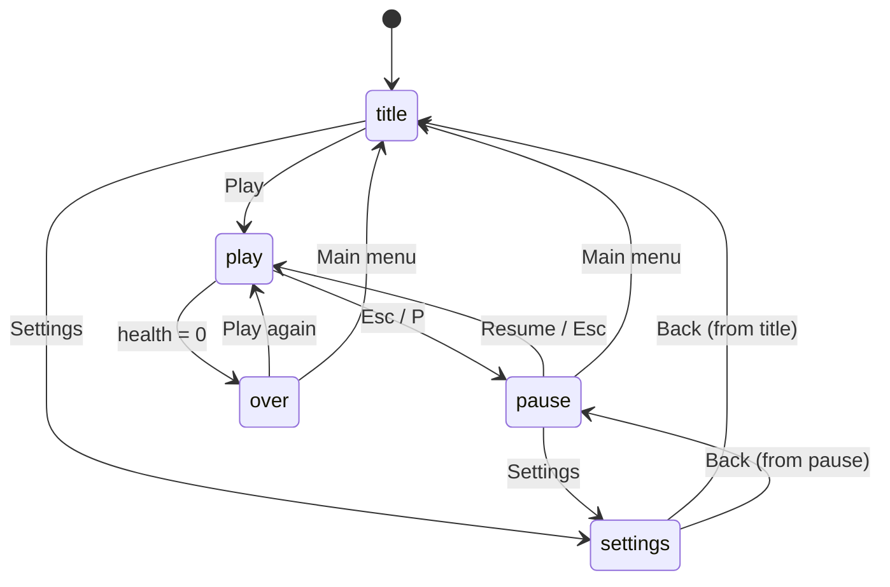

import { Aside, Code, Steps, LinkCard } from '@astrojs/starlight/components';
import Media from '../../../components/Media.astro';
import Run from '../showcase/_run.mdx';
import source from '../../../../../examples/games/menus.py?raw';

Players see your menus before they see your game. This is where Pyzed shines: it is a UI library, so buttons,
sliders, switches, glass panels and glowing text are already there and already look good. This step wraps a
tiny game, *Orb Rush*, in a title screen, a HUD, a pause menu and a settings screen, with transitions between
them.

<Media clip="game-menus" alt="A glowing ORB RUSH title fades in over a starfield with a menu of Play, Settings and Quit; the selection moves, the game starts with a glass HUD, then pauses to a glass menu and opens a Settings panel with sliders, a segmented control and switches" caption="Orb Rush: every panel fades and slides in from one clock per scene, and the menus work with the keyboard and the mouse." eager />

| Goal | Time | Level | You need |
| --- | --- | --- | --- |
| A title menu, HUD, pause menu and settings screen around a game | 45 minutes | Intermediate | [1. Your first game](/pyzed/games/first-game/); the [component library](/pyzed/library/) helps |

## What you'll learn

- Organize a game in **scenes** (`title`, `play`, `pause`, `settings`, `over`).
- Animate **transitions** with one clock per scene and `.style(opacity=..., translate=...)`.
- Build menus that work with **arrow keys and Enter** and with **clicks**.
- A **HUD** with bloom, a health bar, a timer and an FPS counter.
- A **settings screen** with `ui.slider`, `ui.switch` and `ui.segmented` whose values the game reads.

<Run file="examples/games/menus.py" />



<Steps>

1. **One attribute decides the scene.** `go()` switches scene and restarts `since`, the seconds since the
   scene began, which drives every transition. Settings remembers where it was opened from, so Back returns
   to the title or to the pause menu:

   ```python
   def go(self, scene):
       if scene == "settings":
           self.came_from = self.scene
       self.scene = scene
       self.since = 0.0
       self.selected = 0
   ```

   `tick` only runs the game in its scene, so pausing is free: `if self.scene == "play": self.play(dt)`. The
   stars keep moving behind the menus, so the screen never looks frozen.

2. **Menus as data.** Each scene's menu is a list of `(label, action)`. One method does what an action means,
   whether it came from a key or a click, and *Quit* returns `self.close()`, a command that closes the window:

   ```python
   MENUS = {
       "title": [("Play", "play"), ("Settings", "settings"), ("Quit", "quit")],
       "pause": [("Resume", "resume"), ("Settings", "settings"), ("Main menu", "menu")],
       "over": [("Play again", "play"), ("Main menu", "menu")],
       "settings": [("Back", "back")],
   }

   def choose(self, action):
       if action == "play":
           self.reset_round()
           self.go("play")
       ...
       elif action == "quit":
           return self.close()
   ```

3. **Keyboard navigation.** Up and Down move `selected` (wrapping around with `%`), Enter chooses. The selected
   button is drawn `solid` with an arrow; the others are `ghost`. Clicking any of them calls the same `choose`:

   ```python
   items = MENUS[self.scene]
   if combo in ("down", "s"):
       self.selected = (self.selected + 1) % len(items)
   elif combo in ("up", "w"):
       self.selected = (self.selected - 1) % len(items)
   elif combo in ("enter", "space"):
       return self.choose(items[self.selected][1])
   ```

4. **Transitions from one clock.** `appear(delay)` goes from 0 to 1 over 0.35 s, `delay` seconds after the
   scene started, with an ease-out. Any widget can fade and slide in with it, and giving each menu item a
   slightly bigger delay makes them arrive one after another:

   ```python
   def appear(self, delay=0.0):
       return ease_out(game.clamp((self.since - delay) / FADE, 0.0, 1.0))

   def slide_in(self, widget, delay=0.0, distance=24):
       a = self.appear(delay)
       return widget.style(opacity=a, translate=(0, (1 - a) * distance))

   # each item of a menu:
   items.append(self.slide_in(pz.container(button, width=220), delay + i * 0.06, 16))
   ```

   Because the values come from your own clock, the transition is exactly the same every time, in screenshots
   and in tests too.

5. **A glowing title and a glass HUD.** `bloom` makes the bright parts of a widget glow; with the border and
   shadow removed, only the text glows. The HUD is a row in a `glass` container (a blurred, tinted panel), and
   it slides down from the top when the game starts:

   ```python
   def title_text(self, text, color, size=48):
       return pz.container(pz.text(text, size=size, weight="bold", color="#ffffff"), padding=(4, 16)).style(
           bloom=(color, 0.9), border_width=0, shadow=("#00000000", (0, 0), 0))

   bits = [
       self.title_text(f"{self.score:05d}", NEON["cyan"], size=22),
       pz.hspace(),
       pz.row([pz.icon("heart", size=14, color=NEON["red"]),
               pz.container(ui.progress(self.health, max=3, tint=NEON["red"], height=6), width=90)],
              spacing=6, align="center"),
       ui.badge(f"{self.time:4.1f} s", icon="timer", tint="text_muted"),
       ui.badge(f"{self.fps:.0f} fps", icon="gauge", tint="success") if self.settings["fps"] else None,
       pz.row([ui.kbd("Esc"), ui.muted("pause", size="sm")], spacing=4, align="center"),
   ]
   ```

   `None` in a row is skipped, which is the easy way to show something only sometimes (the FPS counter).

6. **The pause menu.** The game is still drawn underneath; on top go the HUD, a dark layer that fades in and
   the menu panel. `pz.stack` needs the size of the board so that the panel can center itself:

   ```python
   return pz.stack([self.hud(), pz.container(width="fill", height="fill").style(
       background=game.rgba("#000000", 0.35 * self.appear())), self.panel(body)], width=W, height=H)
   ```

7. **Settings the game reads.** Settings are a plain dict. Each control writes one key, and the game reads them
   where they matter: the difficulty scales the speed, the shake switch decides whether a hit shakes the screen:

   ```python
   self.settings = {"music": 0.6, "effects": 0.8, "difficulty": "Normal", "shake": True, "fps": False}

   rows = [
       ui.field("Music", pz.container(ui.slider(s["music"], setter("music"), show_value=True), width=180)),
       ui.field("Effects", pz.container(ui.slider(s["effects"], setter("effects"), show_value=True), width=180)),
       ui.field("Difficulty", ui.segmented(list(DIFFICULTY), s["difficulty"], setter("difficulty"), size="sm")),
       ui.field("Screen shake", ui.switch(s["shake"], setter("shake"))),
       ui.field("Show FPS", ui.switch(s["fps"], setter("fps"))),
   ]
   ```

</Steps>

<Aside type="note" title="Volume sliders">
Here the Music and Effects sliders only store a value, since Orb Rush makes no sound.
[Step 8](/pyzed/games/high-scores/#sound-effects) adds sound effects with `pyzed.audio`, shows how a slider
sets their volume, and saves these settings to disk.
</Aside>

<Aside type="tip" title="Accessibility is a setting too">
Offer a switch for screen shake and flashes; some players get motion sick. `pz.system_reduced_motion()` tells
you whether the system asks for less motion, a good default for that switch.
</Aside>

<Aside type="tip" title="See also">
The [Game main menu](/pyzed/showcase/main-menu/) showcase is a title screen with an interactive shader backdrop,
and the [Game HUD](/pyzed/showcase/hud/) one is a full sci-fi HUD.
</Aside>

## Try this

- Add a **Controls** page in Settings that lists the keys with `ui.kbd`.
- Add a 3-2-1 countdown scene between the title and the game.
- Animate the Game over title with `.animate("pulse", repeat="infinite")`.

## Full code

<Code code={source} lang="py" title="examples/games/menus.py" />

## Next

<LinkCard title="8. High scores, saves and sound" href="/pyzed/games/high-scores/" description="Save a leaderboard safely, enter a name, and add sound effects." />
