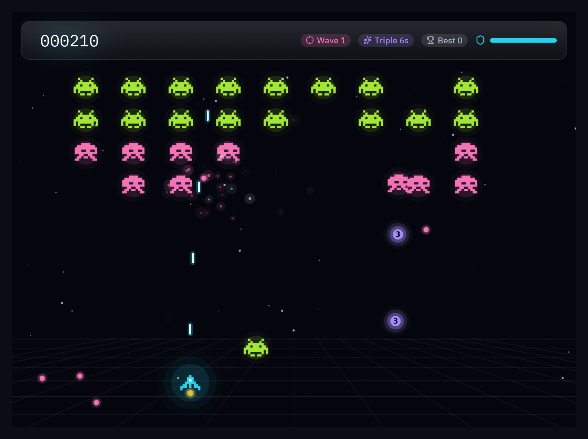

import { Code, Steps, Aside } from '@astrojs/starlight/components';
import source from '../../../../../examples/games/neon_invaders.py?raw';
import Commands from '../../../components/Commands.astro';

The last demo puts everything together in a shooter that looks like a modern indie game:
a parallax starfield, pixel-art invaders that march and dive, auto-fire, a triple-shot
power-up, neon lights everywhere, explosions, screen shake and a HUD of glass panels and
glowing text drawn by the widget library.



<Steps>

1. **Pixel art in plain text.** Sprites are lists of strings; `game.sprite` maps each
   character to a color and draws one shape per color, so a 9×7 ship costs two shapes:

   ```python
   SHIP = ["....#....",
           "...###...",
           "...#@#...",
           "..#####..",
           ".##.#.##.",
           "###.#.###",
           "#.......#"]

   game.sprite(SHIP, {"#": NEON["cyan"], "@": "#ffffff"}, self.x - 13.5, self.y - 10.5, scale=3)
   ```

   Prefer image files? `draw.image("ship.png", x, y, w, h, rotation=angle)` draws them,
   decoded once and cached.

2. **Flying and auto-fire.** `game.vector()` turns arrows and WASD into a direction
   (diagonals normalized), and `pz.is_pressed("space")` fires while the key is held, with
   a cooldown:

   ```python
   def fly(self, dt):
       dx, dy = game.vector()
       self.x = game.clamp(self.x + dx * PLAYER_SPEED * dt, 20, W - 20)
       self.y = game.clamp(self.y + dy * PLAYER_SPEED * dt, H * 0.55, H - 30)
       self.cooldown -= dt
       if game.is_pressed("space") and self.cooldown <= 0:
           self.fire()

   def fire(self):
       self.cooldown = FIRE_DELAY
       for a in ((-12, 0, 12) if self.triple else (0,)):     # the power-up fans out
           r = math.radians(a - 90)
           self.shots.append([self.x, self.y - 14, math.cos(r) * 640, math.sin(r) * 640])
   ```

3. **A formation that marches and dives.** The formation slides side to side and drops a
   little at each edge; now and then an invader leaves it and dives towards the ship,
   steering a bit every frame:

   ```python
   self.march += self.direction * speed * dt
   if abs(self.march) > 60:
       self.direction = -self.direction
       self.drop = min(self.drop + 10, 140)

   for inv in self.invaders:
       if inv.diving:
           inv.vx += (self.x - inv.x) * 1.4 * dt      # home in on the ship
           inv.x += inv.vx * dt
           inv.y += inv.vy * dt
       elif self.random.random() < dt * (0.02 + 0.01 * self.wave):
           inv.diving, inv.vx, inv.vy = True, 0.0, 170 + 20 * self.wave
   ```

   Using `random.random() < rate * dt` keeps events at the same average rate whatever the
   frame rate.

4. **Neon lights.** A canvas has no blur, but light is easy to fake: `game.glow` draws a
   few translucent circles of growing size behind a bright core. Lasers are two lines,
   a wide transparent one under a thin white one:

   ```python
   shapes += game.glow(cx, cy, 10, color, layers=2, strength=0.25, core=False)  # invader halo
   shapes += game.glow(x, y, 3.5, NEON["pink"], layers=2, strength=0.6)         # enemy bullet
   shapes.append(draw.line(x, y, x, y + 12, stroke=game.rgba(NEON["cyan"], 0.3), width=7, cap="round"))
   shapes.append(draw.line(x, y, x, y + 12, stroke="#e0fbff", width=2.5, cap="round"))
   ```

   The starfield is three layers of dots that fall at different speeds (parallax), and a
   perspective grid at the bottom is a handful of `draw.line`s.

5. **Explosions and feedback.** Every kill bursts particles in the invader's color with a
   glow, and big hits shake the screen. After being hit the ship blinks and can't be hurt
   for a moment:

   ```python
   def explode(self, inv, big=False):
       cx, cy = inv.rect.center
       color = INVADER_COLORS[inv.kind]
       self.sparks.burst(cx, cy, count=40 if big else 26, color=[color, "#ffffff", color],
                         speed=(60, 300))
       self.shake.kick(10 if big else 3)
   ```

6. **A HUD with real UI effects.** This is where a UI toolkit shines. The score is text with
   `bloom` (light from its bright pixels), the bar is a `glass` panel that blurs the
   stars behind it, and the title and "WAVE 2" banners use entrance animations:

   ```python
   def neon(widget, color, intensity=1.0):
       """Bloom on the bright parts only, without the lit box edge."""
       return pz.container(widget, padding=(4, 12)).style(
           bloom=(color, intensity), border_width=0, shadow=("#00000000", (0, 0), 0))

   score = neon(pz.text(f"{self.score:06d}", size=22, font="mono", color="#ffffff"), NEON["cyan"], 0.8)
   bar = pz.row([score, pz.hspace(), ui.badge(f"Wave {self.wave}", icon="crosshair"), shield])
   hud = pz.container(bar, padding=(8, 14)).style(glass=True, radius=12, border=(1, "#ffffff22"))

   banner = neon(pz.text(f"WAVE {self.wave}", size=30, weight="bold"), NEON["lime"]).animate("zoom_in")
   board = pz.stack([self.scene(), banner, hud], width=W, height=H)
   ```

   

</Steps>

<Aside type="tip">
Everything on screen is rebuilt every frame from the game state, like any Pyzed view.
That keeps the code simple: there are no sprite objects to create, move or delete, just
lists that `view()` turns into shapes.
</Aside>

## Full code

<Code code={source} lang="py" title="examples/games/neon_invaders.py" />

<Commands
	uv={`uv run python examples/games/neon_invaders.py`}
	pip={`python examples/games/neon_invaders.py`}
	python={`{py} examples/games/neon_invaders.py`}
/>
