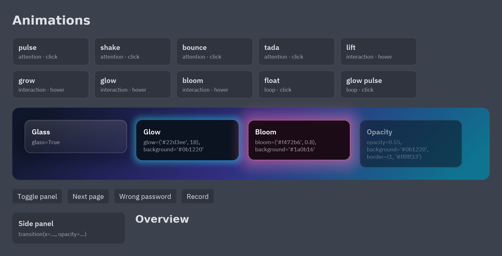

Every widget can animate. Animations run natively at the display's frame rate: Python describes
them once in `view()` and the Rust side plays them, so a running animation never calls your code.



```python
pz.text("Saved").animate("fade_in_up")                          # plays when it appears
card.animate("lift", on="hover")                                # forward on hover, back on leave
icon.animate("pulse", repeat="infinite")                        # loops
field.animate("shake", key=self.errors)                         # replays when key changes
button.animate(on="press", scale=0.96, duration=90)             # ad-hoc values
panel.transition(opacity=1 if self.open else 0, x=0 if self.open else -24)   # like CSS
```

Run [`examples/animations.py`](https://github.com/albakore/pyzed/blob/main/examples/animations.py) to try them all.
To move several widgets and your app's state together on one timeline, with play, pause and
seek, see [Timeline animations](/pyzed/guides/timeline/).

## animate()

`widget.animate(*animations, **options)` takes preset names, `pz.Animation` objects (or lists of
them) and these options, which override each animation's own timing:

| Option | Values |
| --- | --- |
| `on` | What plays it. `"mount"` (the default) plays when the widget appears. `"hover"`, `"press"`, `"focus"` and `"active"` play forward while the condition holds and back when it ends. `"click"` plays from the start on every click. |
| `duration`, `delay` | Milliseconds, or `"0.3s"` / `"300ms"`. |
| `easing` | A name from `pz.animation.EASINGS` (`"ease"`, `"ease_out_cubic"`, `"ease_out_back"`, `"spring"`...), a cubic Bézier `(x1, y1, x2, y2)` or `"steps(4)"`. |
| `repeat` | A count or `"infinite"`. |
| `direction` | `"normal"`, `"reverse"`, `"alternate"` or `"alternate_reverse"`. |
| `fill` | `"both"` (default), `"forwards"`, `"backwards"` or `"none"`, as in CSS. |
| `key` | Any value: when it changes, the animation restarts (an error shake, a "copied" flash). |
| `active` | `True` plays it (forward) and `False` plays it back: `animate("glow_pulse", active=self.recording)`. |
| `on_start`, `on_end` | A callable or message sent when it starts and ends. |

Calling `animate()` several times adds animations; each one keeps its own trigger:

```python
ui.button("Buy", self.buy).animate("fade_in_up").animate("lift", on="hover").animate("shrink", on="press")
```

### Property values

Without a preset, the property values *are* the animation. On `mount` the widget starts from them
and settles on its own look; on the other triggers it goes to them:

```python
pz.text("Hi").animate(opacity=0, y=12, duration=250)          # appears from below
card.animate(on="hover", scale=1.03, background="elevated")    # grows and lightens on hover
```

The animatable properties are:

| Property | Values |
| --- | --- |
| `opacity`, `scale` | Numbers (`scale` around the center). |
| `x`, `y` | Pixels or `"50%"` of the widget's own size. |
| `rotate` | Degrees clockwise around the center, or `"0.25turn"`, `"1.5rad"`, `"90deg"`. |
| `blur` | A gaussian blur of the widget, in pixels. |
| `background`, `border_color`, `color`, `glow_color` | Hex strings or theme tokens. |
| `radius`, `border_width`, `glow` | Pixels. |
| `width`, `height`, `padding`, `font_size` | Pixels. These change the layout, so the widgets around move with it. |

```python
icon.animate("spin")                                            # a loading spinner
card.animate(on="hover", rotate=-3, scale=1.02)                 # tilts on hover
sidebar.transition(width=240 if self.open else 56, duration=200)   # the content beside it reflows
title.transition(font_size=28 if self.big else 16)
```

`padding` animates the padding inside a container or button (all four sides follow the same
value); on any other widget it adds space around it. `font_size` changes every text inside.

## Keyframes

`pz.Animation` is a CSS `@keyframes` rule with its timing. Frames are a list (spread evenly) or a
dict from offsets (`0` to `1`, `"50%"`, `"from"`, `"to"`); a frame can set its own `easing`:

```python
wiggle = pz.Animation([{"x": 0}, {"x": -6}, {"x": 6}, {"x": 0}], duration=300)
beat = pz.Animation({0: {"scale": 1}, "30%": {"scale": 1.15, "easing": "ease_out"}, 1: {"scale": 1}},
                    duration=900, repeat="infinite")
heart.animate(beat)

pz.define_animation("wiggle", wiggle)        # now animate("wiggle") works anywhere
```

A property missing at the start or end goes from or to the widget's own value. `Animation.to_dict()`
and `Animation.from_dict()` save and load animations as JSON.

## Transitions

`widget.transition(**props)` sets property values and animates every change, like a CSS
`transition`. Change the values in `view()` and the widget moves to them:

```python
pz.container(menu).transition(x=0 if self.open else -240, opacity=1 if self.open else 0, duration=220)
row.transition(background="accent" if selected else "panel", easing="ease_out")
```

`duration` and `easing` apply to every property; give a property a dict to time it on its own:
`transition(scale={"value": 1.1, "duration": 90, "easing": "spring"})`.

## Presence and stagger

`pz.presence(content, key)` animates content in and out when `key` changes, keeping the old
content on screen while it leaves (page transitions, tabs, wizards):

```python
pz.presence(self.page_view(), key=self.page, enter="slide_in_right", exit="fade_out")
```

Give it an `id` when one line of code makes several presences (it defaults to the caller's file and line).

`pz.stagger(items, animation, step=40)` gives each item the same animation, each one starting
`step` milliseconds after the previous, so a list cascades in:

```python
pz.column(pz.stagger([row(item) for item in self.items], "fade_in_up", step=30))
```

## Window transitions

A window animates when it opens and closes with `transition` (a name from
`pz.animation.WINDOW_TRANSITIONS`, a preset or a `pz.Animation`) and, optionally, `exit_transition`:

```python
class Settings(pz.Window):
    transition = "zoom"            # fade, zoom, pop, slide_up, slide_down, slide_left, slide_right
    exit_transition = "fade_out"
```

The window stays open until its exit animation ends. See [Windows](/pyzed/guides/windows/).

## Effects

Effects are [style](/pyzed/theming/styles/) properties, so they work with `style()`, `pz.Style`
and named styles:

| Property | What it does |
| --- | --- |
| `opacity` | 0 to 1. Fades the widget and everything inside it. |
| `rotate` | Degrees clockwise (or `"0.25turn"`, `"1rad"`): draws the widget turned around its center. |
| `blur` | Pixels: blurs the widget and everything inside it. |
| `backdrop_blur` | Pixels: blurs what is behind the box, inside its rounded corners. |
| `glow` | A soft halo around the box: a color, a size (accent color) or `(color, size)`. |
| `bloom` | Light that spills from the bright parts of the widget: a color or `(color, intensity)` with an intensity from 0 to 1. |
| `glass` | A translucent panel that blurs what is behind it, with a light edge: `True`, a tint color or `{"tint": ..., "strength": 0.08, "blur": 20}`. |
| `translate` | `(x, y)` in pixels or `"50%"`: draws the widget moved, without changing the layout. |
| `scale` | Draws the widget bigger or smaller around its center. |

```python
pz.container(card).style(glass=True, radius=12, padding=16)
ui.button("Go", self.go).style(glow=("#22d3ee", 18))
badge.style(bloom=("accent", 0.8), opacity=0.9)
sticker.style(rotate=-8)
```


Rotation, blur, backdrop blur and bloom are drawn by the renderer: the widget is drawn on its own
layer, which is then turned, blurred or lit before it lands on the window. On a box (a widget with a
background or glass) bloom also adds a soft halo and a lit edge; on a bare text or icon it only glows, and glass a tinted gradient, a border and a shadow; any of those you set
yourself win. Glass shows best over a colorful background (a gradient or an image). Animations can
change `glow` and `glow_color` too: the `glow`, `bloom`, `glow_pulse` and `glow_flash` presets use them.

## Presets

`pz.animation.presets(category)` lists them; each has a `description`.

| Category | Presets |
| --- | --- |
| Entrance | `fade_in`, `fade_in_up`, `fade_in_down`, `fade_in_left`, `fade_in_right`, `slide_in_up`, `slide_in_down`, `slide_in_left`, `slide_in_right`, `zoom_in`, `pop_in`, `bounce_in`, `drop_in`, `blur_in`, `rotate_in` |
| Exit | `fade_out`, `fade_out_up`, `fade_out_down`, `fade_out_left`, `fade_out_right`, `slide_out_up`, `slide_out_down`, `slide_out_left`, `slide_out_right`, `zoom_out`, `pop_out`, `blur_out`, `rotate_out` |
| Attention | `pulse`, `heartbeat`, `shake`, `wobble`, `bounce`, `flash`, `rubber_band`, `tada`, `swing`, `glow_flash` |
| Interaction (hover, press, focus) | `lift`, `grow`, `shrink`, `dim`, `glow`, `bloom`, `nudge_right`, `tilt` |
| Loop | `float`, `breathe`, `blink`, `glow_pulse`, `throb`, `drift`, `spin` |

`pz.animation.ease(easing, t)` evaluates any easing, handy to animate your own
[canvas](/pyzed/guides/canvas/) drawings with the same curves.

## Reduced motion and tests

`pz.set_reduced_motion(True)` turns motion off: every animation shows its resting state at
once. By default Pyzed follows the system's "reduce motion" setting, read when the app
starts; `set_reduced_motion(False)` or `True` overrides it (offer it as a setting of your
app), `None` follows the system again and the `PYZED_REDUCED_MOTION` environment variable
(`1` or `0`) overrides both. See [Accessibility](/pyzed/guides/accessibility/#reduce-motion).

Screenshots (`App.screenshot`, `pz.screenshot`) always show the resting state too: what a
mount animation ends on, so tests and docs images are stable. To test behavior, check the
widget tree: `repr(widget)` ends with `.animate(2 animation(s), 1 transition(s))`.

## Limits

- Transforms are translation, uniform scale and rotation; there is no skew.
- A rotated or blurred widget takes input where its box is laid out, not where it is drawn.
- A widget with rotation, blur, backdrop blur or bloom is drawn above its siblings, so its bloom
  can light the widgets next to it.
- `backdrop_blur` blurs what the window drew before the widget, inside the same parent layer
  (scrollables and other clipping widgets start a new layer).
- `width`, `height`, `padding` and `font_size` lay the view out again on every frame while they move,
  so prefer `x`, `y` and `scale` for large views.
- Animations restart when a widget leaves the tree and comes back. Give a stable `key`, or use
  `presence`, to control when they replay.
