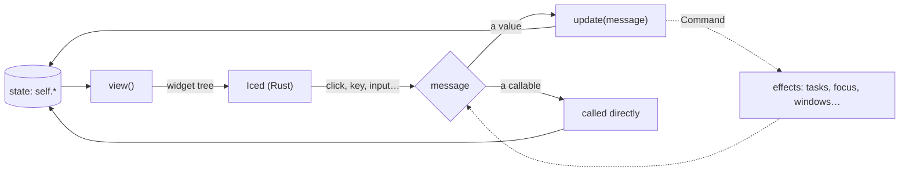

Pyzed follows Iced's **Elm architecture**: state lives in your object, `view()` draws it and
events change it. After every change, Pyzed calls `view()` again.

```
            ┌──────────── view() ────────────┐
            │                                ▼
      state (self)                     widget tree ──► Iced draws it
            ▲                                │
            └── update(msg) / callable ◄─────┘  the user clicks, types…
```

## The App class

```python
import pyzed as pz


class MyApp(pz.App):
    title = "My app"            # or a method/property that returns the title
    size = (900, 600)
    min_size = (480, 320)
    theme = "One Dark"           # a Theme, a name or pz.themes.auto(...)

    def __init__(self):         # the initial state
        self.items = []

    def view(self):             # required: returns a Widget
        ...

    def update(self, message):  # optional: receives messages
        ...


pz.run(MyApp)                   # or MyApp().run()
```

All class attributes are listed in the [App reference](/pyzed/reference/app/#app).

:::tip[`view()` must be cheap and side-effect free]
Pyzed calls `view()` after every message. Compute what you are going to show there, but don't do
I/O or change state: that belongs in `update` or in callbacks.
:::

Every interaction runs the same loop: Pyzed calls `view()`, Iced draws the tree and turns each event into a message, and the message updates your state, which triggers the next `view()`.



## Messages

Interactive widgets take a **message**: any Python value. When activated, Pyzed sends it to
`update`:

```python
ui.button("Delete", ("delete", item.id))

def update(self, message):
    match message:
        case ("delete", item_id):
            self.items = [i for i in self.items if i.id != item_id]
        case "clear":
            self.items.clear()
```

Use messages when you want to keep the logic in one place, log actions, undo them or test
`update` without a UI.

## Callables

If the message is a callable, Pyzed **calls it directly** and `update` never sees it:

```python
ui.button("Save", self.save)
ui.button("Delete", lambda: self.delete(item.id))
```

The callable's return value is handled like this:

| Returns | What happens |
| --- | --- |
| `None` | Nothing else: Pyzed redraws. |
| a `Command` (or a list of them) | The command runs. |
| a coroutine, a generator or an async generator | It runs in the background and each result goes to `update`. See [async and subscriptions](/pyzed/guides/async/). |
| any other value | It is sent to `update` as a message. |

Controls that produce a value call the callable with that value: `on_input(text)`,
`on_toggle(bool)`, `on_change(value)`, `on_select(id)`, `on_cursor(line, column)`.

:::caution[Lambdas inside loops]
Capture the variable with a default argument, or every lambda will use the last value:
`lambda f=f: self.open(f)`.
:::

## Optional hooks

| Method | When it is called |
| --- | --- |
| `on_start()` | Once, at startup. It can return a `Command` or a coroutine (for example, to load data). |
| `on_key(combo)` | On every key press. See [keyboard and shortcuts](/pyzed/guides/keyboard/). |
| `subscriptions()` | After every `update`. Returns the active timers and streams (`pz.every`, `pz.listen`). |
| `on_open()`, `on_close()`, `on_resize(w, h)` | Window events. See [multiple windows](/pyzed/guides/windows/). |

## Effects: `Command`

`update`, `on_start`, `on_key` and callbacks can return a [`Command`](/pyzed/reference/command/)
to request effects: focus a field, close the app, run work in the background… See
[commands and tasks](/pyzed/guides/commands/).

## Errors

If `view()` raises an exception, the window shows the traceback instead of closing. Fix the code
and the next interaction tries again. Exceptions in callbacks and in `update` are printed to the
console.

## Organizing a large app

Since components are functions, split `view()` into regular methods and functions:

```python
class Editor(pz.App):
    def view(self):
        return ui.workspace(self.center(), title_bar=self.title_bar(),
                            left=self.project_panel() if self.show_left else None,
                            status_bar=self.status_bar())

    def project_panel(self):
        return pz.column([ui.panel_header("Project"), ui.tree(self.nodes, expanded=self.expanded)])
```

To reuse pieces across apps, write functions that take data and callbacks and return widgets,
just like the ones in `pyzed.ui`. See [`examples/zed_editor.py`](https://github.com/albakore/pyzed/blob/main/examples/zed_editor.py)
for an example of a large app.
