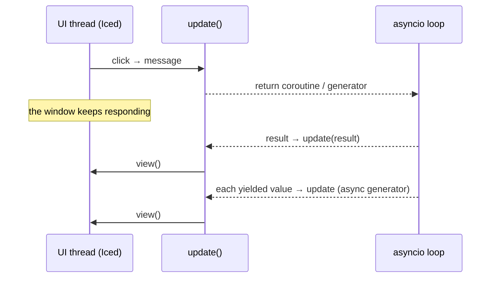

Pyzed runs your coroutines on **a single asyncio loop** that runs in a background thread. That
way you can use `aiohttp`, `httpx`, `websockets` and any async library with no setup, and the
window never blocks.

## What `update` or a callback can return



| Return value | What Pyzed does |
| --- | --- |
| `None` | Redraws. |
| a `Command` or a list of them | Runs them. |
| a **coroutine** (`async def`) | Runs it on the loop and sends its result to `update`. |
| a **generator** | Iterates it in a thread and sends each value to `update`. |
| an **async generator** | Iterates it on the loop and sends each value to `update`. |
| any other value | Sends it to `update` as a message. |

`None` values yielded by a generator are ignored.

## A request: coroutine or `Command.perform`

```python
import httpx


class Repos(pz.App):
    def __init__(self):
        self.repos, self.loading = [], False

    def on_start(self):
        return self.load()

    async def load(self):                       # returning a coroutine runs it
        self.loading = True
        async with httpx.AsyncClient() as client:
            r = await client.get("https://api.github.com/users/albakore/repos")
        return ("loaded", r.json())             # goes to update()

    def update(self, message):
        kind, data = message
        if kind == "loaded":
            self.repos, self.loading = data, False
```

:::caution[State and coroutines]
The coroutine body runs on the asyncio loop, not on the UI thread. Changing `self` from there
works for simple things, but the safest approach is to **return** the result and modify state in
`update` or in the `then` callback.
:::

With `Command.perform(function, then)` the result goes to a specific callback instead of
`update`. `function` can be a regular function (runs in a thread) or `async def` (runs on the
loop):

```python
async def fetch_quote():
    await asyncio.sleep(1.2)
    return "Readability counts."

class Quotes(pz.App):
    def load(self):
        self.loading = True
        return pz.Command.perform(fetch_quote, self.loaded)

    def loaded(self, quote):          # on the UI thread
        self.quote, self.loading = quote, False
```

## Progress: async generators

Each `yield` reaches `update` while the work keeps going in the background:

```python
async def download(index, size):
    received = 0
    while received < size:
        await asyncio.sleep(0.05)
        received = min(size, received + 100_000)
        yield index, "progress", received / size
    yield index, "finished", size


class Downloads(pz.App):
    def start(self, item):
        item.state = "running"
        return download(item.index, item.size)      # returning the generator starts it

    def update(self, message):
        index, event, value = message
        if event == "progress":
            self.downloads[index].progress = value
```

To start several at once, wrap them in `Command.perform`:
`return [pz.Command.perform(self.start(d)) for d in self.downloads]`.

## Subscriptions: timers and streams

`subscriptions()` returns the message sources that should be **active right now**. Pyzed
re-evaluates it after every `update`: a subscription exists as long as you return it and stops
as soon as it no longer appears.

```python
class Stopwatch(pz.App):
    def __init__(self):
        self.running, self.elapsed = False, 0.0

    def subscriptions(self):
        return [pz.every(0.01, "tick")] if self.running else []

    def update(self, message):
        if message == "tick":
            self.elapsed += 0.01
```

| Function | What it does |
| --- | --- |
| `pz.every(seconds, message)` | Sends `message` every `seconds` (like Iced's `time::every`). If `message` is a callable, it is called. |
| `pz.listen(function)` | Runs `function()` (a generator or async generator) while the subscription is active and sends each value to `update`. |

```python
async def feed():
    async with websockets.connect("wss://example.com/prices") as ws:
        async for message in ws:
            yield json.loads(message)


class Ticker(pz.App):
    def subscriptions(self):
        return [pz.listen(feed)] if self.connected else []
```

Subscriptions are identified by a **key** (by default, the message or the function). If you
need two identical ones with different parameters, pass `key="..."`.

:::tip[Animations]
`ui.spinner()` and other clock-driven drawings only move when the view is redrawn. Keep a
`pz.every(1 / 30, lambda: None)` subscription active while they are shown.
:::

## Utilities

- `pz.spawn(coroutine)` schedules a coroutine on Pyzed's loop without waiting for its result
  (returns a `concurrent.futures.Future`).
- `pz.asyncio_loop()` returns the loop, in case a library needs it.
- `pz.post(message)` still works from any thread.
