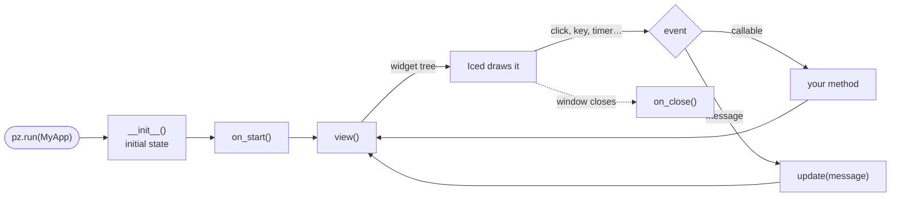

Everything you write in Pyzed is one of four kinds of class (or file). Each one has a few methods that Pyzed
calls for you at the right moment: this page lists them, says when they run and shows what to put in them.

| You write | It is | Pyzed calls |
| --- | --- | --- |
| `class MyApp(pz.App)` | The app and its main window. | `view()`, `update()`, `on_start()`, `on_key()`, `subscriptions()`… |
| `class Settings(pz.Window)` | Another window of the same app. | `view()`, `on_open()`, `on_close()`, `on_resize()`… |
| `login.pzform` + `login.py` | A form drawn in [Pyzed Design](/pyzed/editor/), with its handlers. | `form_load(form, event)`, `<control>_<event>(form, event)`… |
| `class Rating(pz.Component)` | A reusable piece of UI with props, state and events. | `setup()`, `render()`, `on_mount()`, `on_unmount()` |



## `pz.App`: the application

```python
import pyzed as pz
from pyzed import ui


class Notes(pz.App):
    title = "Notes"                 # window options are class attributes
    size = (720, 480)
    theme = "One Dark"

    def __init__(self):             # 1. the initial state: plain attributes
        self.notes = []
        self.draft = ""
        self.saved_at = None

    def on_start(self):             # 2. once, when the window is open
        return pz.Command.focus("draft")

    def view(self):                 # 3. after every change: describe the window
        return pz.column([
            ui.input(self.draft, self.set_draft, id="draft", placeholder="New note",
                     on_submit=self.add),
            pz.column([ui.list_item(n, icon="sticky-note") for n in self.notes]),
            ui.muted(f"Saved at {self.saved_at}" if self.saved_at else "Not saved yet"),
        ], spacing=8, padding=16)

    def set_draft(self, text):      # 4. callbacks change the state
        self.draft = text

    def add(self):
        if self.draft.strip():
            self.notes.append(self.draft.strip())
            self.draft = ""

    def update(self, message):      # 5. messages that are not callables land here
        if message == "save":
            self.saved_at = "now"

    def on_key(self, combo):        # 6. every key press of the window
        if combo == "ctrl-s":
            return self.update("save")

    def subscriptions(self):        # 7. timers and streams active right now
        return [pz.every(60, "save")] if self.notes else []


pz.run(Notes)
```

### The methods

| Method | When Pyzed calls it | What to put in it | May return |
| --- | --- | --- | --- |
| `__init__()` | Once, when the app is created (`pz.run(MyApp)` creates it). | The initial state as attributes. No widgets and no I/O. | — |
| `view()` | At start and after **every** event, message or command. | Build and return the widget tree from the state. Never change state here. | A `Widget` (required). |
| `update(message)` | When a widget's handler is a value (a string, a tuple, a dataclass…), or a callable returns one. | Change the state according to the message. | `None`, a `Command`, a list of them, a coroutine or another message. |
| `on_start()` | Once, after the window opens. | Load data, focus a field, start a background task. | A `Command`, a coroutine or a message. |
| `on_key(combo)` | On every key press of the window, before the focused widget. `combo` reads like `"ctrl-shift-p"`. | Global shortcuts. Returning something (even `[]`) keeps the key from moving the focus. | Like `update`. |
| `on_key_up(key)` | When a key is released (`"left"`, `"space"`). | Games and press-and-hold controls. | Like `update`. |
| `subscriptions()` | After every update. | Return the timers, streams and frame callbacks that should run *now*: `pz.every`, `pz.listen`, `pz.frames`. A subscription you stop returning stops. | A list. |
| `on_close()` | When the user closes the window. | Ask to save. Return `False` to keep the window open. | `None` or `False`. |
| `on_resize(width, height)` | When the window changes size. | Switch layouts (also see `self.window_size`). | Like `update`. |
| `frame_menus()` | When `frame = "custom"` draws the title bar. | The menus on its left side: `[ui.Menu("File", [...])]`. | A list or `None`. |

And the ones you call yourself:

| Method | What it does |
| --- | --- |
| `run(reload=None)` | Opens the window and blocks until the app closes (`pz.run(MyApp)` is the same). `reload=True` turns on [hot reload](/pyzed/editor/console-and-running/). |
| `screenshot(path, size=None)` | Renders the current state into a PNG without a screen (tests, docs). |
| `resolved_theme()` | The theme in use right now, with `pz.set_style` applied: `self.resolved_theme().accent`. |

Useful attributes the runtime keeps up to date: `self.window_size`, `self.window_focused`, `self.window_maximized`,
`self.window_position` and `self.system_dark`. The window options (`title`, `size`, `min_size`, `resizable`,
`frame`, `transparent`, `icon`, `splash`, `tab_focus`…) are listed in the [App reference](/pyzed/reference/app/#app).

:::tip[Callables or messages?]
A handler can be a **callable** (`self.add`, `lambda: self.open(path)`), which Pyzed calls directly, or a
**message** (`"save"`, `("delete", item.id)`, `Delete(item.id)`), which goes to `update`. Both work in the same app:
see [Imperative, declarative and functional](/pyzed/guides/code-styles/) for when to use each.
:::

## `pz.Window`: more windows

A `Window` is an `App` without the app-wide parts: it has its own `view()` and window options, and sends its
messages to the app's `update()`. Open it by returning a command:

```python
class Settings(pz.Window):
    title = "Settings"
    size = (420, 300)

    def on_open(self):                       # the window is on screen
        self.draft = self.app.prefs.copy()   # self.app is the App that opened it

    def view(self):
        return pz.column([
            ui.switch(self.draft["dark"], self.set_dark, label="Dark mode"),
            ui.button("Save", self.save, variant="solid"),
        ], spacing=12, padding=16)

    def set_dark(self, value):
        self.draft["dark"] = value

    def save(self):
        self.app.prefs = self.draft
        return self.close()                  # a command

    def on_close(self):                      # the user pressed the window's X
        return None if self.draft == self.app.prefs else False


class Main(pz.App):
    prefs = {"dark": True}

    def view(self):
        return ui.button("Settings…", lambda: Settings().open())
```

| Method | When | Notes |
| --- | --- | --- |
| `view()`, `on_key()`, `on_key_up()`, `on_resize()`, `subscriptions()` | As in `App`. | — |
| `on_open()` | The window opened (`self.app` is already set). | May return a command. |
| `on_close()` | The user asked to close it. | `False` keeps it open. |
| `update(message)` | A message produced inside the window. | Forwards to `self.app.update` by default. |
| `open()`, `close()`, `drag()`, `minimize()`, `toggle_maximize()` | You call them. | Each returns a `Command`: return it from a handler. |

See [Multiple windows](/pyzed/guides/windows/) for positions, modal windows and custom frames.

## Designed forms: `.pzform` + handlers

A form you draw in Pyzed Design is saved as `login.pzform` (the controls and their properties) and
`login.py` (your code). The code file has no class: each event is a **function** named
`<control>_<event>`, and the form's own events are `form_<event>`. Every handler gets the running `form` and
the `event`:

```python
# login.py: the handlers of login.pzform

def form_load(form, event):                 # the window opened
    form.status.text = ""
    return form.email.focus()               # handlers may return commands


def email_change(form, event):              # every keystroke: event.value is the new text
    form.sign_in.enabled = "@" in event.value


def password_submit(form, event):           # Enter in the password box
    return sign_in_click(form, event)


def sign_in_click(form, event):
    if not form.validate():                 # runs the validation rules set in the designer
        return
    form.progress.show()
    return form.open("welcome", data=form.email.text)


def form_key(form, event):                  # every key press: event.value is the combo
    if event.value == "escape":
        return form.close()


def form_close(form, event):                # return False to keep the window open
    if form.password.text:
        return False
```

| Handler | When | `event.value` |
| --- | --- | --- |
| `form_load` | Once, when the window opens. | `None` |
| `form_close` | The window is closing; `False` keeps it open. | `None` |
| `form_key` | Every key press. | The combo, `"ctrl-s"` |
| `form_resize` | The window changed size. | `(width, height)` |
| `<control>_<event>` | The control raised the event (`click`, `change`, `submit`, `tick`…). | Depends on the event: the new text, `True`/`False`, the selected item… |

The `form` object is your way into the window: `form.<control>.<property>` reads and writes properties,
`form.<control>.show()` / `.hide()` / `.focus()`, `form.title`, `form.data` (what `form.open(..., data=)`
passed), `form.validate()`, `form.close()` and `form.open("other_form")`. The events of every control are
listed in [Events and handlers](/pyzed/editor/events/), and on each page of the [library](/pyzed/library/).

Run a form from Python, or open it from a code-first app:

```python
from pyzed import designer

designer.run("ui/login.pzform")                       # the form is the app (same as `pyzed run`)

class Main(pz.App):                                   # or a form as one more window
    def view(self):
        return ui.button("Sign in…", lambda: designer.open_window("login", data="ada@example.com"))
```

## `pz.Component`: reusable pieces

A component is a class with **props** (annotated class attributes, passed by the parent), **state** (attributes
it keeps between renders) and **events** (that it raises with `self.emit`). Calling it returns a widget.

```python
class Stepper(pz.Component):
    """A number with − and + buttons."""

    value: int = 0                                  # props
    step: int = 1
    min: int = 0
    max: int = 10
    events = {"change": "The value changed (event.value is the new number)."}

    pressed: int = pz.state(0)                      # state, private to each instance

    def setup(self):                                # once, before the first render
        self.pressed = 0

    def on_mount(self):                             # after the first render
        return None

    def change(self, delta):
        self.pressed += 1
        new = max(self.min, min(self.max, self.value + delta))
        return self.emit("change", new)             # calls the parent's on_change

    def render(self):                               # on every render of the parent
        return pz.row([
            ui.icon_button("minus", lambda: self.change(-self.step)),
            pz.text(str(self.value), size=18),
            ui.icon_button("plus", lambda: self.change(self.step)),
        ], spacing=8, align="center")

    def on_unmount(self):                           # it is no longer rendered
        print(f"pressed {self.pressed} times")


# In any view:
Stepper(value=self.copies, max=99, on_change=lambda e: setattr(self, "copies", e.value))
```

| Method | When | Notes |
| --- | --- | --- |
| `setup()` | Once, before the first render. Props are already set. | Initialize state. |
| `render()` | Every time the parent's `view()` calls the component. | Return widgets; read `self.<prop>` and the state. |
| `on_mount()` | After the first render. | May return a `Command` or a message. The parent's `on_mount=` handler runs too. |
| `on_unmount()` | When the parent stops rendering it. Its state is dropped. | Stop timers, close files. |
| `emit(name, value)` | You call it. | Calls the parent's `on_<name>` with a `pz.Event(value=..., source=self)`. Return its result. |
| `handles(name)` | You call it. | Whether the parent passed `on_<name>`: hide a button nobody listens to. |
| `provide()` | Before each render. | A dict shared with everything rendered inside (`pz.use_context(name)`). |
| `context(name)` | You call it. | The closest value shared with `pz.provide` or `provide()`. |
| `Rating.create(...)` | In tests. | An instance without rendering it: `Rating.create(value=3).render()`. |

Every component also takes the [common events](/pyzed/guides/events/) (`on_click`, `on_drag`, `on_key_down`…),
`style=`, `class_=`, `id=`, `animate=` and `key=`. See [Custom components](/pyzed/guides/components/) for children,
context, stylesheets and how components appear in the designer's toolbox.

## Creating your own events

An event is a name plus a value that a piece of UI hands to whoever uses it. There are three ways to make one,
from the most structured to the simplest.

### 1. In a component: `events` and `emit`

Declare the events and raise them with `self.emit(name, value)`. The parent listens with `on_<name>=`:

```python
class ColorRow(pz.Component):
    colors: list = ()
    selected: str = ""
    events = {
        "pick": "A color was clicked (event.value is the color).",
        "remove": "The × of a color was pressed (event.value is the color).",
    }

    def render(self):
        return pz.row([
            pz.row([
                ui.color_swatch(c, size=28 if c == self.selected else 20,
                                on_press=lambda c=c: self.emit("pick", c)),
                self.handles("remove") and ui.icon_button("x", lambda c=c: self.emit("remove", c), size="xs"),
            ], spacing=2)
            for c in self.colors
        ], spacing=8)


ColorRow(colors=self.palette, selected=self.color,
         on_pick=lambda e: setattr(self, "color", e.value),
         on_remove=lambda e: self.palette.remove(e.value))
```

- `events` is a dict `{name: description}` (the description shows in the designer and the reference) or a tuple
  of names. Subclasses add to the events they inherit.
- The handler gets a `pz.Event` with `type` (the name), `value` and `source` (the component). A handler without
  arguments (`on_pick=self.refresh`) is called with nothing.
- `emit` of an undeclared name raises an error, so typos show up at once.
- Every component also emits `mount` and `unmount`.

### 2. In a function: a callback parameter

The components of `pyzed.ui` are plain functions with `on_*` parameters. Yours can be too: take the callback as a
parameter and give it to a widget, or wrap it to pass a value.

```python
def tag_list(tags, on_remove=None, on_add=None):
    """Tags as chips. on_remove(tag) when a chip's × is pressed, on_add() for the + button."""
    return pz.row([
        *[ui.chip(t, on_remove=on_remove and (lambda t=t: on_remove(t))) for t in tags],
        on_add and ui.icon_button("plus", on_add, tooltip="Add a tag"),
    ], spacing=6)


tag_list(self.tags, on_remove=self.tags.remove, on_add=self.new_tag)
```

### 3. App-wide: messages and `pz.post`

A message is an event for the whole app: any value that reaches `update`. Use one when the same thing can come
from several places (a button, a shortcut, a menu, a timer, a worker thread):

```python
from dataclasses import dataclass


@dataclass
class Downloaded:                     # a message with data
    name: str
    size: int


def worker(url):                      # runs in a thread
    data = fetch(url)
    pz.post(Downloaded(url, len(data)))   # any thread can send a message to update()


class App(pz.App):
    def update(self, message):
        match message:
            case Downloaded(name, size):
                self.files.append((name, size))
```

In Pyzed Design, a designed component's **custom events** are added in its *Events* card and raised from its
code with `self.emit("change", value)`. See [Component designer](/pyzed/editor/component-designer/).

## Where next

- [Events](/pyzed/guides/events/): the common events of every widget and the `pz.Event` object.
- [Events of every component](/pyzed/library/events/): how many events each component has, and which.
- [Imperative, declarative and functional](/pyzed/guides/code-styles/): the same app written three ways.
- [App architecture](/pyzed/guides/architecture/): the view → message → update loop in detail.
