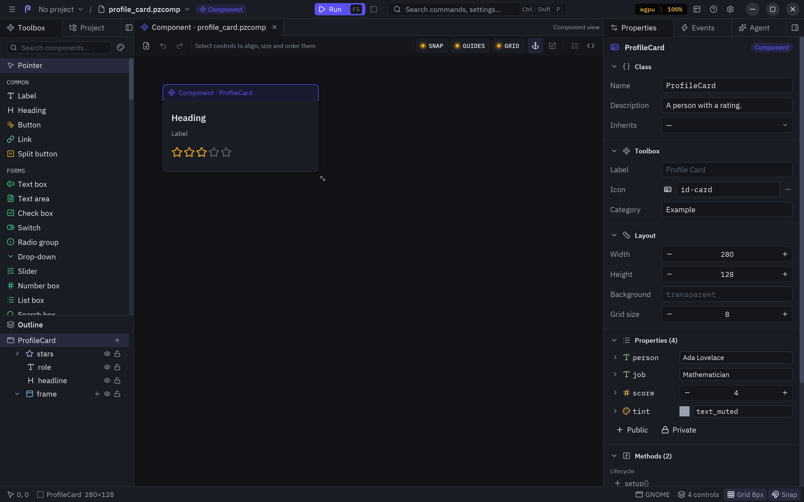

Pyzed Design has a second mode for building **components** instead of windows: you draw the component like a
form, declare its properties and events in a panel, write the logic of its methods, and place it in forms or
inside other components, like scenes in Godot. A designed component **is** a [`pz.Component`](/pyzed/guides/components/).

The full guide is in the Pyzed Design manual: **[Component designer](/pyzed/editor/component-designer/)**.

## Property types

See [Property types](/pyzed/editor/component-designer/#property-types).

## Inheritance

See [Inheritance](/pyzed/editor/component-designer/#inheritance).
