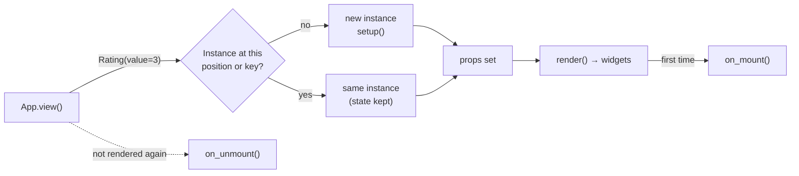

A component is a class that groups widgets with their logic, like a React component:

- **Props** are annotated class attributes with defaults. The parent passes them on every render.
- **State** is any other attribute you set. It stays between renders.
- `render()` returns the component's widgets.
- `events` declares the custom events it raises with `self.emit(name, value)`.

```python
import pyzed as pz


class Rating(pz.Component):
    """Stars the user can click."""

    value: int = 0                 # props
    max: int = 5
    events = {"change": "A star was picked (event.value is the rating)."}
    icon = "star"                  # how it appears in the designer's toolbox

    def setup(self):               # once, before the first render
        self.hover = None          # state

    def render(self):
        shown = self.hover or self.value
        return pz.row([
            pz.text("★" if i <= shown else "☆", size=20).on(
                click=lambda i=i: self.emit("change", i),
                mouse_enter=lambda i=i: setattr(self, "hover", i),
                mouse_leave=lambda: setattr(self, "hover", None),
            )
            for i in range(1, self.max + 1)
        ], spacing=2)
```

Calling a component returns a widget, so it goes anywhere a widget does:

```python
class Review(pz.App):
    stars = 3

    def view(self):
        return pz.column([
            Rating(value=self.stars, on_change=lambda e: setattr(self, "stars", e.value)),
            pz.text(f"{self.stars} of 5"),
        ])
```


See [`examples/components.py`](https://github.com/albakore/pyzed/blob/main/examples/components.py)
for a star rating, a tag editor and a draggable note.

## Events

- **Custom events** are declared in `events`, as a tuple of names or a `{name: description}` dict.
  The parent handles them with `on_<name>=`.
- `self.emit(name, value)` calls the parent's handler with a `pz.Event` whose `value` and
  `source` are set. Return its result from your callback, so a `Command` or a message reaches
  the runtime.
- **Common events**, such as `on_click`, `on_drag` and `on_key_down`, work on every component
  without any code. See [Events](/pyzed/guides/events/).
- **Lifecycle events**: `on_mount` and `on_unmount` tell the parent when the component appears
  and disappears.

## State and keys

State is kept per position in the parent's `view()`: the second `Rating` in a view keeps its own
state as long as the order stays the same. When components come from a list whose items move,
give each one a stable `key`:

```python
pz.column([TodoItem(key=todo.id, todo=todo) for todo in self.todos])
```

A component that is no longer rendered is unmounted, and its state is dropped.



## Lifecycle

| Hook | When |
| --- | --- |
| `setup()` | Once, before the first render. Props are already set. Initialize state here. |
| `render()` | On every render of the parent. |
| `on_mount()` | After the first render. It may return a `Command` or a message. |
| `on_unmount()` | When the component is no longer rendered. |

Hooks run after the view is drawn, never in the middle of it.

## In the designer

Every `pz.Component` subclass appears in the [designer](/pyzed/guides/designer/)'s toolbox:

- **Props** become properties. `bool` gets a switch, `int` and `float` a number box, `Literal[...]`
  a drop-down, `list` one item per line, and a prop named `color` or `icon` gets its own picker.
- **Custom events** become events you can write code for.

Class attributes control how it appears:

| Attribute | Default |
| --- | --- |
| `label` | The class name, split into words. |
| `icon` | `"component"` (any Lucide icon). |
| `category` | `"Custom"`. |
| `size` | `(160, 40)`, the size when placed on a form. |
| `designer` | `True`; `False` keeps it out of the toolbox. |
| `type_name` | The class name in snake case; the id saved in forms. |

The docstring's first paragraph is shown as the description.
