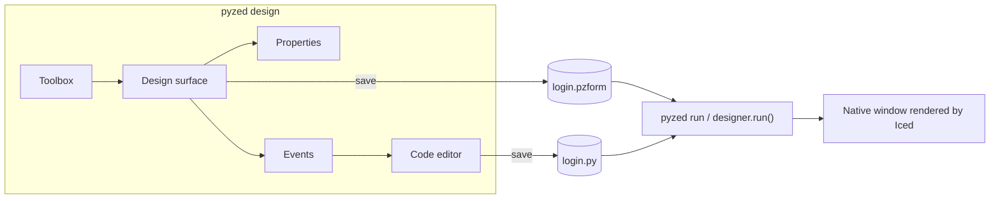
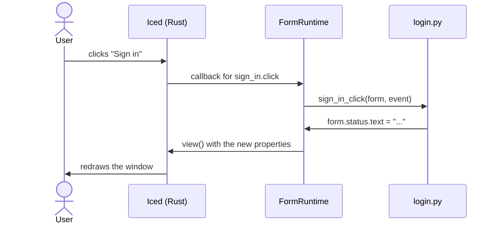
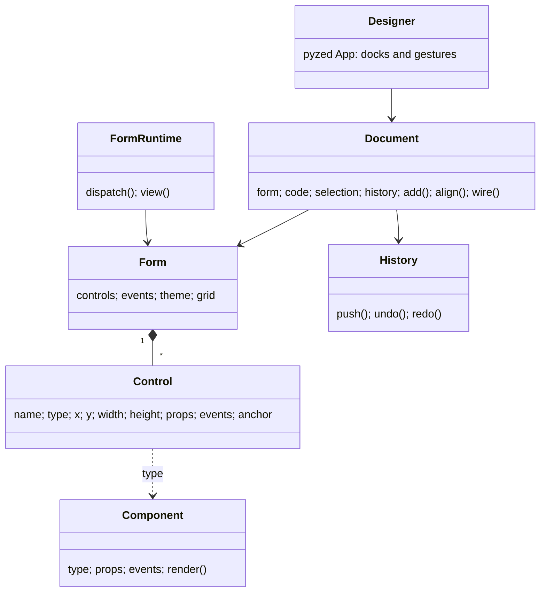

Pyzed Designer is a form editor in the spirit of Visual Basic, the WinForms designer in Visual Studio and
Qt Designer, built with Pyzed itself. You draw a window with the mouse, set properties in a grid, double-click a
control to write the code of its event, and press **F5** to run it with all its logic.

```bash
pyzed design login.pzform      # open (or create) a form
pyzed run login.pzform         # run it, no designer needed
pyzed run login.pzform --reload  # ...and update it every time the form or its code is saved
```


## The window

| Area | What it does |
| --- | --- |
| **Toolbox** (left) | The component library. Click a component, then click on the form to place it at its default size, or drag a rectangle to give it a size. Search filters the list. |
| **Outline** (left) | Every control in z-order (top first). Click to select; the eye and lock buttons hide or lock a control. |
| **Form** (center) | The design surface with a dot grid. Drag to move, use the eight handles to resize, drag on empty space to select with a rubber band. The grip under the bottom-right corner resizes the form. |
| **Properties** (right) | Name, the component's own properties, layout (X, Y, size, anchors) and behavior (visible, enabled, locked). With nothing selected it edits the form: title, size, theme, accent, background, corner radius, font size and grid. |
| **Events** (right) | The events of the selected control (or of the form). Double-click one to create its handler and open it in the code editor. |
| **Code** (bottom) | The source of one handler, or of the whole file (**F7**). **Apply** checks the syntax before touching the file. |


## Alignment, grid and snapping

- **Snap to grid** (magnet) rounds positions and sizes to the grid step (8 px by default, set per form). Press
  **G** to show or hide the dots.
- **Smart guides** (ruler) snap a moving control to the edges and centers of the others and of the form, and draw a
  red guide line while they line up.
- The toolbar aligns the selection by **left, center, right, top, middle or bottom** edges, **distributes** three or
  more controls evenly, gives them the **same width or height**, **centers** them in the form and changes the
  **z-order**. With one control selected, alignment is relative to the form.
- **Anchors** decide what happens when the running window is resized, like WinForms: anchored to left and right a
  control stretches, anchored only to the right it follows that edge, anchored to neither it stays centered.


### Keyboard

| Keys | Action |
| --- | --- |
| Arrows / Shift+arrows | Nudge by 1 px / one grid step |
| Delete | Delete the selection |
| Ctrl+C, Ctrl+X, Ctrl+V, Ctrl+D | Copy, cut, paste, duplicate |
| Ctrl+A | Select every control |
| Ctrl+Z, Ctrl+Shift+Z | Undo, redo |
| Enter | Open the code of the selected control's main event |
| Escape | Cancel a drag, close a menu, go back to the pointer |
| Ctrl+S, Ctrl+O, Ctrl+N | Save, open, new |
| F5, Shift+F5 | Run the form, close the running form |
| F7 | Edit the whole code file |

Right-click a control for a context menu with the same actions.

## Look and feel

Each form picks any registered theme (One, Ayu, Gruvbox or your own) and can override its accent color,
background, corner radius and font size. The designer's own theme is independent (top-right selector).


## Files

A form is two files side by side, both meant to be committed:

```
login.pzform   ← layout: JSON, diffs nicely
login.py       ← event handlers: plain Python
```



The `.pzform` file stores the form settings and, for each control, its type, position, size, properties, anchors
and which handler each event calls:

```json
{
  "format": "pyzed.form/1",
  "form": { "name": "login", "title": "Sign in", "width": 440, "height": 400, "theme": "One Dark", "events": { "load": "form_load" } },
  "controls": [
    { "name": "sign_in", "type": "button", "x": 48, "y": 304, "width": 344, "height": 32,
      "props": { "text": "Sign in", "variant": "solid", "icon": "log-in" },
      "events": { "click": "sign_in_click" }, "anchor": ["left", "top"] }
  ]
}
```

## Live updates

Forms work with hot reload (`pyzed.hot_reload`): run them with `pyzed run app.pzform --reload` (or
`designer.run(path, reload=True)`, or `PYZED_RELOAD=1`) and every save of `app.pzform` or `app.py`, from the
designer or from your editor, updates the open window without restarting it. Layout, properties and code are
replaced; what the user typed or picked in each control stays. Inside the designer, **Save** also refreshes the
form opened with **F5**.

## Writing event handlers

Handlers are named `<control>_<event>` and receive the running `form` and an `event`. Controls are attributes of
the form and their properties are attributes of the control; changing them updates the window.

```python
def sign_in_click(form, event):
    if "@" not in form.email.text:
        form.status.text = "Enter a valid email address."
        return form.email.focus()          # handlers may return commands
    form.sign_in.enabled = False
    form.progress.show()
    form.ticker.running = True             # a Timer control starts ticking
```

`event.sender` is the control that raised it, `event.name` the event and `event.value` its value (the new text of a
text box, the state of a check box, the key combo of the form's `key` event...). Handlers can return anything a
Pyzed callback can: a `Command`, a coroutine, a generator. If a handler raises, the error appears at the bottom of
the running window instead of closing it.



### Events

Every visible control has `mouse_enter`, `mouse_leave` and `right_click`. On top of that:

| Component | Events |
| --- | --- |
| Button | `click` |
| Label | `click`, `double_click` |
| Text box | `change`, `submit` |
| Text area, Check box, Switch, Radio group, Drop-down, Slider, Number box, List box | `change` |
| Timer (invisible at run time) | `tick` |
| Form | `load`, `close` (return `False` to keep it open), `key`, `resize` |

## Components

Label, Heading, Button, Text box, Text area, Check box, Switch, Radio group, Drop-down, Slider, Number box,
List box, Progress bar, Badge, Image, Icon, Markdown, Spinner, Panel, Divider and Timer.


Register your own and it shows up in the toolbox:

```python
from pyzed import ui
from pyzed.designer import Component, Prop, register

register(Component(
    type="rating", label="Rating", icon="star", category="Custom", size=(120, 24),
    props=(Prop("value", "number", 3, min=0, max=5),),
    events=("change",),
    render=lambda control, ctx: ui.label("★" * int(control.props["value"])),
))
```

`render` is used both in the designer (inert) and at run time; use `ctx.on(control, "change", "value")` for
callbacks so the same code works in both.

## Scripting forms

Everything the designer does is available from Python, which is handy for generating forms or for tests:

```python
from pyzed import designer
from pyzed.designer import Document

doc = Document(designer.Form(name="hello", title="Hello", width=320, height=140))
doc.add("input", 16, 16, 200, 28)
doc.add("button", 224, 16)
doc.select_all()
doc.align("middle")
handler = doc.wire("button1", "click")
doc.set_handler_source(handler, "def button1_click(form, event):\n    form.button1.text = form.input1.text\n")
doc.save("hello.pzform")

designer.run("hello.pzform")
```

## How it is built



- `model.py`: the form and its controls, saved as JSON.
- `components.py`: the component library and the `render` shared by designer and runtime.
- `geometry.py`: snapping, alignment, distribution, resizing, anchors and smart guides (pure functions).
- `history.py`: undo/redo as snapshots; repeated edits of one field merge into one step.
- `code.py`: finds, adds, renames and replaces handler functions with `ast` without touching the rest of the file.
- `document.py`: every editing command, with no UI, so it is fully testable.
- `project_panel.py`: the Project tab (uv projects, dependencies, ruff, ty and git; see [Projects with uv](/pyzed/guides/projects/)).
- `surface.py` and `panels.py`: the views; `app.py`: the `Designer` app wiring clicks and keys to the document.
- `runtime.py`: `FormApp` and `FormWindow`, which draw a form and call its handlers.
