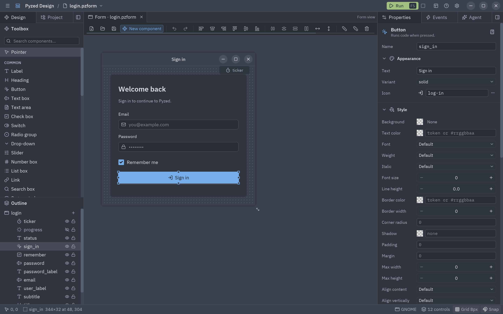

import Commands from '../../../components/Commands.astro';

Pyzed Design is a form editor in the spirit of Visual Basic, the WinForms designer in Visual Studio and
Qt Designer, built with Pyzed itself. You draw a window with the mouse, set properties in a grid, double-click a
control to write the code of its event, and press **F5** to run it with all its logic.

<Commands
	uv={`
		uv run pyzed design login.pzform        # open (or create) a form
		uv run pyzed run login.pzform           # run it, no designer needed
		uv run pyzed run login.pzform --reload  # ...and update it every time the form or its code is saved
	`}
	pip={`
		pyzed design login.pzform        # open (or create) a form
		pyzed run login.pzform           # run it, no designer needed
		pyzed run login.pzform --reload  # ...and update it every time the form or its code is saved
	`}
	python={`
		{py} -m pyzed design login.pzform        # open (or create) a form
		{py} -m pyzed run login.pzform           # run it, no designer needed
		{py} -m pyzed run login.pzform --reload  # ...and update it every time the form or its code is saved
	`}
/>

Everything about it now lives in its own manual, **[Pyzed Design](/pyzed/editor/)**:

| Topic | Page |
| --- | --- |
| The window and its areas | [Overview](/pyzed/editor/) |
| Placing, moving, aligning, snapping, the outline | [Toolbox and canvas](/pyzed/editor/toolbox-and-canvas/) |
| The property grid, lists and tables | [Properties](/pyzed/editor/properties/) |
| Panels, flex rows and columns, grids, anchors | [Layouts and containers](/pyzed/editor/layouts/) |
| The Style section, the color picker, themes | [Styles and themes](/pyzed/editor/styles-and-themes/) |
| Events and writing handlers | [Events and handlers](/pyzed/editor/events/) |
| Completion, diagnostics, language servers | [Code editor](/pyzed/editor/code-editor/) |
| F5, the debug console, hot reload | [Running and the console](/pyzed/editor/console-and-running/) |
| uv projects, dependencies, ruff, ty, git | [Projects](/pyzed/editor/projects/) |
| Reusable components | [Component designer](/pyzed/editor/component-designer/) |
| New forms, templates, `.pzform` files, scripting | [Files, templates and scripting](/pyzed/editor/files-and-scripting/) |
| Menus, the command palette, docks | [Menus and commands](/pyzed/editor/menus-and-commands/) |
| Every shortcut | [Keyboard shortcuts](/pyzed/editor/keyboard-shortcuts/) |
| Preferences | [Settings](/pyzed/editor/settings/) |

## Debug console

See [Running and the console](/pyzed/editor/console-and-running/#the-console).

## Panels

See [Panels and docks](/pyzed/editor/menus-and-commands/#panels-and-docks).

## Code editor

See [Code editor](/pyzed/editor/code-editor/): completion, diagnostics, code lens, folding and the ty and ruff
language servers.

## Telemetry

See [Settings → Telemetry](/pyzed/editor/settings/#telemetry).

## Components

**Common**: Label, Heading, Button, Text box, Text area, Check box, Switch, Radio group, Drop-down, Slider, Number box,
List box, Link and Search box. **Containers**: Panel, Group box, Card. **Layout**: Flex row, Flex column, Grid,
Spacer. **Navigation**: Tab bar, Segmented. **Display**: Progress bar, Badge, Chip, Callout, Avatar, Key binding,
Stat, Chart, Table, Image, Icon, Markdown, Spinner, Divider and Timer.

To add your own, see [Files, templates and scripting](/pyzed/editor/files-and-scripting/#adding-your-own-components)
and the [component designer](/pyzed/editor/component-designer/).

## How it is built

See [Files, templates and scripting → How it is built](/pyzed/editor/files-and-scripting/#how-it-is-built).
