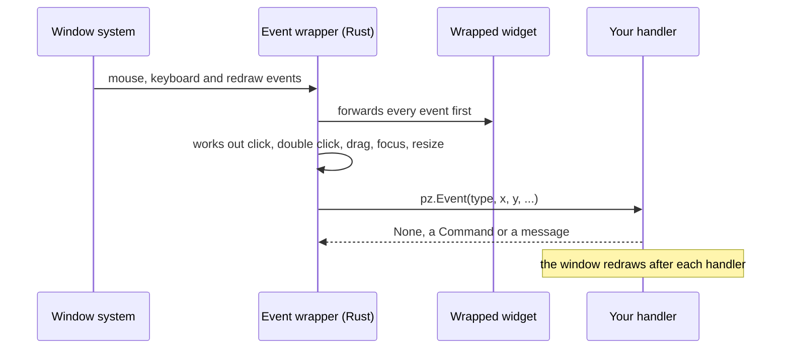

Any widget can react to the events that graphical editors usually offer: clicks, double
clicks, hovering, dragging, focus, keys and size changes. Attach them with `.on(...)`:

```python
import pyzed as pz

card = pz.container(pz.text("Drag me"), padding=12, bg="#2c313a").on(
    click=self.select,                        # takes no argument: just called
    double_click=lambda e: self.rename(e.x),  # takes one: gets a pz.Event
    drag=self.move,                           # e.dx, e.dy since the last drag event
    key_down=self.shortcut,                   # after a click gives it the focus
    cursor="grab",
)
```

`pz.on(widget, ...)` does the same. Calling `.on()` again merges the handlers, and
`None` removes one. A handler can also be a message (any value that is not callable),
which goes to `update`, like every other Pyzed callback.


## The events

| Group | Event | When |
| --- | --- | --- |
| Mouse | `click` | Pressed and released with the left button. |
| | `double_click` | Two clicks in quick succession (after the second `click`). |
| | `right_click`, `middle_click` | The right or middle button was pressed. |
| | `mouse_down`, `mouse_up` | Any button (`event.button` is `"left"`, `"right"`, ...). |
| | `mouse_enter`, `mouse_leave` | The pointer moved onto or off the widget. |
| | `mouse_move` | The pointer moved over the widget. |
| | `scroll` | The wheel turned (`event.dx`, `event.dy` in lines). |
| Drag | `drag_start`, `drag`, `drag_end` | Left button held and moved a few pixels; `drag` reports the movement since the previous one. |
| Focus | `focus`, `blur` | A click on the widget gives it the focus; a click elsewhere takes it away. |
| Keyboard | `key_down`, `key_up` | Keys while focused (`event.key` such as `"ctrl-s"`). |
| Layout | `resize` | The widget got a new size, including its first one. |

`pz.events.CATALOG` has this list with descriptions (the designer shows them).

## The `Event` object

| Field | Meaning |
| --- | --- |
| `type` | The event name. |
| `x`, `y` | Pointer position relative to the widget's top-left corner (`position` gives both). |
| `dx`, `dy` | Scroll amount, or drag movement since the previous `drag`. |
| `width`, `height` | The widget's size (`size` gives both). |
| `button` | `"left"`, `"right"`, `"middle"`... for mouse buttons. |
| `key` | The key combo for key events. |
| `shift`, `ctrl`, `alt`, `logo` | Modifiers held. |
| `value`, `source` | For custom events: the value and the component that emitted it. |

A handler gets the event only if it has a required positional parameter (or `*args`).
`lambda: ...` and `lambda i=i: ...` are called with nothing, so the usual way of capturing
a loop variable keeps working.

## How it works

The events are implemented once, in a native wrapper widget (`src/events.rs`), instead of
in each component. The wrapper only observes: it never stops an event, so a button inside
a card still gets its click, and the card gets one too.



Components made with [`pz.Component`](/pyzed/guides/components/) accept these events too
(`on_click=...`), and add their own.
