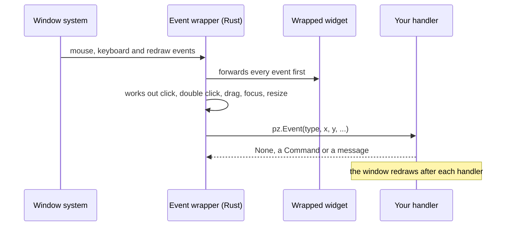

Any widget can react to the events that graphical editors usually offer: clicks, double
clicks, hovering, dragging, focus, keys and size changes. Attach them with `.on(...)`:

```python
import pyzed as pz

card = pz.container(pz.text("Drag me"), padding=12, bg="#2c313a").on(
    click=self.select,                        # takes no argument: just called
    double_click=lambda e: self.rename(e.x),  # takes one: gets a pz.Event
    drag=self.move,                           # e.dx, e.dy since the last drag event
    key_down=self.shortcut,                   # after a click gives it the focus
    cursor="grab",
)
```

`pz.on(widget, ...)` does the same. Calling `.on()` again merges the handlers, and
`None` removes one. A handler can also be a message (any value that is not callable),
which goes to `update`, like every other Pyzed callback.


## The events

| Group | Event | When |
| --- | --- | --- |
| Mouse | `click` | Pressed and released with the left button. |
| | `double_click` | Two clicks in quick succession (after the second `click`). |
| | `right_click`, `middle_click` | The right or middle button was pressed. |
| | `mouse_down`, `mouse_up` | Any button (`event.button` is `"left"`, `"right"`, ...). |
| | `mouse_enter`, `mouse_leave` | The pointer moved onto or off the widget. |
| | `mouse_move` | The pointer moved over the widget. |
| | `scroll` | The wheel turned (`event.dx`, `event.dy` in lines). |
| Drag | `drag_start`, `drag`, `drag_end` | Left button held and moved a few pixels; `drag` reports the movement since the previous one. |
| Focus | `focus`, `blur` | A click on the widget gives it the focus; a click elsewhere takes it away. |
| Keyboard | `key_down`, `key_up` | Keys while focused (`event.key` such as `"ctrl-s"`). |
| Layout | `resize` | The widget got a new size, including its first one. |

`pz.events.CATALOG` has this list with descriptions (the designer shows them).

## The `Event` object

| Field | Meaning |
| --- | --- |
| `type` | The event name. |
| `x`, `y` | Pointer position relative to the widget's top-left corner (`position` gives both). |
| `dx`, `dy` | Scroll amount, or drag movement since the previous `drag`. |
| `width`, `height` | The widget's size (`size` gives both). |
| `button` | `"left"`, `"right"`, `"middle"`... for mouse buttons. |
| `key` | The key combo for key events. |
| `shift`, `ctrl`, `alt`, `logo` | Modifiers held. |
| `value`, `source` | For custom events: the value and the component that emitted it. |

A handler gets the event only if it has a required positional parameter (or `*args`).
`lambda: ...` and `lambda i=i: ...` are called with nothing, so the usual way of capturing
a loop variable keeps working.

## Own events and common events

Every widget reacts to events in two layers:

| | Own events | Common events |
| --- | --- | --- |
| What | The `on_*` parameters of a component: `on_press`, `on_input`, `on_select`, `on_close`… | The 18 events of this page: `click`, `mouse_enter`, `drag`, `key_down`, `resize`… |
| Which widgets | Each component its own (a button has 1, a tab bar 7, a mouse area 10). | Every widget, whatever it is. |
| How | `ui.input(text, self.typed, on_submit=self.send)` | `widget.on(double_click=self.rename)` |
| The handler gets | The component's value: the text, the checked state, the item, the row… | Nothing, or a `pz.Event`. |

Both mix freely on the same widget:

```python
ui.list_item("main.py", self.open, icon="file").on(   # on_press: its own event
    right_click=lambda e: self.menu(e.x, e.y),         # a common event
    mouse_enter=lambda: setattr(self, "hovered", "main.py"),
)
```

[Events of every component](/pyzed/library/events/) lists the own events of each component, what its handler
gets and how many events it can have in total. Each page of the [library](/pyzed/library/) has an **Events**
section with them, written in three styles.

## Recipes

### Hover and click

```python
class Cards(pz.App):
    def __init__(self):
        self.hovered = None
        self.opened = None

    def card(self, name):
        hot = self.hovered == name
        return pz.container(pz.text(name), padding=16, radius=8, bg="#3b4048" if hot else "#2c313a").on(
            mouse_enter=lambda: setattr(self, "hovered", name),
            mouse_leave=lambda: setattr(self, "hovered", None),
            click=lambda: setattr(self, "opened", name),
            cursor="pointer",
        )

    def view(self):
        return pz.row([self.card(n) for n in ("Inbox", "Drafts", "Sent")], spacing=8)
```

:::tip
For hover *colors* alone you don't need events: `pz.Style(hover={"background": "..."})` and the `hover_bg` of
buttons change them without calling Python. Use `mouse_enter` / `mouse_leave` when the state matters to your app.
:::

### A context menu where the pointer is

```python
class Board(pz.App):
    def __init__(self):
        self.menu_at = None

    def view(self):
        board = pz.container(ui.muted("Right-click anywhere"), width="fill", height="fill").on(
            right_click=lambda e: setattr(self, "menu_at", (e.x, e.y)),   # where, inside the board
        )
        x, y = self.menu_at or (0, 0)
        menu = ui.menu([ui.MenuItem("New note", lambda: setattr(self, "menu_at", None), icon="plus")])
        return ui.popover(board, menu if self.menu_at else None, x=x, y=y,
                          on_dismiss=lambda: setattr(self, "menu_at", None))
```

### Drag to move

```python
class Desk(pz.App):
    def __init__(self):
        self.x, self.y = 40, 40

    def move(self, e):                          # e.dx, e.dy: movement since the last drag
        self.x += e.dx
        self.y += e.dy

    def view(self):
        note = pz.container(pz.text("Drag me"), padding=12, radius=8, bg="#e5c07b", color="#282c34")
        return pz.stack([pz.pin(note.on(drag=self.move, cursor="grab"), x=self.x, y=self.y)],
                        width="fill", height="fill")
```

### Double click to rename

```python
class Rename(pz.App):
    def __init__(self):
        self.name, self.editing = "notes.py", False

    def view(self):
        if self.editing:
            return ui.input(self.name, lambda t: setattr(self, "name", t), id="name",
                            on_submit=lambda: setattr(self, "editing", False))
        return ui.label(self.name).on(double_click=self.start)

    def start(self):
        self.editing = True
        return pz.Command.focus("name")          # a handler can return a command
```

### Ctrl + click to select several

```python
class Files(pz.App):
    def __init__(self):
        self.selected = set()

    def pick(self, name, e):
        if e.ctrl or e.logo:                     # Ctrl (Cmd on macOS) adds to the selection
            self.selected ^= {name}
        else:
            self.selected = {name}

    def view(self):
        return pz.column([
            ui.list_item(n, None, icon="file", selected=n in self.selected).on(
                click=lambda e, n=n: self.pick(n, e))
            for n in ("a.py", "b.py", "c.py")
        ], width=240)
```

### Change the layout with the size

```python
class Gallery(pz.App):
    def __init__(self):
        self.narrow = False

    def view(self):
        items = [ui.card(ui.muted(f"Photo {i}"), width=160) for i in range(6)]
        layout = pz.column(items, spacing=8) if self.narrow else pz.row(items, spacing=8, wrap=True)
        return pz.container(layout, width="fill").on(resize=lambda e: setattr(self, "narrow", e.width < 520))
```

### Ctrl + wheel to zoom

```python
class Zoom(pz.App):
    def __init__(self):
        self.zoom = 1.0

    def view(self):
        return pz.container(pz.text("Zoom me", size=16 * self.zoom), width="fill", height="fill").on(
            scroll=lambda e: setattr(self, "zoom", max(0.5, min(4, self.zoom + e.dy * 0.1))) if e.ctrl else None,
            double_click=lambda: setattr(self, "zoom", 1.0),
        )
```

### Focus and keys on any widget

```python
class Field(pz.App):
    def __init__(self):
        self.focused, self.last_key = False, ""

    def view(self):
        border = "#74ade8" if self.focused else "#3e4452"
        return pz.container(pz.text(self.last_key or "Click me, then press keys"), padding=16,
                            border_color=border, border_width=1, radius=6).on(
            focus=lambda: setattr(self, "focused", True),
            blur=lambda: setattr(self, "focused", False),
            key_down=lambda e: setattr(self, "last_key", e.key),
        )
```

## In the three styles

A handler of `.on(...)` can be a callable or a message, like any other handler, so the common events fit the
[three styles](/pyzed/guides/code-styles/):

```python
# Imperative: the handler changes self
ui.card(ui.muted("Hover me"), selected=self.hovered).on(
    mouse_enter=lambda: setattr(self, "hovered", True),
    mouse_leave=lambda: setattr(self, "hovered", False))

# Declarative: the handlers are messages, update() decides
@dataclass
class Hover:
    on: bool

ui.card(ui.muted("Hover me"), selected=self.hovered).on(mouse_enter=Hover(True), mouse_leave=Hover(False))

def update(self, message):
    match message:
        case Hover(on):
            self.hovered = on

# Functional: a pure view asks for a new state
def view(state, set_state):
    return ui.card(ui.muted("Hover me"), selected=state.hovered).on(
        mouse_enter=lambda: set_state(hovered=True), mouse_leave=lambda: set_state(hovered=False))
```

A message given to `.on()` reaches `update` as it is, without the `pz.Event`. When you need the event's data,
build the message in a lambda: `drag=lambda e: Moved(e.dx, e.dy)`.

## How it works

The events are implemented once, in a native wrapper widget (`src/events.rs`), instead of
in each component. The wrapper only observes: it never stops an event, so a button inside
a card still gets its click, and the card gets one too.



Components made with [`pz.Component`](/pyzed/guides/components/) accept these events too
(`on_click=...`), and add their own: see [creating your own events](/pyzed/guides/classes/#creating-your-own-events).
In a [designed form](/pyzed/editor/events/), the events of each control are wired in the Events panel.
