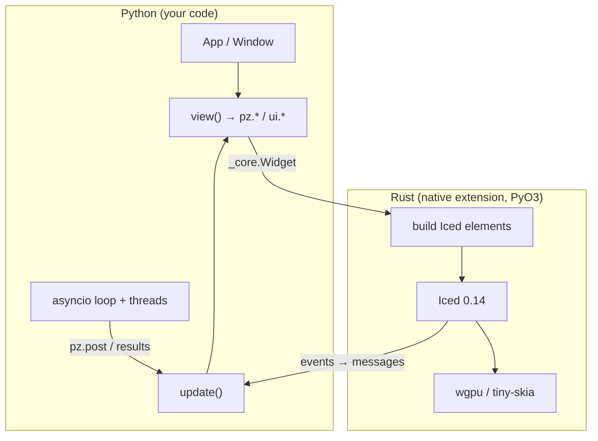

```
Python                         Rust (pyzed._core, PyO3)                 Iced 0.14
App.view() ──► Widget tree ──────► render.rs: Widget → iced::Element ──► layout + wgpu/tiny-skia
App.update() ◄── messages ◄────── app.rs: Message, Command → Task ◄──── events (mouse, keyboard)
```

## Pieces



| File | Responsibility |
| --- | --- |
| `src/widget.rs` | The (immutable) `Widget` class and the functions that build it (`text`, `row`…). |
| `src/render.rs` | Turns the `Widget` tree into an `iced::Element` every frame. |
| `src/app.rs` | The runtime: `Message`, `Command`, dispatch to Python, keyboard, `post`, `run` and `screenshot`. |
| `src/style.rs` | Conversion of colors, sizes, padding and fonts from Python values. |
| `src/highlighter.rs` | Syntax highlighting with syntect (two-face grammars) and theme colors. |
| `src/fonts.rs` | Bundled fonts (IBM Plex, Lucide) and `load_font`. |
| `python/pyzed/` | The `App` class, themes, icons, CLI and the `pyzed.ui` components. |

## Performance

- **Widgets are Rust data.** Building the tree from Python creates small, immutable objects;
  no live Iced objects exist in Python.
- **The heavy lifting is in Rust.** Layout, text measurement, highlighting, scrolling and drawing
  happen in Rust; Python only runs when there is a message.
- **The GIL is released** while Iced waits for events, so Python threads keep running.
- **Native state for the editor.** Each editor's buffer (text, cursor, history) lives in Rust
  and is identified by `id`, so typing doesn't rebuild the text in Python.

## Messages

Every interactive widget keeps a reference to the Python value you gave it. When Iced produces
an event, `app.rs` turns it into a call:

1. If it is a callable, it calls it (with the control's value, if any).
2. If it returns a `Command`, it translates it into an Iced `Task`.
3. If it returns any other value (or the message was not callable), it calls `app.update(value)`.
4. It asks for `view()` again and Iced draws the difference.

## Contributing

```bash
maturin develop --release
pytest tests
cargo fmt --check && cargo clippy -- -D warnings
```

The documentation lives in [`docs/`](https://github.com/albakore/pyzed/tree/main/docs). See
[editing the documentation](/pyzed/contributing/docs/).
