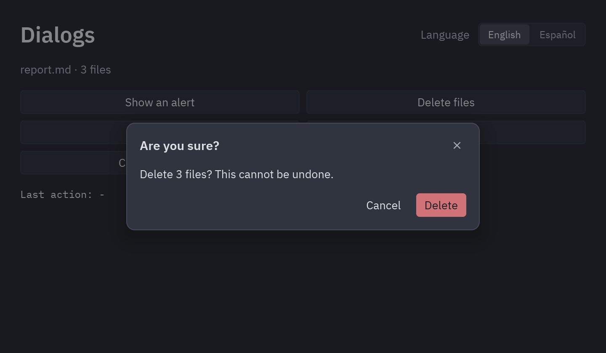

## Languages

`pyzed.i18n` keeps one catalog of texts per language. Views look texts up with `pz.t`, so
switching the language from a handler redraws the whole app in the new one.

```python
import pyzed as pz
from pyzed import i18n

i18n.add("en", {"greeting": "Hello, {name}!", "files": {"one": "{count} file", "other": "{count} files"}})
i18n.add("es", {"greeting": "¡Hola, {name}!", "files": {"one": "{count} archivo", "other": "{count} archivos"}})
i18n.set_language(i18n.system_language())   # or "es", "pt_BR"...


class Hello(pz.App):
    def view(self):
        return pz.column([
            pz.text(pz.t("greeting", name="Kev")),
            pz.text(pz.t("files", count=3)),
            pz.button("Español", on_press=lambda: i18n.set_language("es")),
        ])
```

- Placeholders like `{name}` are filled from the keyword arguments.
- A text with `one`/`other` (and optionally `zero`) forms is a plural; `count=` picks the form.
- Nested tables become dotted keys: `{"menu": {"open": "Open"}}` is `pz.t("menu.open")`.
- Missing texts fall back from `"es_AR"` to `"es"`, then to the fallback language (`"en"`,
  see `i18n.set_fallback`), then to the key itself.

Catalogs can live in files, one per language, next to your app:

```text
locales/
├── en.json      {"greeting": "Hello, {name}!"}
└── es.toml      greeting = "¡Hola, {name}!"
```

```python
i18n.load("locales")   # ["en", "es"]
```

Pyzed's own components (the dialogs below, the dock's menu) are translated too. English and
Spanish are built in; their keys start with `pyzed.` (`pyzed.ok`, `pyzed.cancel`...), so
`i18n.add("fr", {"pyzed": {"ok": "OK", "cancel": "Annuler"}})` adds French.

## Dialogs

`pyzed.ui` has ready-made dialogs. Keep which one is open in your state and wrap the view
with `ui.dialog_layer`, which dims the window and centers the dialog:



```python
from pyzed import ui

class Files(pz.App):
    asking = False

    def delete(self):
        ...
        self.asking = False

    def view(self):
        dialog = None
        if self.asking:
            dialog = ui.confirm("Delete 3 files?", self.delete, lambda: setattr(self, "asking", False), danger=True)
        return ui.dialog_layer(self.main_view(), dialog, on_dismiss=lambda: setattr(self, "asking", False))
```

| Dialog | What it does |
| --- | --- |
| `ui.alert(message, on_close, kind=)` | A message with an OK button; `kind` adds an info, success, warning or error icon. |
| `ui.confirm(message, on_confirm, on_cancel, danger=)` | A yes/no question; `danger=True` makes the button a red Delete. |
| `ui.prompt(title, value, on_input, on_submit, on_cancel)` | Asks for a line of text (Enter submits). |
| `ui.choice(message, [(label, on_press), ...], on_cancel)` | Your own buttons; the last one is the main one. |
| `ui.unsaved_changes(name, on_save, on_discard, on_cancel)` | "Save your changes before closing?" |

For anything else, `ui.modal(content, title=, footer=[...])` is the same surface with your
own content. See [`examples/dialogs.py`](https://github.com/albakore/pyzed/blob/main/examples/dialogs.py).
