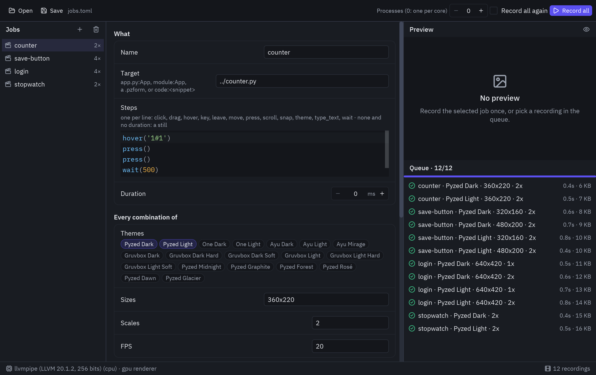

import Commands from '../../../components/Commands.astro';

`pyzed record` films your app **off-screen**: no window, display or GPU needed. The pointer, the
keyboard and the clock are simulated, so hover and press states, tooltips, typing and animations show up
as they do in a window, and a clip comes out the same on every machine. Every image and animation in this
documentation is made this way.

## One screenshot or one clip

<Commands
	uv={`
		uv run pyzed record shot app.py -o app.png --size 800x600
		uv run pyzed record clip app.py --steps "hover('Save'); press(); wait(600)" -f webp,gif,mp4
	`}
	pip={`
		pyzed record shot app.py -o app.png --size 800x600
		pyzed record clip app.py --steps "hover('Save'); press(); wait(600)" -f webp,gif,mp4
	`}
	python={`
		{py} -m pyzed.recording shot app.py -o app.png --size 800x600
		{py} -m pyzed.recording clip app.py --steps "hover('Save'); press(); wait(600)" -f webp,gif,mp4
	`}
/>

What to record (the **target**):

- `app.py` or `app.py:MyApp`: a `pz.App` in a file (without a name, the file's `app` or the last App it defines).
- `package.module:MyApp`: the same, from an importable module.
- `login.pzform` / `card.pzcomp`: a form or component made with the designer.
- `code:ui.button('Save', None)`: a snippet whose last line is the widget.

Options separated by commas record **every combination**: `--theme "Pyzed Dark,Pyzed Light" --scale 1,2` makes
four files, named `app.pyzed-dark.1x.png`, `app.pyzed-dark.2x.png`... (`-o` takes `{name}`, `{variant}`,
`{theme}`, `{size}`, `{scale}`, `{fps}` and `{ext}`).

| Option | |
| --- | --- |
| `-f`, `--formats` | `webp` (animated), `png` (a still), `gif`, `apng`, `mp4`, `webm` (the last two need ffmpeg) |
| `--size`, `--scale`, `--theme`, `--fps` | the canvas in logical pixels, pixels per logical pixel, themes, frames per second |
| `--steps`, `--duration` | what happens (below) and milliseconds to film after it |
| `--crop` | trim the clip to what is drawn, plus `--margin` pixels |
| `--max-bytes`, `--max-width` | lower the quality until each file fits, scale wide clips down |
| `--poster` | also write the first frame as a still `.still.webp` (for "reduce motion") |
| `--renderer` | `auto`, `gpu` or `cpu` (see [Speed](#speed)) |

## Steps

Steps move the pointer and the keyboard while the frames are filmed, one per line or separated by `;`:

```python
hover("Save")            # glide to the text "Save" and stay
press()                  # click where the pointer is (or press("Save"))
drag("@0.2,0.5", "@0.8,0.5")   # points relative to what is drawn
type_text("Ada", cps=12) # type into the focused field
key("Enter")             # or key("s", "ctrl")
scroll(3)                # the wheel, three lines down
wait(600)                # time passes: animations and spinners move
leave()                  # the pointer leaves
theme("Pyzed Light")     # switch themes mid-clip
```

A target is a text on screen (`"Save"`; `"1#1"` is the second text `"1"`, in reading order), a point
`(x, y)`, `"@0.25,0.5"` (relative to what is drawn), `"input"` / `"input:1"`, `"center"`, or
`("Save", 0, 30)` to aim beside a text. Only these steps and plain values are allowed, so a job file never
runs other code.

## Many at once: job files

A job file lists recordings in TOML (or JSON). Lists in a job record every combination, and `formats`
writes one recording in several formats:

```toml
out_dir = "media"              # next to this file

[defaults]
theme = ["Pyzed Dark", "Pyzed Light"]
formats = ["webp", "png"]

[[job]]
name = "counter"
target = "../counter.py"
steps = """
hover('1#1')
press()
wait(500)
"""

[[job]]
name = "login"
target = "../designer/login.pzform"
size = "640x420"
scale = [1, 2]
formats = ["png"]
```

<Commands
	uv={`
		uv run pyzed record batch examples/recording/jobs.toml            # every job
		uv run pyzed record batch examples/recording/jobs.toml counter    # only some
		uv run pyzed record batch examples/recording/jobs.toml --dry-run  # list the files it would write
	`}
	pip={`
		pyzed record batch examples/recording/jobs.toml            # every job
		pyzed record batch examples/recording/jobs.toml counter    # only some
		pyzed record batch examples/recording/jobs.toml --dry-run  # list the files it would write
	`}
	python={`
		{py} -m pyzed.recording batch examples/recording/jobs.toml            # every job
		{py} -m pyzed.recording batch examples/recording/jobs.toml counter    # only some
		{py} -m pyzed.recording batch examples/recording/jobs.toml --dry-run  # list the files it would write
	`}
/>

The batch runs one process per CPU core (`--jobs N` to choose) and **skips what didn't change**: a cache
in `out_dir` remembers the settings and the target file behind each output. `--force` records everything
again (do it when a module the app imports changed). A job that fails is reported and the rest go on;
`--json` prints one line per recording for other tools.

The whole list of settings is in the docstring of `pyzed.recording.batch`, and
[examples/recording/jobs.toml](https://github.com/albakore/pyzed/blob/main/examples/recording/jobs.toml)
is a complete example.

## The recorder window

<Commands
	uv={`uv run pyzed record gui examples/recording/jobs.toml`}
	pip={`pyzed record gui examples/recording/jobs.toml`}
	python={`{py} -m pyzed.recording gui examples/recording/jobs.toml`}
/>



The jobs are on the left, the selected job's settings in the middle (themes and formats are toggles), and the
preview and the queue on the right. **Preview** records the selected job once; **Record all** runs the batch
in other processes, so the window keeps responding and **Stop** ends it. Click a finished recording to see
it. **Save** writes the job file the command line reads.

## From Python

```python
from pyzed import recording as rec

take = rec.record(MyApp, [rec.hover("Save"), rec.press(), rec.wait(600)], size=(480, 270), fps=20)
rec.encode(take.images(), "save.webp", "webp", fps=take.fps, target=200_000)
rec.screenshot(MyApp, size=(800, 600)).save("app.png")
```

`take.images(pointer=False)` leaves the pointer out, and `rec.crop_box(...)` finds what is drawn.

## Speed

- Each process keeps its renderer (a GPU device and its pipelines) between recordings, so a batch pays for
  it once. A clip's frame builds the view twice, not three times, and goes to the encoder as pixels, with
  no PNG in between.
- WebP is encoded with effort 4: effort 6 takes ten times as long for files about 2 % smaller. The quality
  that fits `max_bytes` is found by bisection, in three or four tries.
- `--renderer auto` draws with the GPU when there is one, a software Vulkan driver (lavapipe) included, so
  recordings look the same everywhere. On a machine whose GPU is a software one (`pyzed record info` says
  so), `--renderer cpu` is two to three times faster for drafts, but blur, glow and glass come out a little
  different and `pz.shader` shows its fallback color.

On a 4-core machine with lavapipe, the docs' animation clip `overview` (120 frames at 1520×720) went from
162 s to 26 s.
