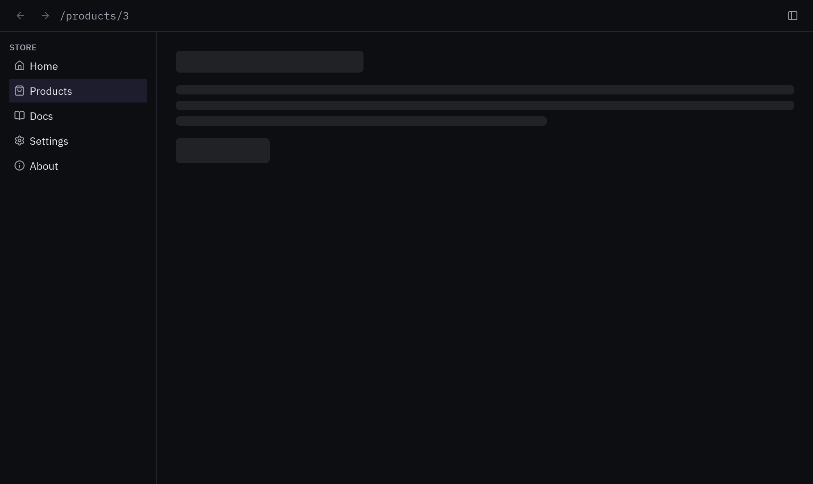
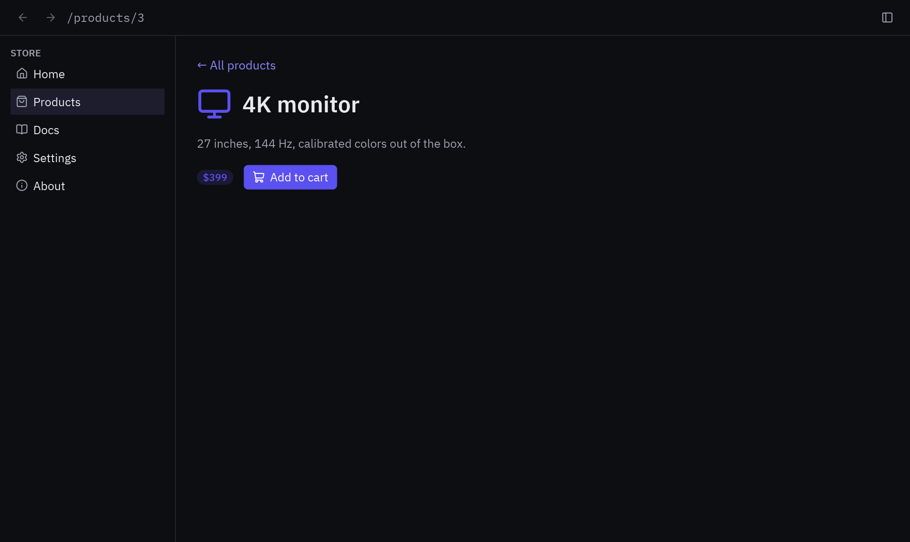
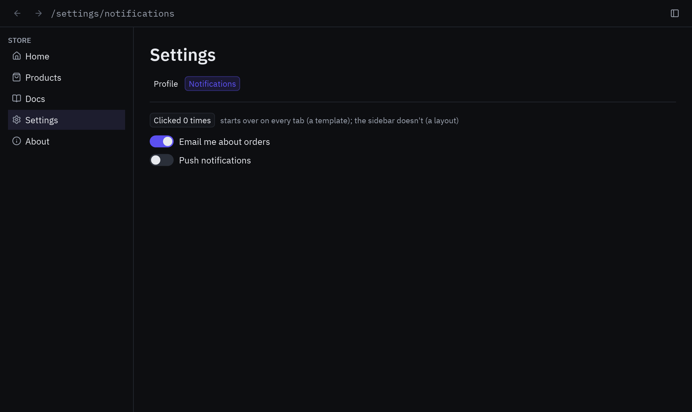
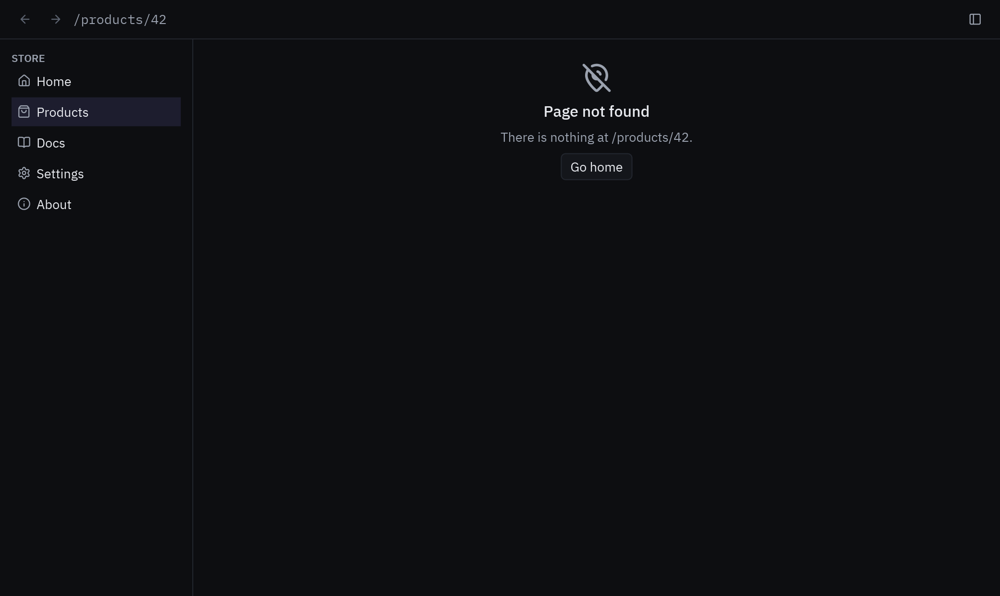

If you have built a site with the Next.js App Router, you already know how to build a multi-page
Pyzed app. Every folder of `app/` is a part of the address, `page.py` is what the address shows, and
`layout.py`, `template.py`, `loading.py`, `error.py` and `not_found.py` do what their names say.
A web app moves to the desktop with the same folders.


## Start a project

```bash
pyzed new shop --router            # a uv project
pyzed new shop --script --router   # or just main.py and app/, without uv
```

The starter has a layout with a sidebar, a home page, a list that loads its data and a detail page.
Run it with `uv run pyzed dev main.py` (or `python main.py`): with `pyzed dev`, a saved page shows
up at once, and a new folder becomes a new page without restarting.

`main.py` only starts the router:

```python
import pyzed as pz


class Shop(pz.RouterApp):
    routes = "app"        # the folder, next to this file
    title = "Shop"        # the window's title when a page has none
    size = (1000, 680)


if __name__ == "__main__":
    pz.run(Shop)
```

## Folders are addresses

```text
app/
├── layout.py               wraps every page
├── page.py                 /
├── loading.py              while a page loads
├── error.py                when a page fails
├── not_found.py            unknown addresses
├── about/page.py           /about
├── (shop)/                 a group: not part of the address
│   └── products/
│       ├── page.py         /products
│       └── [id]/
│           ├── loading.py
│           └── page.py     /products/3        params["id"] == "3"
├── docs/[[...slug]]/page.py   /docs, /docs/a/b   params["slug"] == ["a", "b"]
└── _components/            private: not a route, put helpers here
```

| Folder name | Matches | `params` |
| --- | --- | --- |
| `products` | that exact text | |
| `[id]` | one part | `{"id": "3"}` |
| `[...slug]` | one part or more | `{"slug": ["a", "b"]}` |
| `[[...slug]]` | zero parts or more | `{"slug": []}` on `/docs` |
| `(group)` | nothing: it only organizes | |
| `_private` | skipped | |

As in Next.js, a static folder wins over `[id]`, which wins over `[...slug]`, which wins over
`[[...slug]]`. Two folders that answer the same address (say, `(a)/about` and `(b)/about`) are
reported when the router starts.

## Pages

A route file defines a function named like it. It takes only the arguments it names:

```python
# app/about/page.py
import pyzed as pz
from pyzed import ui

title = "About"        # the window's title on this page


def page(params, query, router):
    return pz.column([ui.heading("About"), ui.label(f"{len(router.history)} pages visited")])
```

| Argument | What it is |
| --- | --- |
| `params` | the dynamic parts of the address: `{"id": "3"}` |
| `query` | the query string as a dict: `?sort=price` gives `{"sort": "price"}` (`query.get_all("tag")` for repeated keys) |
| `data` | what the file's `load` returned (see below) |
| `children` | in layouts and templates: what goes inside |
| `error`, `reset` | in `error.py`: the exception and a function that tries again |
| `router`, `pathname` | the router and the current path |

A page may also be a component. Its props get the same values, and its state lives while the
page is open:

```python
class Page(pz.Component):
    params: dict = {}
    name = pz.state("")

    def render(self):
        return ui.input(self.name, on_input=lambda v: setattr(self, "name", v))
```

The function (or class) can also be called `default`, like `export default`. A page may return a
string or a list too, and they become text and a column.

## Data: `load` and `loading.py`

Fetching data goes in `load`, next to the page. It runs off the UI thread, so the window stays
responsive. `async def` runs on Pyzed's asyncio loop and a regular function runs in a worker
thread. What it returns reaches the page as `data`:

```python
# app/(shop)/products/[id]/page.py
import pyzed as pz
from pyzed import ui

import store                     # store.py next to app/ is importable, like @/ in Next.js


async def load(params):
    product = await store.product(params["id"])
    if product is None:
        pz.not_found()           # shows the closest not_found.py
    return product


def title(data):
    return data.name


def page(data):
    return pz.column([pz.link("/products", "← All products"), ui.heading(data.name)])
```

While `load` runs, the closest `loading.py` above the page takes its place, inside the layouts:





Without a `loading.py`, the previous page stays on screen until the new one is ready, like
Next.js. A page's data is cached: going back and forward shows it at once, and going to the page
again after `stale_time` seconds (30 by default, `pz.Router(..., stale_time=60)`) loads it again.
`router.refresh()` loads the current data again and keeps the old data on screen meanwhile, and
`router.prefetch(href)` starts a page's `load` early (links do it when the mouse is over them).

A layout can have its own `load`: its data is kept while you navigate between the pages inside it.

:::note
The page function itself can't be `async def`. Widgets are built on the UI thread, so the awaits
go in `load`. The error message says so if you try.
:::

## Layouts and templates

`layout.py` wraps every page under its folder and the layouts inside it. It **keeps its state**
while you navigate between them, so a sidebar stays collapsed and a scroll position stays put:

```python
# app/layout.py
import pyzed as pz
from pyzed import ui

title_template = "%s · Shop"     # page titles become "Products · Shop"


class Layout(pz.Component):
    children: list = ()
    collapsed = pz.state(False)      # survives every navigation

    def render(self):
        side = pz.column([
            pz.nav_link("/", "Home", icon="house"),
            pz.nav_link("/products", "Products", icon="shopping-bag"),
        ], width=200, padding=12)
        return pz.row([side if not self.collapsed else None, pz.column(self.children, padding=24)],
                      height="fill")
```

A function works too: `def layout(children): ...`. Layouts nest: `app/settings/layout.py` adds
tabs inside the root layout.



`template.py` is the same, except that it **starts over** on every navigation: its components and
their state are created again, so an entrance animation plays again. A layout below a dynamic
folder (`[id]/layout.py`) starts over when the parameter changes, and a page starts over when its
parameters change but not when only the query does.

A layout can also share values with everything inside it through `provide`, which components read
with `pz.use_context`:

```python
def provide(params, data):
    return {"team": data}
```

## Errors and missing pages

`error.py` catches what fails below it: its pages, nested layouts and their `load`. It doesn't catch
its own folder's layout, which is caught one level up. `reset` drops the failed data and draws again:

```python
# app/error.py
def error(error, reset):
    return pz.column([ui.heading("Something went wrong"), ui.label(str(error)),
                      ui.button("Try again", reset)])
```

`not_found.py` shows for addresses that match no page, and wherever a page or a `load` calls
`pz.not_found()`. The closest one above wins:



Without these files, Pyzed shows its own error card (with the traceback in the terminal) and its
own "Page not found". `pz.redirect("/login")` goes to another page instead of the one being drawn,
replacing the history entry. `push=True` adds an entry instead.

## Navigating

```python
pz.link("/products/3", "See the monitor")          # text in the accent color
pz.link("/products/3", ui.card(...))               # any widget
pz.link("?sort=price", "Cheapest first", replace=True)
pz.link(("/users/[id]", {"id": user.id}), user.name)
pz.nav_link("/settings", "Settings", icon="settings")   # a sidebar row, selected while active
```

From code, `pz.use_router()` gives the router:

| Call | Does |
| --- | --- |
| `push(href)` | goes there and adds a history entry |
| `replace(href)` | goes there instead of the current entry |
| `back()`, `forward()`, `go(n)` | moves in the history (`can_go_back`, `can_go_forward`) |
| `refresh()` | loads the current data again |
| `prefetch(href)` | starts a page's `load` before going there |
| `is_active(href, exact=False)` | whether `href` is the current page or one of its parents |
| `href("/users/[id]", id=7)` | builds `/users/7` |
| `routes()` | every page pattern: `["/", "/products", "/products/[id]"]` |
| `listen(callback)` | calls `callback(location)` after every navigation |

`pz.use_pathname()`, `pz.use_params()` and `pz.use_search_params()` read where you are, like their
Next.js namesakes. Relative addresses work like in a browser: `"reviews"`, `"../"` and `"?page=2"`.

Alt+Left and Alt+Right (Cmd+[ and Cmd+] on macOS), the mouse's back and forward buttons and
Android's back button move in the history. The window's title follows the page's `title`,
`title(data)` or `metadata` with the closest `title_template`.

## Routes in code

A single-file app can give its routes as a dict. A value is the page, or a dict of the files:

```python
def home():
    return ui.heading("Home")

def user(params):
    return ui.heading(f"User {params['id']}")

pz.run(pz.RouterApp({
    "/": {"page": home, "layout": shell, "not_found": missing},
    "/users/[id]": {"page": user, "load": fetch_user, "loading": spinner, "title": "User"},
}))
```

A router also fits inside your own app: keep `self.router = pz.Router("app")`, return
`self.router.view()` from `view()` (or from one region of it), and forward the keys with
`def on_key(self, combo): return self.router.handle_key(combo) or None`.

## Forms from Pyzed Design

A `page.pzform` made in [Pyzed Design](/pyzed/guides/designer/) works as a page: put it in the
route's folder instead of `page.py`. It is laid out in the space the layouts leave it, and its
handlers can navigate with `pz.use_router().push(...)`.

## On the web

Locations are plain URLs (`/products/3?sort=price#reviews`), so the same `app/` folder can map one
to one to a browser's address bar. `router.url` and `router.location` give the current one and
`push` accepts any of them.

## Next.js equivalents

| Next.js | Pyzed |
| --- | --- |
| `page.tsx`, `layout.tsx`, `template.tsx` | `page.py`, `layout.py`, `template.py` |
| `loading.tsx`, `error.tsx`, `not-found.tsx` | `loading.py`, `error.py`, `not_found.py` |
| async server component | `async def load(params)` + `def page(data)` |
| `generateMetadata` / `metadata` | `title`, `def title(data)`, `metadata` |
| `<Link href>` | `pz.link(href, content)` |
| `useRouter`, `usePathname`, `useParams`, `useSearchParams` | `pz.use_router`, `pz.use_pathname`, `pz.use_params`, `pz.use_search_params` |
| `notFound()`, `redirect()` | `pz.not_found()`, `pz.redirect()` |

Parallel routes (`@slot`) and intercepting routes (`(.)photo`) are not supported yet.

See the full example in `examples/routing/` and the [API reference](/pyzed/reference/routing/).
