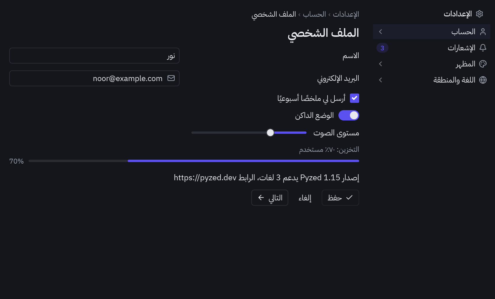
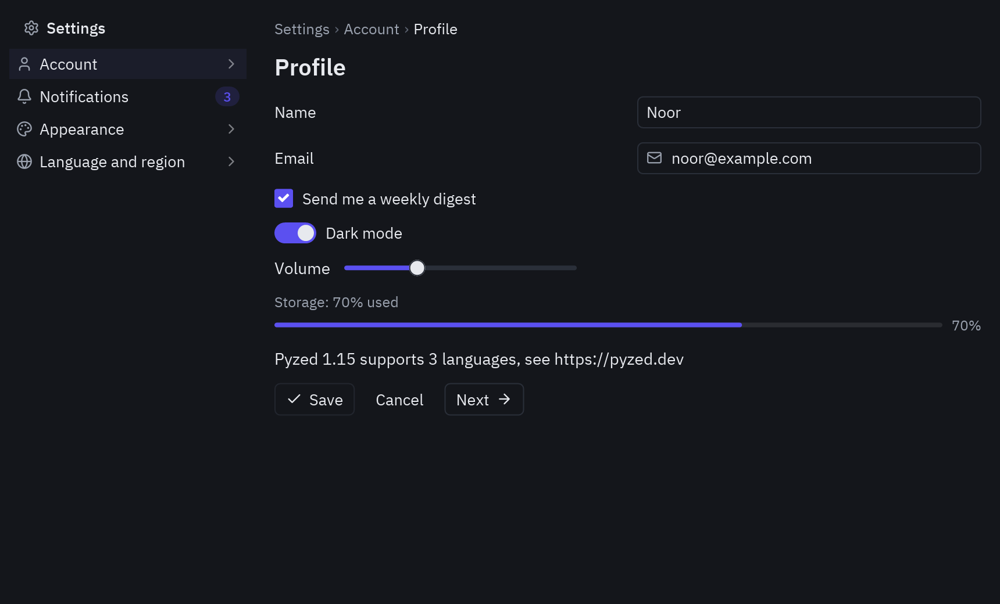
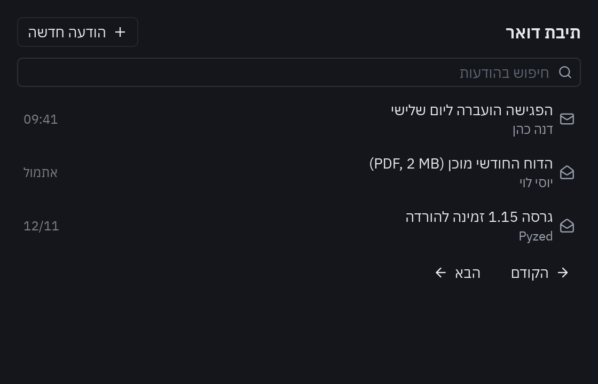

Arabic, Hebrew, Persian and Urdu are read from right to left, and so is the whole screen: the
sidebar goes on the right, rows start on the right, a progress bar fills from the right and a
"next" arrow points left. Pyzed does all of that with one setting.



The same screen with the language set to English:



## Turning it on

The direction follows the language by default: once [`i18n.set_language`](/pyzed/guides/i18n/) picks
`"ar"`, `"he"`, `"fa"`, `"ur"` or another right-to-left language, every window is laid out from
right to left. Nothing else in the app changes.

```python
import pyzed as pz
from pyzed import i18n

i18n.set_language("ar")   # the app now runs right to left


class Settings(pz.App):
    def view(self):
        return pz.row([
            pz.text("الإعدادات"),                       # starts on the right
            pz.button("التالي", icon="arrow-right"),    # its arrow points left
        ], spacing=8)
```

You can also choose it yourself:

| Where | How |
| --- | --- |
| The whole app | `pz.set_direction("rtl")`, `"ltr"` or `"auto"` (follow the language, the default) |
| One window | `direction = "rtl"` on the class, or `self.set_direction("rtl")`; `None` uses the app's |
| One part of a view | `pz.direction(widget, "ltr")` or `widget.direction("ltr")` |

`pz.get_direction()` returns `"ltr"` or `"rtl"`, and `pz.is_rtl()` tells a view which way it is
being drawn, for the few things you place by hand.

```python
class Editor(pz.Window):
    direction = "rtl"

    def view(self):
        return pz.column([
            pz.text("שלום"),
            # a phone number, a code or a math formula reads left to right even here
            pz.row([pz.text("+972"), pz.text("52-123-4567")]).direction("ltr"),
        ])
```

## What is mirrored

- **Layout.** Rows, grids, wraps, stacks and docks place their children from the right. The
  start of `padding=(top, right, bottom, left)` and `align_x="left"` mean the start side, so a
  layout written for one direction works in both.
- **Text.** Lines line up on the right, and letters, numbers, Latin words and URLs inside an
  Arabic or Hebrew sentence keep their own order (the Unicode bidirectional algorithm).
  `align_x="right"` on a text means "the end side", the left in a right-to-left part.
- **Text fields.** The text starts on the right, typing goes to the left, and the
  <kbd>←</kbd>/<kbd>→</kbd> keys move the way the line reads: <kbd>←</kbd> goes forward in a
  right-to-left line. A click puts the cursor on the letter it lands on, also in Arabic,
  Hebrew and accented text.
- **Controls.** Sliders and progress bars fill from the right, scroll areas start on the right,
  split views and resizable panels keep their handle between the same two parts, and tooltips and
  popups placed on the `"left"` or `"right"` open on the other side.
- **Icons.** Arrows, chevrons, panel and undo/redo icons point the other way
  (`chevron-right` is drawn as `chevron-left`). A text made only of a pointing mark such as
  `›` or `→` is flipped too. `pyzed.bidi.mirrored_icon(name)` tells you which icon is shown.
- **Components.** Everything in `pyzed.ui` (lists, breadcrumbs, tabs, menus, dialogs, forms,
  toolbars) is built from the pieces above, so it mirrors with no extra code. The themes are
  the same in both directions.



## Fonts

Pyzed bundles IBM Plex Sans Arabic and IBM Plex Sans Hebrew, the companions of the interface
font, in the four weights the components use. They are picked for Arabic and Hebrew letters
automatically, so text in those scripts looks the same on every system. Persian and Urdu use the
Arabic font; other scripts use the system's fonts.

## What stays as it is

- **Code editors** (`pz.code_editor`) are always left to right, like code.
- **Canvas drawings, `pz.pin` positions and mouse coordinates** are real screen positions: x
  still grows to the right. Use `pz.is_rtl()` if a drawing should flip.
- **Scrollbars** stay on the right side of a scroll area.
- **Images and other icons** are drawn as they are. Mirror a custom image with your own asset.
- A long right-to-left text in a field that does not have the focus shows its end, not its start.
- Custom fonts used in right-to-left text should include the Unicode marks U+200F and U+200B
  (most do); without them the first letter of some lines can be drawn with a fallback font.

## API

| Name | Description |
| --- | --- |
| `pz.set_direction(direction)` | The app's direction: `"ltr"`, `"rtl"` or `"auto"` (follow the language) |
| `pz.get_direction()` | The direction now in effect, `"ltr"` or `"rtl"` |
| `pz.is_rtl()` | Whether the view being drawn is right to left |
| `pz.direction(widget, direction)` / `widget.direction(direction)` | Lays out a part of a view in its own direction |
| `Window.direction`, `Window.set_direction`, `Window.resolved_direction()` | A window's own direction |
| `pyzed.bidi.is_rtl_language(code)` | Whether a language code (`"ar"`, `"he-IL"`, `"fa_IR"`) is right to left |
| `pyzed.bidi.mirrored_icon(name)` | The icon drawn for `name` in a right-to-left part |
| `pyzed.bidi.RTL_LANGUAGES` | The language codes laid out right to left |
