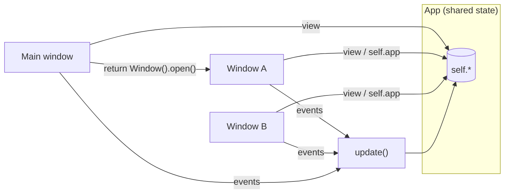

An app can have as many windows as you want. The main window is your `App`; the others are
subclasses of `pz.Window`, each with its own `view()`, title, size and theme.


```python
import pyzed as pz
from pyzed import ui


class Settings(pz.Window):
    title = "Settings"
    size = (420, 300)
    theme = "One Light"                # optional: defaults to the app's theme

    def view(self):
        return pz.container(
            pz.column([
                ui.heading("Settings", level=2),
                ui.field("Autosave", ui.switch(self.app.autosave, self.app.set_autosave)),
                ui.button("Close", self.close),
            ], spacing=12),
            padding=20,
        )


class Main(pz.App):
    def __init__(self):
        self.autosave = True
        self.settings = Settings()

    def set_autosave(self, value):
        self.autosave = value

    def open_settings(self):
        if not self.settings.is_open:
            return self.settings.open()
        return pz.Command.focus_window(self.settings)

    def view(self):
        return pz.center(ui.button("Open settings", self.open_settings, icon="settings"))


pz.run(Main)
```

## How it works



- `window.open()` (or `Command.open_window(window)`) returns the command that opens it.
- `self.app` points to the app inside each window, so they **share state**: callbacks like
  `self.app.save` work directly.
- Messages produced in a window go to its `update()`, which by default forwards them to
  `app.update()`.
- `window.is_open` tells whether it is open. Closing the main window ends the app.

## Options

Class or instance attributes:

| Attribute | Description |
| --- | --- |
| `title` | Text or callable. |
| `size`, `min_size`, `max_size` | Sizes in logical pixels. |
| `position` | `"center"` or `(x, y)`. |
| `resizable`, `decorations` | `decorations=False` removes the system frame (custom title bar). |
| `transparent`, `maximized`, `fullscreen` | Initial state. |
| `scale` | Interface scale. |
| `theme` | A `Theme`, a name or `themes.auto(...)`. `None` uses the app's theme. |
| `transition`, `exit_transition` | How it animates when it opens and closes: `"fade"`, `"zoom"`, `"pop"`, `"slide_up"`... a preset or a `pz.Animation`. See [Animation](/pyzed/guides/animation/#window-transitions). |

`window_size` holds the current size and `window_position` where the window is on the screen (both updated by the runtime; the position is `None` on Wayland).

## Hooks

| Method | When it is called |
| --- | --- |
| `on_open()` | When it opens. |
| `on_close()` | When the user asks to close it. Return `False` to keep it open (for example, to ask whether to save). |
| `on_resize(width, height)` | When it is resized. |
| `on_key(combo)` | Key presses while that window is focused. |

## Window commands

They all accept the window as the last argument; without it they act on the window that produced
the message.

| Command | Effect |
| --- | --- |
| `Command.open_window(w)` / `w.open()` | Opens the window. |
| `Command.close_window(w)` / `w.close()` | Closes it. |
| `Command.drag_window(w)` / `w.drag()` | Starts moving it with the mouse (for custom title bars). |
| `Command.minimize_window(w)` | Minimizes it. |
| `Command.toggle_maximize_window(w)` | Maximizes or restores it. |
| `Command.set_fullscreen(True, w)` | Fullscreen. |
| `Command.resize_window(width, height, w)` | Resizes it. |
| `Command.move_window(x, y, w)` | Moves it. |
| `Command.focus_window(w)` | Brings it to the front. |

### Custom title bar

```python
class Frameless(pz.App):
    decorations = False

    def view(self):
        bar = pz.mouse_area(
            ui.title_bar([ui.title_button("My app")], [ui.icon_button("x", self.close)]),
            on_press=self.drag,
            on_double_click=lambda: pz.Command.toggle_maximize_window(),
        )
        return pz.column([bar, self.content()])
```

### Draggable tabs and detachable windows

`ui.tab_bar` tabs can be dragged. `on_drag(id)` says a drag started; while `dragging` names the tab,
`on_drag_over(index)` reports the insertion point under the pointer (or `None` off the row) and `drop_index`
draws the mark there. `on_drop(id, event)` comes when it is released, with the pointer in the window
(`event.window_x`, `event.window_y`, outside it when the tab was dropped outside) and on the screen
(`event.screen`). Each window's `window_position` and `window_size` say where it is, so you can open the tab
in a new window, or stack it into the window under the pointer:

```python
class Detached(pz.Window):
    size = (640, 420)

    def __init__(self, name, position):
        self.name = self.title = name
        if position is not None:
            self.position = position

    def view(self):
        return ui.tab_bar([ui.Tab.for_file(self.name)], self.name)


class Editor(pz.App):
    def __init__(self):
        self.files, self.active = ["main.py", "app.py", "README.md"], "main.py"
        self.dragging, self.over = None, None

    def start(self, name):
        self.dragging = name

    def hover(self, index):
        self.over = index

    def drop(self, name, event):
        over, self.dragging, self.over = self.over, None, None
        if over is not None:  # released on the row: reorder
            i = self.files.index(name)
            self.files.insert(over - (over > i), self.files.pop(i))
            return None
        width, height = self.window_size or self.size
        if 0 <= event.window_x < width and 0 <= event.window_y < height:
            return None  # released inside the window, off the row
        self.files.remove(name)
        self.active = self.files[0] if self.files else None
        where = (event.screen_x - 80, event.screen_y - 12) if event.screen else None
        return Detached(name, where).open()

    def view(self):
        return ui.tab_bar([ui.Tab.for_file(f) for f in self.files], self.active,
                          on_select=lambda f: setattr(self, "active", f),
                          on_drag=self.start, on_drop=self.drop, on_drag_over=self.hover,
                          dragging=self.dragging, drop_index=self.over)
```

To stack a tab into another of your windows, compare `event.screen` with that window's `window_position` and
`window_size`. Wayland does not tell apps where their windows are: there `event.screen` and `window_position`
are `None`, so offer a menu command too (Pyzed Design has **Move tab to new window** and **Move tab to main
window**).

:::note
`pz.run()` can only be called once per process (a winit limitation). For more windows, use
`pz.Window`.
:::
