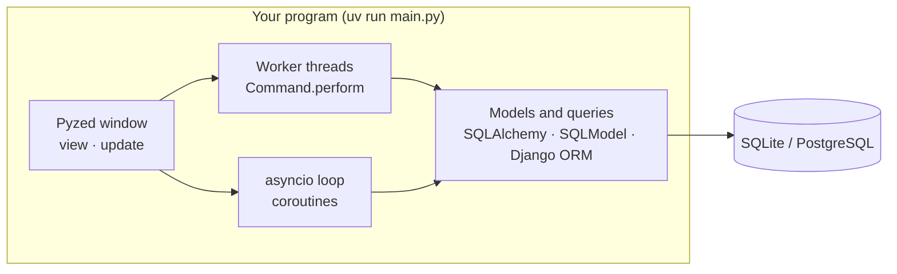
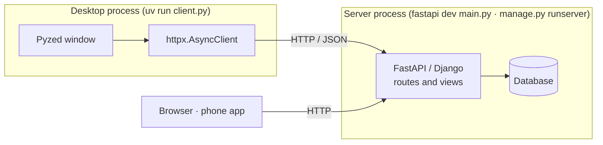
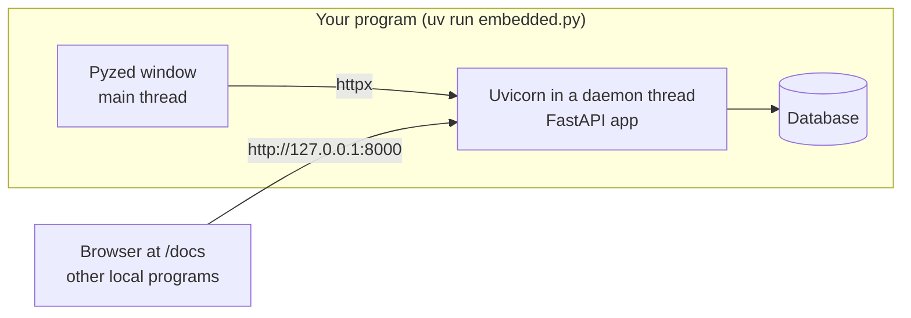
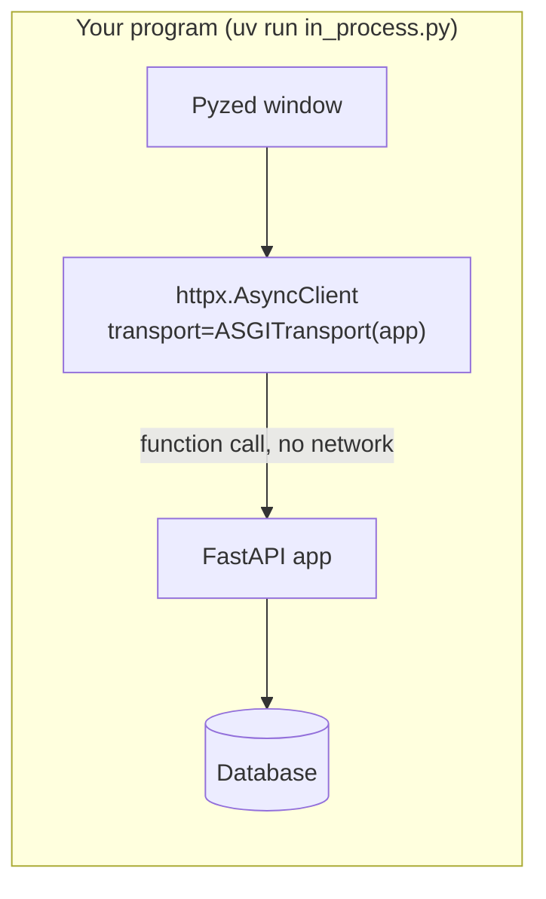

A Pyzed window is a Python program, so a backend library can sit next to it in four different
ways. The choice depends on one question: **who else needs the data?**

| Architecture | Who uses the data | Network | Demos |
| --- | --- | --- | --- |
| [1. Same process](#1-same-process) | Only this desktop app | None | SQLAlchemy, SQLModel, Django ORM, aiosqlite, Pydantic |
| [2. Client and server](#2-client-and-server) | A website, a phone app, other users | HTTP to a server | FastAPI `client.py`, Django `client.py`, httpx |
| [3. Embedded server](#3-embedded-server) | This app and other programs on the same computer | Local port | FastAPI `embedded.py` |
| [4. In-process API](#4-in-process-api) | Only this app, but the code is an API | None | FastAPI `in_process.py` |

All four can share the same code: the models and the API don't know whether a window, a browser
or a test calls them. That is what lets an app start with architecture 1 and move to 2 later.

## 1. Same process

The window imports the library and calls it directly. There is no server and nothing listens
on the network. This is the default for a desktop app with its own database.



- **Blocking libraries** (a SQLAlchemy `Session`, SQLModel, the Django ORM) run in a worker
  thread with `Command.perform(function, then)`.
- **Async libraries** (`AsyncSession`, aiosqlite) run as coroutines on Pyzed's loop.
- The database can still be shared: the [Django demo](/pyzed/integrations/django/)'s
  `desktop.py` and `manage.py runserver` use the same `db.sqlite3` at the same time.

Demos: [`sqlalchemy_quickstart`](/pyzed/integrations/sqlalchemy/) (both backends),
[`sqlmodel_heroes`](/pyzed/integrations/sqlmodel/), [`django_polls`](/pyzed/integrations/django/) `desktop.py`,
[`aiosqlite_journal`](/pyzed/integrations/other-libraries/#aiosqlite), [`pydantic_signup`](/pyzed/integrations/pydantic/).

## 2. Client and server

The backend is a separate program, started with its own tool (`fastapi dev`, `manage.py runserver`,
a deployment on a server). The window is one more client and only speaks HTTP, usually with httpx.



- Use it when the data must be shared between users or devices, or the API already exists.
- The window needs neither the database driver nor the backend framework installed.
- Errors arrive as HTTP statuses: a FastAPI 422 goes straight into `pz.validation_errors`.

Demos: [`fastapi_heroes`](/pyzed/integrations/fastapi/) `client.py`, [`django_polls`](/pyzed/integrations/django/)
`client.py`, [`httpx_pypi`](/pyzed/integrations/httpx/) (a public API).

## 3. Embedded server

One program starts the API in a background thread with Uvicorn and then opens the window. The
API is available on a local port while the window is open, for a browser, a script or another app.



- Use it for a tool that also exposes an API or a web page, such as a local dashboard or a
  device that receives webhooks.
- The server stops with the window, because its thread is a daemon.
- Bind to `127.0.0.1` unless other computers must connect.

Demo: [`fastapi_heroes`](/pyzed/integrations/fastapi/#3-embedded-server) `embedded.py`.

## 4. In-process API

httpx can send requests straight to an ASGI app with `httpx.ASGITransport`, without a server or
a port. The code is written as an API and a client, but runs as one offline program.



- Use it to ship the same API as a desktop app that works offline, or to test the client.
- `ASGITransport` doesn't run startup or lifespan events: call your setup code yourself.

Demo: [`fastapi_heroes`](/pyzed/integrations/fastapi/#4-in-process) `in_process.py`.

## Which one fits each library

| Library | Same process | Client and server | Embedded server | In-process API |
| --- | --- | --- | --- | --- |
| FastAPI | Import its models only | ✅ `fastapi dev` / `fastapi run` | ✅ Uvicorn in a thread | ✅ `ASGITransport` |
| Django | ✅ ORM after `django.setup()` | ✅ `manage.py runserver` | Not recommended: run it apart | Possible through its ASGI app |
| SQLAlchemy | ✅ `Session` or `AsyncSession` | Behind your API | — | — |
| SQLModel | ✅ `Session` | Behind FastAPI | — | — |
| httpx | — | ✅ the client | ✅ the client | ✅ the transport |
| Pydantic | ✅ validates the form | ✅ parses the responses | ✅ | ✅ |
| aiosqlite | ✅ on Pyzed's loop | — | — | — |

## Structure of a project

Keep the backend free of Pyzed and the window free of SQL. The demos all follow this layout,
which lets the same backend serve a window, an API and tests:

```text
myapp/
├── pyproject.toml
├── models.py       # SQLModel / SQLAlchemy / Django models, Pydantic schemas
├── db.py           # the queries, one function per action, no Pyzed imports
├── main.py         # FastAPI app or Django project (when there is a server)
└── window.py       # the Pyzed App: calls db.py or the API
```
