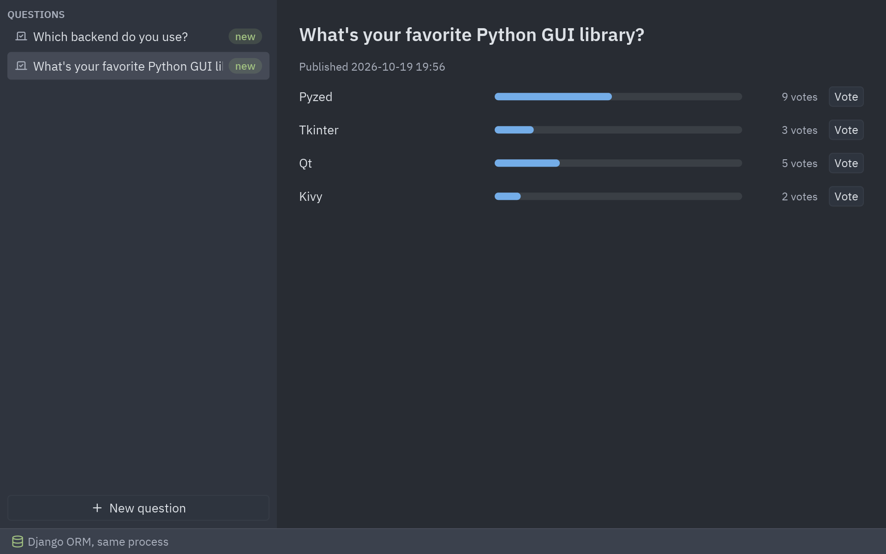
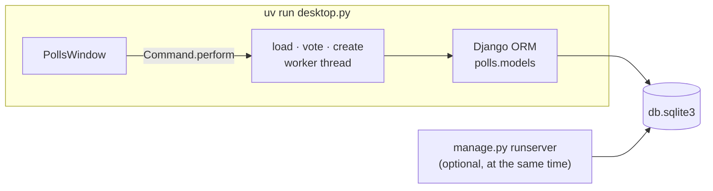
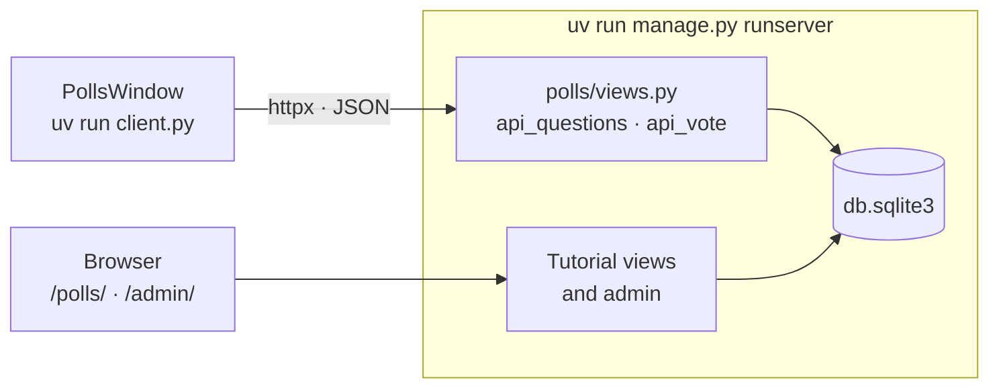

import { Code, Steps, Aside, Tabs, TabItem } from '@astrojs/starlight/components';
import desktop from '../../../../../examples/integrations/django_polls/desktop.py?raw';
import client from '../../../../../examples/integrations/django_polls/client.py?raw';
import window from '../../../../../examples/integrations/django_polls/polls_window.py?raw';
import views from '../../../../../examples/integrations/django_polls/polls/views.py?raw';

The demo is the project from [Django's tutorial](https://docs.djangoproject.com/en/stable/intro/tutorial01/),
`mysite` with its `polls` app, built step by step as the tutorial does: models, migrations, the
admin, generic views and templates. A Pyzed window then votes on the polls in two ways, which
correspond to two [architectures](/pyzed/integrations/architectures/):

- **`desktop.py`**: the window imports the models and uses the ORM directly (same process).
- **`client.py`**: the site runs with `runserver` and the window calls its JSON views (client and server).



## The Django project, as the tutorial builds it

<Steps>

1. **Create the project and the app** (already done in the demo folder):

   ```bash
   uv run django-admin startproject mysite .
   uv run manage.py startapp polls
   ```

   and add `"polls.apps.PollsConfig"` to `INSTALLED_APPS` in `mysite/settings.py`.

2. **Write the models** in `polls/models.py` (tutorial part 2):

   ```python
   class Question(models.Model):
       question_text = models.CharField(max_length=200)
       pub_date = models.DateTimeField("date published")

   class Choice(models.Model):
       question = models.ForeignKey(Question, on_delete=models.CASCADE)
       choice_text = models.CharField(max_length=200)
       votes = models.IntegerField(default=0)
   ```

3. **Create the tables and an admin user:**

   ```bash
   uv run manage.py migrate
   uv run manage.py createsuperuser
   ```

4. **Register the admin** (part 7), with the choices inline, so you can add polls at
   [http://127.0.0.1:8000/admin/](http://127.0.0.1:8000/admin/).

5. **Write the views and URLs** (parts 3 and 4): `IndexView`, `DetailView`, `ResultsView` and
   `vote`, which uses an `F()` expression so concurrent votes don't overwrite each other. The demo
   adds two small JSON views for the desktop client, `api/questions/` and
   `api/questions/<id>/vote/`.

6. **Run the site:**

   ```bash
   uv run manage.py runserver
   ```

   The polls are at [http://127.0.0.1:8000/polls/](http://127.0.0.1:8000/polls/).

</Steps>

## Way 1: the ORM in the same process

`desktop.py` sets up Django the way `manage.py` does and then imports the models. No web server
is needed; the window reads and writes `db.sqlite3` through the ORM.

```bash
uv run manage.py migrate     # once
uv run desktop.py
```



<Steps>

1. **Call `django.setup()` before importing models:**

   ```python
   os.environ.setdefault("DJANGO_SETTINGS_MODULE", "mysite.settings")
   django.setup()

   from polls.models import Question
   ```

2. **Run ORM queries in worker threads.** They block, so `Command.perform` runs them off the UI
   thread. Django opens one database connection per thread; closing them afterwards keeps the
   thread pool from holding connections:

   ```python
   def in_thread(function):
       @functools.wraps(function)
       def wrapper(*args, **kwargs):
           try:
               return function(*args, **kwargs)
           finally:
               connections.close_all()
       return wrapper

   @in_thread
   def vote(question_id, choice_id):
       choice = Question.objects.get(pk=question_id).choice_set.get(pk=choice_id)
       choice.votes = F("votes") + 1
       choice.save()
   ```

3. **Validate with the model's own rules.** `full_clean()` checks `max_length`, required fields
   and custom validators; `pz.validation_errors` turns Django's `ValidationError` into
   `{field: message}` for `ui.field`:

   ```python
   question = Question(question_text=draft["question_text"], pub_date=timezone.now())
   try:
       question.full_clean()
   except ValidationError as error:
       return pz.validation_errors(error)
   with transaction.atomic():
       question.save()
       for text in draft["choices"]:
           question.choice_set.create(choice_text=text, votes=0)
   ```

</Steps>

<Aside type="tip">
`runserver` can run at the same time on the same database. A vote cast in the window appears on
`/polls/` and in the admin, and a question added in the admin appears in the window after a reload.
</Aside>

## Way 2: an HTTP client of the site

`client.py` doesn't import Django at all. It talks to the site's JSON views with httpx, so the
site can run on this computer or on a server:

```bash
uv run manage.py runserver   # terminal 1
uv run client.py             # terminal 2 (or: uv run client.py https://polls.example.com)
```



```python
async def vote(question_id, choice_id):
    async with httpx.AsyncClient(base_url=SITE, timeout=5) as client:
        response = await client.post(f"/polls/api/questions/{question_id}/vote/", json={"choice": choice_id})
        response.raise_for_status()
    return response.json()
```

<Aside type="caution">
The JSON vote view is marked `@csrf_exempt` because a desktop app has no CSRF cookie. For a
real API, authenticate the client with tokens, for example with
[Django REST framework](https://www.django-rest-framework.org/).
</Aside>

## One window, two backends

`PollsWindow` receives `load`, `vote` and optionally `create` as plain functions. `desktop.py`
passes regular functions (run in threads) and `client.py` passes coroutines (run on the asyncio
loop); `Command.perform` accepts both, so the window code is the same.

## Full code

<Tabs>
<TabItem label="desktop.py"><Code code={desktop} lang="py" /></TabItem>
<TabItem label="client.py"><Code code={client} lang="py" /></TabItem>
<TabItem label="polls_window.py"><Code code={window} lang="py" /></TabItem>
<TabItem label="polls/views.py"><Code code={views} lang="py" /></TabItem>
</Tabs>
