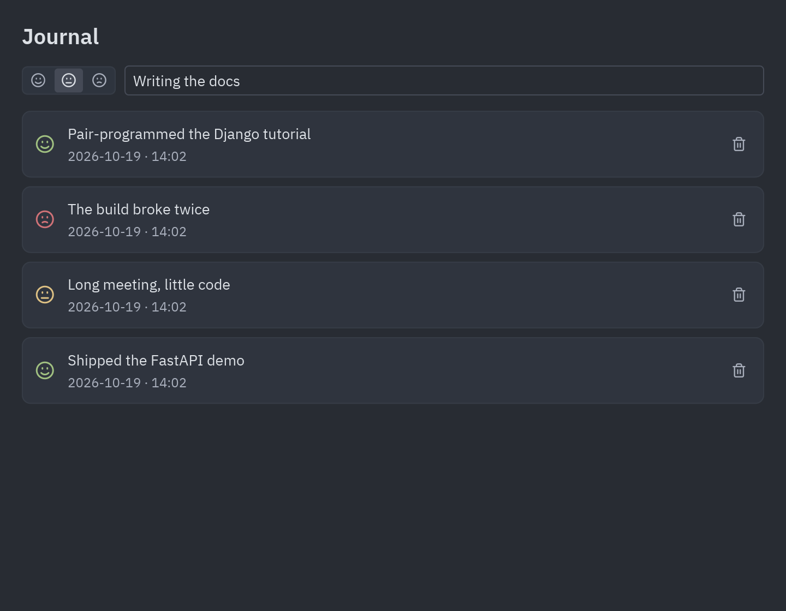

import { Code } from '@astrojs/starlight/components';
import journal from '../../../../../examples/integrations/aiosqlite_journal/main.py?raw';
import Commands from '../../../components/Commands.astro';

Every library falls into one of the cases in the [overview](/pyzed/integrations/overview/#where-your-code-runs):
async, blocking, a server or a stream. These recipes cover the ones people ask about most.

## aiosqlite

[aiosqlite](https://aiosqlite.omnilib.dev/) gives SQLite an async API. Because Pyzed runs every
coroutine on one loop, a single connection opened in `on_start` can serve the whole app:



```python
class Journal(pz.App):
    async def on_start(self):
        self.db = await aiosqlite.connect("journal.db")
        self.db.row_factory = aiosqlite.Row
        await self.db.execute("CREATE TABLE IF NOT EXISTS entries (...)")
        return await self.load()

    async def load(self):
        async with self.db.execute("SELECT * FROM entries ORDER BY id DESC") as cursor:
            return ("loaded", await cursor.fetchall())
```

<Commands
	uv={`
		cd examples/integrations/aiosqlite_journal
		uv run main.py
	`}
	pip={`
		cd examples/integrations/aiosqlite_journal
		{venv}
		{activate}
		pip install pyzed-ui aiosqlite
		python main.py
	`}
	python={`
		cd examples/integrations/aiosqlite_journal
		{py} -m pip install pyzed-ui aiosqlite
		{py} main.py
	`}
/>

<details>
<summary>Full code: <code>examples/integrations/aiosqlite_journal/main.py</code></summary>

<Code code={journal} lang="py" />

</details>

## SQLAlchemy asyncio

Covered on the [SQLAlchemy page](/pyzed/integrations/sqlalchemy/#the-asyncio-version): the
`sqlalchemy_quickstart` demo runs the same window on a sync `Session` or on an `AsyncSession`
with aiosqlite (`uv run main.py --async`).

## pandas and Polars

`ui.table` takes a list of dicts, which is one call away from a DataFrame. Read big files in a
thread so the window stays responsive:

```python
import pandas as pd


class Sales(pz.App):
    def __init__(self):
        self.frame = pd.DataFrame()

    def open(self, path):
        return pz.Command.perform(lambda: pd.read_csv(path), self.loaded)

    def loaded(self, frame):
        self.frame = frame
        self.rows = frame.to_dict("records")       # Polars: frame.to_dicts()

    def view(self):
        columns = [ui.Column(name, name) for name in self.frame.columns]
        return ui.table(columns, self.rows, height="fill")
```

The table is virtualized, so hundreds of thousands of rows scroll smoothly. For filtering,
run the query on the DataFrame (`frame[frame.city == city]`) and rebuild `self.rows`.

## requests and other blocking clients

Any blocking call goes through `Command.perform`. `raise_for_status` errors are worth catching
in the function so `then` always gets something to show:

```python
import requests


def fetch_weather(city):
    try:
        response = requests.get("https://wttr.in/" + city, params={"format": "j1"}, timeout=10)
        response.raise_for_status()
        return response.json()
    except requests.RequestException as error:
        return {"error": str(error)}


class Weather(pz.App):
    def search(self, city):
        return pz.Command.perform(lambda: fetch_weather(city), self.show)
```

## Redis pub/sub and other streams

A stream of events is a subscription: `pz.listen` runs an async generator while it appears in
`subscriptions()` and stops it when it no longer does:

```python
import redis.asyncio as redis


async def events():
    client = redis.Redis()
    async with client.pubsub() as pubsub:
        await pubsub.subscribe("orders")
        async for message in pubsub.listen():
            if message["type"] == "message":
                yield ("order", message["data"].decode())


class Orders(pz.App):
    def subscriptions(self):
        return [pz.listen(events)] if self.live else []
```

WebSockets work the same way; see `examples/websocket_stream.py` and the
[Async guide](/pyzed/guides/async/#subscriptions-timers-and-streams).

## Matplotlib

Pyzed draws its own charts (`ui.bar_chart`, `ui.sparkline`, `ui.donut`, `pz.canvas`), but a
Matplotlib figure can be shown as an image. `pz.image` accepts PNG bytes; build the figure with
`matplotlib.figure.Figure` (not `pyplot`) so it is safe to render in a thread:

```python
import io
from matplotlib.figure import Figure


def render(values) -> bytes:
    figure = Figure(figsize=(6, 3), dpi=144)
    figure.subplots().plot(values)
    buffer = io.BytesIO()
    figure.savefig(buffer, format="png", transparent=True)
    return buffer.getvalue()


class Plot(pz.App):
    def refresh(self):
        return pz.Command.perform(lambda: render(self.values), lambda png: setattr(self, "png", png))

    def view(self):
        return pz.image(self.png) if self.png else ui.spinner()
```
