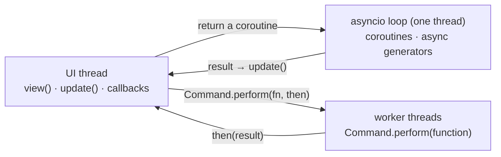

:::note[Runnable demos]
Every integration has a complete demo in examples/integrations that you can run with uv. More libraries will be added over time.
:::

Pyzed is only the interface: everything else in your app is ordinary Python. That means the
libraries you already use for web backends, databases and HTTP work unchanged in a desktop app.
This section shows how to wire the most common ones. Each demo starts from the library's own
official tutorial (FastAPI's SQL tutorial, Django's polls app, SQLAlchemy's Quick Start,
SQLModel's heroes) and adds a Pyzed window to it.

When a backend has to run alongside the window, [Architectures](/pyzed/integrations/architectures/)
explains the four ways to combine them, with a diagram for each: same process, client and server,
embedded server and in-process API.

| Demo | Libraries | What it shows | Tutorial |
| --- | --- | --- | --- |
| [`fastapi_heroes`](https://github.com/albakore/pyzed/tree/main/examples/integrations/fastapi_heroes) | FastAPI, SQLModel, httpx | FastAPI's SQL tutorial API and a desktop client for it, run three ways: separate server, embedded server and in-process. | [FastAPI](/pyzed/integrations/fastapi/) |
| [`django_polls`](https://github.com/albakore/pyzed/tree/main/examples/integrations/django_polls) | Django, httpx | Django's polls tutorial, used from a window through the ORM in the same process or over HTTP while runserver runs. | [Django](/pyzed/integrations/django/) |
| [`sqlalchemy_quickstart`](https://github.com/albakore/pyzed/tree/main/examples/integrations/sqlalchemy_quickstart) | SQLAlchemy 2.0, aiosqlite | The ORM Quick Start's users and addresses, with a sync Session in threads or an AsyncSession on the loop. | [SQLAlchemy](/pyzed/integrations/sqlalchemy/) |
| [`sqlalchemy_contacts`](https://github.com/albakore/pyzed/tree/main/examples/integrations/sqlalchemy_contacts) | SQLAlchemy 2.0 | 20,000 rows in a virtual table, searched and sorted in SQL from a worker thread. | [SQLAlchemy](/pyzed/integrations/sqlalchemy/#many-rows-the-contacts-demo) |
| [`sqlmodel_heroes`](https://github.com/albakore/pyzed/tree/main/examples/integrations/sqlmodel_heroes) | SQLModel | SQLModel's tutorial: teams, heroes, where() filters, relationships and a validated form. | [SQLModel](/pyzed/integrations/sqlmodel/) |
| [`sqlmodel_inventory`](https://github.com/albakore/pyzed/tree/main/examples/integrations/sqlmodel_inventory) | SQLModel, Pydantic | One model validates the form and defines the table. | [SQLModel](/pyzed/integrations/sqlmodel/#one-model-for-the-form-and-the-table-the-inventory-demo) |
| [`httpx_pypi`](https://github.com/albakore/pyzed/tree/main/examples/integrations/httpx_pypi) | httpx, Pydantic | Concurrent requests streamed into the window and parsed into models. | [httpx](/pyzed/integrations/httpx/) |
| [`httpx_download`](https://github.com/albakore/pyzed/tree/main/examples/integrations/httpx_download) | httpx | Streaming downloads with progress bars and cancel. | [httpx](/pyzed/integrations/httpx/#streaming-downloads-with-progress) |
| [`pydantic_signup`](https://github.com/albakore/pyzed/tree/main/examples/integrations/pydantic_signup) | Pydantic | A sign-up form validated by a model, saved and loaded as JSON. | [Pydantic](/pyzed/integrations/pydantic/) |
| [`aiosqlite_journal`](https://github.com/albakore/pyzed/tree/main/examples/integrations/aiosqlite_journal) | aiosqlite | An async SQLite connection on Pyzed's event loop. | [Other libraries](/pyzed/integrations/other-libraries/#aiosqlite) |

## Running a demo

Each demo is a small [uv](https://docs.astral.sh/uv/) project. From its folder:

```bash
cd examples/integrations/sqlalchemy_contacts
uv run main.py
```

`uv run` creates the virtual environment and installs the dependencies listed in the demo's
`pyproject.toml` the first time. Inside the repository the demos use your checkout of Pyzed
(the `[tool.uv.sources]` table); to start your own app from one, copy the folder and delete
those two lines so `pyzed-ui` comes from PyPI.

## Where your code runs

A Pyzed app has three places where code runs. Knowing which one a library call lands in is all
it takes to integrate anything:



| The library is… | Call it with | Examples |
| --- | --- | --- |
| **async** (`await ...`) | Return a coroutine or an async generator from `update`, a callback or `on_start`. Its result goes to `update`. | httpx `AsyncClient`, aiosqlite, Django's async ORM, SQLAlchemy `AsyncSession`, websockets, redis.asyncio |
| **blocking** | `Command.perform(function, then)`: `function` runs in a thread and `then(result)` on the UI thread. | SQLAlchemy and SQLModel sessions, requests, pandas, file I/O |
| **a server** | Run it apart (`fastapi dev`, `manage.py runserver`) or in a daemon thread before `pz.run`. See [Architectures](/pyzed/integrations/architectures/). | FastAPI, Django, Starlette |
| **a stream** | `pz.listen(async_generator)` in `subscriptions()`. | websockets, server-sent events, Redis pub/sub |

Three rules keep it safe:

1. **Change `self` on the UI thread.** Coroutines and threads *return* results; `update` or
   `then` store them. Reading `self` from a coroutine is fine.
2. **Never block the UI thread.** A query that takes 50 ms freezes the window for 50 ms. Use
   `Command.perform` or an async library.
3. **Ignore stale answers.** When the user types a search, results can come back out of order.
   Send the query along with the request and drop answers for an older one (every demo does
   this in its `loaded` handler).

All coroutines share **one** asyncio loop (`pz.asyncio_loop()`), so objects tied to a loop, such
as an `httpx.AsyncClient` or an `aiosqlite` connection, can be created once and reused.

## Validation errors on each field

Most backends report invalid input as a list of field errors. `pz.validation_errors(error)`
turns any of them into `{field: message}`, and `ui.field(..., error=)` shows the message under the
field title, in the theme's error color:

```python
from pydantic import ValidationError

def save(self):
    try:
        item = ItemIn.model_validate(self.draft)
    except ValidationError as error:
        self.errors = pz.validation_errors(error)
        return
    ...

def view(self):
    return ui.field("Price", ui.input(self.draft["price"], self.set_price),
                    error=self.errors.get("price"))
```

It understands:

- Pydantic and SQLModel `ValidationError` (custom `ValueError` messages lose their
  `Value error,` prefix),
- the JSON of a FastAPI **422** response, `{"detail": [...]}`, without the `body`/`query` part of
  each location, and a plain `{"detail": "Not found"}`,
- Django's `ValidationError` from `full_clean()` (`__all__` errors use the key `""`).

Nested fields are joined with dots (`"address.city"`), and errors that belong to no field use
the key `""`, which the demos show in a `ui.callout`.

## Selects with objects

`ui.select` accepts any objects as options and shows them with `str()`: a Django model, an enum,
a dataclass. `on_select` receives the object back, not its label:

```python
ui.select(self.authors, self.draft["author"], lambda author: self.draft.update(author=author))
```
