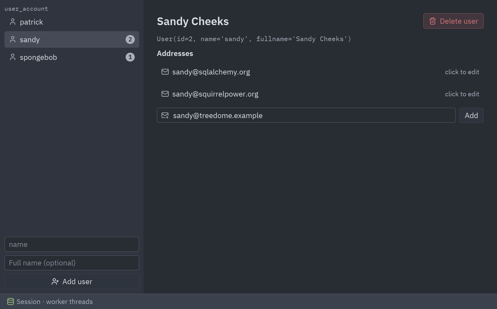
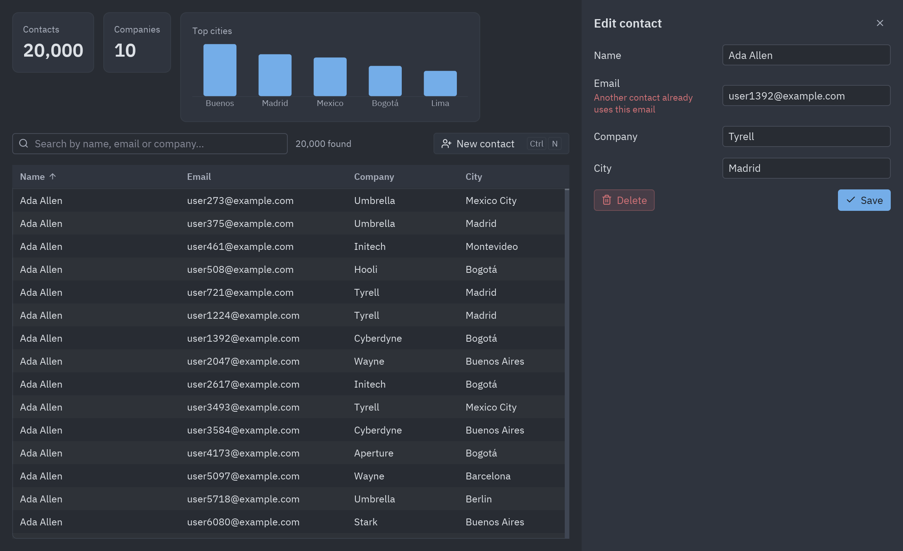

import { Code, Steps, Aside, Tabs, TabItem } from '@astrojs/starlight/components';
import qsMain from '../../../../../examples/integrations/sqlalchemy_quickstart/main.py?raw';
import qsModels from '../../../../../examples/integrations/sqlalchemy_quickstart/models.py?raw';
import qsSync from '../../../../../examples/integrations/sqlalchemy_quickstart/sync_backend.py?raw';
import qsAsync from '../../../../../examples/integrations/sqlalchemy_quickstart/async_backend.py?raw';
import main from '../../../../../examples/integrations/sqlalchemy_contacts/main.py?raw';
import db from '../../../../../examples/integrations/sqlalchemy_contacts/db.py?raw';
import Commands from '../../../components/Commands.astro';

SQLAlchemy runs in the same process as the window (architecture 1 in
[Architectures](/pyzed/integrations/architectures/)). There are two demos:

- **`sqlalchemy_quickstart`**: the `User` and `Address` models of SQLAlchemy's
  [ORM Quick Start](https://docs.sqlalchemy.org/en/20/orm/quickstart.html), with the same
  window on a sync `Session` or on the [asyncio extension](https://docs.sqlalchemy.org/en/20/orm/extensions/asyncio.html).
- **`sqlalchemy_contacts`**: 20,000 rows in a virtual table, with search and sorting in SQL.

## The Quick Start in a window



<Commands
	uv={`
		cd examples/integrations/sqlalchemy_quickstart
		uv run main.py            # Session in worker threads
		uv run main.py --async    # AsyncSession with aiosqlite on Pyzed's loop
	`}
	pip={`
		cd examples/integrations/sqlalchemy_quickstart
		{venv}
		{activate}
		pip install pyzed-ui "sqlalchemy[asyncio]" aiosqlite
		python main.py            # Session in worker threads
		python main.py --async    # AsyncSession with aiosqlite on Pyzed's loop
	`}
	python={`
		cd examples/integrations/sqlalchemy_quickstart
		{py} -m pip install pyzed-ui "sqlalchemy[asyncio]" aiosqlite
		{py} main.py            # Session in worker threads
		{py} main.py --async    # AsyncSession with aiosqlite on Pyzed's loop
	`}
/>

<Steps>

1. **Declare the models** exactly as the Quick Start does, with `DeclarativeBase`, `Mapped` and
   `relationship`. The cascade deletes a user's addresses with the user:

   ```python
   class Base(DeclarativeBase):
       pass

   class User(Base):
       __tablename__ = "user_account"

       id: Mapped[int] = mapped_column(primary_key=True)
       name: Mapped[str] = mapped_column(String(30))
       fullname: Mapped[Optional[str]]
       addresses: Mapped[List["Address"]] = relationship(back_populates="user", cascade="all, delete-orphan")

   class Address(Base):
       __tablename__ = "address"

       id: Mapped[int] = mapped_column(primary_key=True)
       email_address: Mapped[str]
       user_id: Mapped[int] = mapped_column(ForeignKey("user_account.id"))
       user: Mapped["User"] = relationship(back_populates="addresses")
   ```

2. **Create an Engine and the tables:**

   ```python
   engine = create_engine("sqlite:///quickstart.db")
   Base.metadata.create_all(engine)
   ```

3. **Open a Session per unit of work.** Each backend function opens its own `Session`, which makes
   it safe to run in any worker thread. `selectinload` loads the addresses before the session
   closes, so the window can read `user.addresses` later:

   ```python
   def users() -> list[User]:
       stmt = select(User).options(selectinload(User.addresses)).order_by(User.name)
       with Session(engine) as session:
           return list(session.scalars(stmt))

   def add_address(user_id: int, email_address: str) -> None:
       with Session(engine) as session:
           user = session.get(User, user_id)
           user.addresses.append(Address(email_address=email_address))
           session.commit()
   ```

4. **Call it from the window with `Command.perform`.** The function runs in a thread and `then`
   receives the result on the UI thread:

   ```python
   def on_start(self):
       return Command.perform(backend.setup, lambda _: self.reload())

   def reload(self):
       return Command.perform(backend.users, self.loaded)

   def add_address(self, *_):
       user_id, email = self.selected_id, self.new_email.strip()
       return Command.perform(lambda: backend.add_address(user_id, email), lambda _: self.reload())
   ```

</Steps>

### The asyncio version

`async_backend.py` has the same functions written with `create_async_engine`, an
`async_sessionmaker` and the aiosqlite driver. `Command.perform` sees that they are coroutine
functions and runs them on Pyzed's asyncio loop instead of a thread, so `main.py` doesn't change:

```python
engine = create_async_engine("sqlite+aiosqlite:///quickstart.db")
async_session = async_sessionmaker(engine, expire_on_commit=False)

async def setup() -> None:
    async with engine.begin() as conn:
        await conn.run_sync(Base.metadata.create_all)

async def users() -> list[User]:
    stmt = select(User).options(selectinload(User.addresses)).order_by(User.name)
    async with async_session() as session:
        return list(await session.scalars(stmt))
```

<Aside>
With `AsyncSession`, lazy loading would need an `await`, so relationships are loaded eagerly
with `selectinload`, and `expire_on_commit=False` keeps the objects readable after `commit()`.
Install `sqlalchemy[asyncio]` and `aiosqlite`; the extra brings `greenlet`, which the extension needs.
</Aside>

| | `Session` | `AsyncSession` |
| --- | --- | --- |
| Where it runs | A worker thread per call | Pyzed's asyncio loop |
| Pyzed call | `Command.perform(sync_function, then)` | `Command.perform(async_function, then)` or return the coroutine |
| Use it when | Most desktop apps; any driver | You already use asyncio drivers (asyncpg, aiosqlite) |

<Tabs>
<TabItem label="main.py"><Code code={qsMain} lang="py" /></TabItem>
<TabItem label="models.py"><Code code={qsModels} lang="py" /></TabItem>
<TabItem label="sync_backend.py"><Code code={qsSync} lang="py" /></TabItem>
<TabItem label="async_backend.py"><Code code={qsAsync} lang="py" /></TabItem>
</Tabs>

## Many rows: the contacts demo

A contacts manager on SQLAlchemy 2.0 and SQLite. The table holds 20,000 rows and scrolls
smoothly because `ui.table` only builds the rows in view; search and sorting run in SQL, in a
worker thread, so the window never waits for the database.



<Commands
	uv={`
		cd examples/integrations/sqlalchemy_contacts
		uv run main.py
	`}
	pip={`
		cd examples/integrations/sqlalchemy_contacts
		{venv}
		{activate}
		pip install pyzed-ui sqlalchemy
		python main.py
	`}
	python={`
		cd examples/integrations/sqlalchemy_contacts
		{py} -m pip install pyzed-ui sqlalchemy
		{py} main.py
	`}
/>

The demo keeps the database code in `db.py`, with no Pyzed in it, and the window in `main.py`.
That split is worth copying: the same `db.py` could serve a FastAPI app or a CLI.

<Steps>

1. **Models are plain SQLAlchemy 2.0.**

   ```python
   class Contact(Base):
       __tablename__ = "contacts"

       id: Mapped[int] = mapped_column(primary_key=True)
       name: Mapped[str] = mapped_column(String(80), index=True)
       email: Mapped[str] = mapped_column(String(120), unique=True)
       company: Mapped[str] = mapped_column(String(80), default="")
       city: Mapped[str] = mapped_column(String(60), default="")
   ```

2. **Each query is a function with its own session.** SQLAlchemy sessions are not shared
   between threads, so every function opens one and closes it. The loaded objects keep their
   values after the session closes, which is all the view needs:

   ```python
   def search(text, sort, descending):
       column = COLUMNS[sort]
       query = select(Contact).order_by(column.desc() if descending else column, Contact.id)
       if text:
           pattern = f"%{text}%"
           query = query.where(or_(Contact.name.ilike(pattern), Contact.email.ilike(pattern),
                                   Contact.company.ilike(pattern)))
       with Session(engine) as session:
           return list(session.scalars(query))
   ```

3. **Run it with `Command.perform`.** The function runs in a thread and `then` gets the
   result on the UI thread. Returning a list of commands runs them together:

   ```python
   def reload(self):
       query, sort, descending = self.query, self.sort, self.descending
       return [
           Command.perform(lambda: db.search(query, sort, descending), lambda rows: self.loaded(query, rows)),
           Command.perform(db.stats, lambda stats: setattr(self, "stats", stats)),
       ]

   def loaded(self, query, rows):
       if query == self.query:          # a newer search is on its way: keep waiting for it
           self.rows, self.loading = rows, False
   ```

   Copy the state you need into locals first (`query, sort, ...`): the lambda runs later, in
   another thread, and should not read `self` while the user keeps typing.

4. **Hand all the rows to `ui.table`.** It is virtualized, so 20,000 rows cost the same as 20.
   Clicking a header calls `on_sort`, which here re-runs the query with a new `ORDER BY`:

   ```python
   ui.table(columns, self.rows, sort_by=self.sort, descending=self.descending, on_sort=self.sort_by,
            on_row_press=self.open, selected=self.editing, striped=True, height="fill")
   ```

5. **Turn database errors into field errors.** `save` returns either the contact or
   `{field: message}`. A unique constraint becomes a message under the Email field:

   ```python
   try:
       session.commit()
   except IntegrityError:
       return {"email": "Another contact already uses this email"}
   ```

   ```python
   ui.field("Email", ui.input(self.draft["email"], ...), error=self.errors.get("email"))
   ```

</Steps>

<Aside type="tip">
Prefer `asyncio`? SQLAlchemy's `AsyncSession` with `aiosqlite` or `asyncpg` works too: return the
coroutine instead of using `Command.perform`. See
[Other libraries](/pyzed/integrations/other-libraries/#sqlalchemy-asyncio).
</Aside>

<Tabs>
<TabItem label="main.py"><Code code={main} lang="py" /></TabItem>
<TabItem label="db.py"><Code code={db} lang="py" /></TabItem>
</Tabs>
