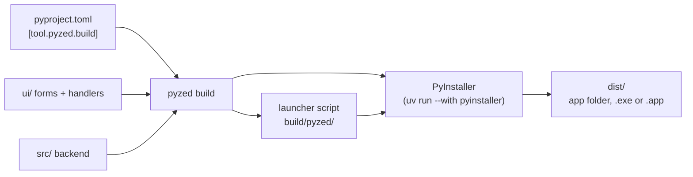

import { Aside, Steps, Tabs, TabItem } from '@astrojs/starlight/components';

`pyzed build` turns a [Pyzed project](/pyzed/guides/projects/) into an app that runs on machines without Python:
a folder (or a single file) with the Python interpreter, `pyzed-ui`, your dependencies, your backend code and your
forms. It uses [PyInstaller](https://pyinstaller.org) underneath, run inside the project's own environment, so
nothing has to be installed globally.

## Build in three steps

<Steps>

1. Open a terminal in the project folder (the one with `pyproject.toml`). If you do not have a project yet, create one
   with `pyzed new` (see [Create a project](/pyzed/getting-started/new-project/)).

2. Run the build:

   <Tabs syncKey="pkg">
   	<TabItem label="uv">
   		```bash title="Windows, macOS and Linux"
   		uv run pyzed build
   		```
   	</TabItem>
   	<TabItem label="pip">
   		```bash title="macOS and Linux"
   		source .venv/bin/activate
   		pyzed build          # or: python -m pyzed build
   		```

   		```powershell title="Windows (PowerShell)"
   		.venv\Scripts\Activate.ps1
   		pyzed build          # or: py -m pyzed build
   		```
   	</TabItem>
   </Tabs>

3. Open the result in `dist/`:

   | Platform | Result | Run it |
   | --- | --- | --- |
   | Windows | `dist\Shop\Shop.exe` (or `dist\Shop.exe` with `--onefile`) | Double-click it. |
   | macOS | `dist/Shop.app` | Open it from Finder. |
   | Linux | `dist/Shop/Shop` (or `dist/Shop` with `--onefile`) | `./dist/Shop/Shop` |

</Steps>

<Aside type="note" title="uv is needed, even with pip">
`pyzed build` runs PyInstaller through `uv run --with pyinstaller`, so [uv](https://docs.astral.sh/uv/) must be
installed even if you use pip for everything else. You do not need to install PyInstaller yourself. Install uv with
`pip install uv` or from its website.
</Aside>

<Aside type="caution" title="One build per platform">
PyInstaller does not cross-compile: build the Windows app on Windows, the macOS app on macOS and the Linux app on
Linux. A [CI workflow](/pyzed/packaging/ci/) builds all three for you.
</Aside>

## What happens when you build



1. `pyzed build` reads `[tool.pyzed]` and `[tool.pyzed.build]` from `pyproject.toml`.
2. It writes a small **launcher** (`build/pyzed/<name>_launcher.py`) that opens the main form (`[tool.pyzed] main`)
   from inside the bundle.
3. It scans the `.py` files of the UI folder with Python's `ast` module to find what they import.
4. It runs PyInstaller in the project's environment with the right options, and PyInstaller writes the app to `dist/`.

### What gets bundled

Forms load their handlers from `.py` files when they open, so PyInstaller cannot follow their imports by itself.
`pyzed build` fills the gaps:

- **The UI folder** is shipped as data, keeping its layout (`ui/main.pzform`, `ui/main.py`, helper modules...).
- **Every module imported by the UI** is passed as a hidden import, so the backend in `src/`, modules next to
  `pyproject.toml` and third-party packages are bundled with all their dependencies.
- **The project's own package** (`src/<name>`) is collected whole, including modules imported dynamically.
- **Pyzed itself** with its data files (themes, icons, templates).
- `ui/`, `src/` and the project root are added to PyInstaller's search path.

Code outside the project, such as a shared library in a sibling folder, is bundled like any other dependency once it is
installed in the environment:

```bash
pyzed add --editable ../billing     # then `from billing import invoice` in a handler
```

<Aside type="note" title="Apps written in code">
`pyzed build` starts the project's main **form**. For an app written fully in code (a `pz.App` class and
`pz.run(...)`), run PyInstaller on your script yourself; see [Other tools](#other-tools) below.
</Aside>

## Options

Command line flags win over `[tool.pyzed.build]` in `pyproject.toml`:

| Flag | Effect |
| --- | --- |
| `--onefile` | A single executable instead of a folder. |
| `--console` | Keep the console window (useful to see tracebacks). |
| `--name Shop` | Name of the executable or bundle. |
| `--dry-run` | Print the PyInstaller command and stop. |
| `--workflow` | Write a GitHub Actions workflow instead of building (see [CI](/pyzed/packaging/ci/)). |

All the settings of a project live in `pyproject.toml`:

```toml title="pyproject.toml"
[tool.pyzed.build]
name = "Shop"                          # executable / bundle name (default: the project name)
onefile = false                        # one self-extracting file instead of a folder
windowed = true                        # no console window on Windows and macOS
icon = "assets/icon.ico"               # .ico on Windows, .icns on macOS
include = ["assets", "data/prices.csv"]  # extra files and folders, same relative path in the bundle
hidden-imports = ["shop.plugins.csv"]  # modules imported with importlib or by name
collect = ["babel"]                    # packages to ship whole: code, data files and binaries
args = ["--noupx"]                     # anything else, passed to PyInstaller as is
```

| Setting | Default | Notes |
| --- | --- | --- |
| `name` | the project name | Also the name of the folder in `dist/`. |
| `onefile` | `false` | A single file starts slower (it unpacks itself each time) and cannot [update itself](/pyzed/packaging/updates/). |
| `windowed` | `true` | `false` (or `--console`) shows a terminal next to the app. |
| `icon` | none | See [Icons and metadata](/pyzed/packaging/icons-metadata/). |
| `include` | `[]` | Paths relative to the project root. |
| `hidden-imports` | `[]` | Modules PyInstaller cannot see. |
| `collect` | `[]` | Packages with data files or plugins. |
| `args` | `[]` | Any other [PyInstaller option](https://pyinstaller.org/en/stable/usage.html). |

### Finding your data files

Files listed in `include` end up under the bundle root, with the same relative path. Find them from your code with:

```python
import sys
from pathlib import Path

ROOT = Path(getattr(sys, "_MEIPASS", Path(__file__).resolve().parents[1]))
prices = ROOT / "data" / "prices.csv"
```

`sys._MEIPASS` is the bundle folder when the app is packaged; while you develop, the fallback points at the project
root (adjust `parents[1]` to where the file that runs this lives).

<Aside type="tip" title="Do not write next to the app">
The app folder may be read-only once installed (for example in `/Applications` or `Program Files`). Save user data
in the user's folders instead: the `platformdirs` package (`pyzed add platformdirs`) gives the right place on each
system with `platformdirs.user_data_dir("Shop")`.
</Aside>

### Where the files go

The intermediate files go to `build/pyzed/` and the result to `dist/`; both are in the `.gitignore` of new projects.
Each build starts clean (`--clean`), so delete nothing by hand.

## Other tools

`pyzed build --dry-run` prints the exact PyInstaller command, which you can adapt to other packagers.

**An app written in code.** Run PyInstaller on your script, collecting Pyzed's data files:

<Tabs syncKey="pkg">
	<TabItem label="uv">
		```bash
		uv run --with pyinstaller pyinstaller main.py --name Shop --windowed --collect-data pyzed --collect-submodules pyzed
		```
	</TabItem>
	<TabItem label="pip">
		```bash title="macOS and Linux"
		python3 -m pip install pyinstaller
		python3 -m PyInstaller main.py --name Shop --windowed --collect-data pyzed --collect-submodules pyzed
		```

		```powershell title="Windows (PowerShell)"
		py -m pip install pyinstaller
		py -m PyInstaller main.py --name Shop --windowed --collect-data pyzed --collect-submodules pyzed
		```
	</TabItem>
</Tabs>

**Nuitka.** [Nuitka](https://nuitka.net) compiles Python to C and can produce smaller, faster binaries. Run it from
the project environment with the same ideas: include the UI folder as data and the modules it imports. The launcher
that `pyzed build` writes already knows how to find the UI folder in a Nuitka build:

```bash
uv run --with nuitka python -m nuitka --standalone --include-data-dir=ui=ui \
  --include-package=shop --include-package=pyzed --include-package-data=pyzed build/pyzed/shop_launcher.py
```

(`build/pyzed/shop_launcher.py` is written by `pyzed build --dry-run`.)

<Aside type="caution" title="Nuitka is not tested by Pyzed">
The Nuitka command is a starting point, not a supported path: `pyzed build` only drives PyInstaller.
</Aside>

## Next

- Per platform: [Windows](/pyzed/packaging/windows/), [macOS](/pyzed/packaging/macos/), [Linux](/pyzed/packaging/linux/).
- [Build every platform in CI](/pyzed/packaging/ci/) and [ship updates](/pyzed/packaging/updates/).
- Something wrong? [Troubleshooting](/pyzed/packaging/troubleshooting/).
