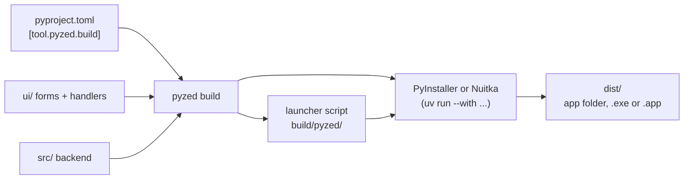

import { Aside, Steps, Tabs, TabItem } from '@astrojs/starlight/components';

`pyzed build` turns a [Pyzed project](/pyzed/guides/projects/) into an app that runs on machines without Python:
a folder (or a single file) with the Python interpreter, `pyzed-ui`, your dependencies, your backend code and your
forms. It uses [PyInstaller](https://pyinstaller.org) or [Nuitka](https://nuitka.net) underneath, run inside the
project's own environment, so nothing has to be installed globally.

<Aside type="tip" title="From the designer">
Pyzed Design does all of this from a dialog: **File → Export app…** sets every option below, previews the icon and the
splash screen, builds with the output in the Console and writes the CI workflow. See
[Exporting your app](/pyzed/editor/exporting/).
</Aside>

## Build in three steps

<Steps>

1. Open a terminal in the project folder (the one with `pyproject.toml`). If you do not have a project yet, create one
   with `pyzed new` (see [Create a project](/pyzed/getting-started/new-project/)).

2. Run the build:

   <Tabs syncKey="pkg">
   	<TabItem label="uv">
   		```bash title="Windows, macOS and Linux"
   		uv run pyzed build
   		```
   	</TabItem>
   	<TabItem label="pip">
   		```bash title="macOS and Linux"
   		source .venv/bin/activate
   		pyzed build          # or: python -m pyzed build
   		```

   		```powershell title="Windows (PowerShell)"
   		.venv\Scripts\Activate.ps1
   		pyzed build          # or: py -m pyzed build
   		```
   	</TabItem>
   </Tabs>

3. Open the result in `dist/`:

   | Platform | Result | Run it |
   | --- | --- | --- |
   | Windows | `dist\Shop\Shop.exe` (or `dist\Shop.exe` with `--onefile`) | Double-click it. |
   | macOS | `dist/Shop.app` | Open it from Finder. |
   | Linux | `dist/Shop/Shop` (or `dist/Shop` with `--onefile`) | `./dist/Shop/Shop` |

</Steps>

<Aside type="note" title="uv is needed, even with pip">
`pyzed build` runs PyInstaller through `uv run --with pyinstaller` (and Nuitka through `uv run --with nuitka`), so [uv](https://docs.astral.sh/uv/) must be
installed even if you use pip for everything else. You do not need to install PyInstaller or Nuitka yourself. Install uv with
`pip install uv` or from its website.
</Aside>

<Aside type="caution" title="One build per platform">
Neither PyInstaller nor Nuitka cross-compiles: build the Windows app on Windows, the macOS app on macOS and the Linux
app on Linux, each on the architecture it is for (x64 or ARM). A [CI workflow](/pyzed/packaging/ci/) builds all of them
for you.
</Aside>

## What happens when you build



1. `pyzed build` reads `[tool.pyzed]` and `[tool.pyzed.build]` from `pyproject.toml`.
2. It writes a small **launcher** (`build/pyzed/<name>_launcher.py`) that opens the main form (`[tool.pyzed] main`)
   from inside the bundle, with the window icon and the splash screen.
3. It makes the icon files (`.ico`, `.icns`, `.png`) from your picture, and the Windows version file.
4. It scans the `.py` files of the UI folder with Python's `ast` module to find what they import.
5. It runs the backend in the project's environment with the right options, and the app lands in `dist/`. Last, it
   fills in the macOS `Info.plist` and packs the archive, if you asked for one.

### What gets bundled

Forms load their handlers from `.py` files when they open, so PyInstaller cannot follow their imports by itself.
`pyzed build` fills the gaps:

- **The UI folder** is shipped as data, keeping its layout (`ui/main.pzform`, `ui/main.py`, helper modules...).
- **Every module imported by the UI** is passed as a hidden import, so the backend in `src/`, modules next to
  `pyproject.toml` and third-party packages are bundled with all their dependencies.
- **The project's own package** (`src/<name>`) is collected whole, including modules imported dynamically.
- **Pyzed itself** with its data files (themes, icons, templates).
- `ui/`, `src/` and the project root are added to PyInstaller's search path.

Code outside the project, such as a shared library in a sibling folder, is bundled like any other dependency once it is
installed in the environment:

```bash
pyzed add --editable ../billing     # then `from billing import invoice` in a handler
```

<Aside type="note" title="Apps written in code">
`pyzed build` starts the project's main **form**. For an app written fully in code (a `pz.App` class and
`pz.run(...)`), see [Apps written in code](#apps-written-in-code) below.
</Aside>

## Options

Command line flags win over `[tool.pyzed.build]` in `pyproject.toml`:

| Flag | Effect |
| --- | --- |
| `--backend nuitka` | Build with Nuitka instead of PyInstaller (see [Choosing a backend](#choosing-a-backend)). |
| `--onefile` | A single executable instead of a folder. |
| `--console` | Keep the console window (useful to see tracebacks). |
| `--name Shop` | Name of the executable or bundle. |
| `--archive zip` | Also pack the app in a `zip` (or `tar.gz`) named for the [self-updater](/pyzed/packaging/updates/). |
| `--target linux-x64` | Check that this computer builds that target (CI uses it); it does not cross-compile. |
| `--dry-run` | Print the backend's command and stop. |
| `--workflow` | Write a GitHub Actions workflow for the project's `targets` instead of building (see [CI](/pyzed/packaging/ci/)). |

All the settings of a project live in `pyproject.toml` (the [Export dialog](/pyzed/editor/exporting/) of Pyzed Design
writes the same table):

```toml title="pyproject.toml"
[tool.pyzed.build]
name = "Shop"                          # executable / bundle name (default: the project name)
backend = "pyinstaller"                # or "nuitka"
onefile = false                        # one self-extracting file instead of a folder
windowed = true                        # no console window on Windows and macOS
icon = "assets/icon.png"               # one square picture; .ico and .icns are made from it
version = "1.2.0"                      # default: [project] version
publisher = "Acme"                     # the company in the Windows file properties
identifier = "com.acme.shop"           # macOS bundle id and Linux app id
copyright = "© 2026 Acme"
optimize = 0                           # 1 drops asserts, 2 also docstrings
slim = true                            # leave out tkinter, test, idlelib... (unused by Pyzed apps)
exclude = ["numpy.tests"]              # more modules to leave out
include = ["assets", "data/prices.csv"]  # extra files and folders, same relative path in the bundle
hidden-imports = ["shop.plugins.csv"]  # modules imported with importlib or by name
collect = ["babel"]                    # packages to ship whole: code, data files and binaries
archive = "zip"                        # also pack the app: shop-windows-x86_64.zip...
targets = ["windows-x64", "macos-arm64", "linux-x64"]  # what the CI workflow builds
args = []                              # anything else, passed to the backend as is

[tool.pyzed.build.splash]
image = "assets/splash.png"
duration = 1.5                         # seconds, at least
text = "Loading…"
native = true                          # also the backend's own splash while the app unpacks

[tool.pyzed.build.nuitka]              # options for one backend only ([tool.pyzed.build.pyinstaller] too)
args = ["--lto=yes"]
```

| Setting | Default | Notes |
| --- | --- | --- |
| `name` | the project name | Also the name of the folder in `dist/`. |
| `backend` | `"pyinstaller"` | `"nuitka"` compiles to C: see below. |
| `onefile` | `false` | A single file starts slower (it unpacks itself each time) and cannot [update itself](/pyzed/packaging/updates/). |
| `windowed` | `true` | `false` (or `--console`) shows a terminal next to the app. |
| `icon` | none | A PNG becomes `.ico`, `.icns` and the window icon; see [Icons and metadata](/pyzed/packaging/icons-metadata/). |
| `version`, `publisher`, `identifier`, `description`, `copyright` | from `[project]` | Written into the Windows file properties and the macOS `Info.plist`. |
| `splash` | none | A [splash screen](#splash-screen). |
| `optimize` | `0` | Python's `-O` (`1`) or `-OO` (`2`). |
| `slim` | `true` | Leaves out `tkinter`, `test`, `idlelib`, `lib2to3`, `ensurepip`, `pydoc_data`, `turtle` and `turtledemo`. |
| `strip`, `upx` | `true`, `false` | Strip debug symbols (Linux and macOS); compress with [UPX](https://upx.github.io/) if installed. |
| `exclude` | `[]` | Modules to leave out. |
| `include` | `[]` | Paths relative to the project root. |
| `hidden-imports` | `[]` | Modules the backend cannot see. |
| `collect` | `[]` | Packages with data files or plugins. |
| `archive` | none | `"zip"` or `"tar.gz"`. |
| `targets` | this computer | For `--workflow`: `windows-x64`, `windows-arm64`, `macos-arm64`, `macos-x64`, `linux-x64`, `linux-arm64`. |
| `args` | `[]` | Any other option of the backend ([PyInstaller](https://pyinstaller.org/en/stable/usage.html), [Nuitka](https://nuitka.net/user-documentation/)). |

## Choosing a backend

| | PyInstaller | Nuitka |
| --- | --- | --- |
| How | Bundles your `.py` files as they are, next to Python | Compiles your code and its dependencies to C, then to machine code |
| Build time | Seconds | Minutes |
| Speed | Normal Python | Compiled: faster pure-Python code |
| Size of a single file | Larger | About 15% smaller (better compression) |
| Size of a folder | Smaller | Larger (compiled code takes more room than `.pyc`) |
| Needs | Nothing (uv installs it) | A C compiler |

Measured with a one-form app on Linux x64: PyInstaller made a 57 MB folder or a 25 MB single file in about 25
seconds; Nuitka a 72 MB folder or a 21 MB single file in about 3 minutes. Most of the size is Pyzed's engine (about
33 MB) and Python itself, so `slim`, `exclude` and `strip` matter more than the backend.

Start with PyInstaller while you develop, and try Nuitka for releases. Nuitka needs a C compiler: on Linux `gcc`
(`sudo apt install gcc`), on macOS the Xcode command line tools (`xcode-select --install`), on Windows Visual Studio's
Build Tools, or Nuitka downloads a compiler the first time. `pyzed build` adds `patchelf` (Linux) and `zstandard`
(single files) itself.

## Splash screen

With `[tool.pyzed.build.splash]`, the app opens a frameless window with your image, centered on the screen, before the
main form. It stays up for `duration` seconds at least and until the main form has loaded, then closes. `text` is
written over the bottom of the image. With `native = true`, the backend's own splash also shows before Python starts
(PyInstaller on Windows and Linux, which needs `tkinter` in the project's Python; Nuitka for single files on Windows),
useful for single-file apps that take a moment to unpack.

The same splash works in an app written in code, through `App.splash`:

```python
import pyzed as pz

class Shop(pz.App):
    splash = pz.Splash("assets/splash.png", duration=1.5, text="Loading…")
```

### Finding your data files

Files listed in `include` end up under the bundle root, with the same relative path. Find them from your code with:

```python
import sys
from pathlib import Path

ROOT = Path(getattr(sys, "_MEIPASS", Path(__file__).resolve().parents[1]))
prices = ROOT / "data" / "prices.csv"
```

`sys._MEIPASS` is the bundle folder of a PyInstaller app. In a Nuitka app and while you develop, the fallback is used:
from a handler in `ui/` it points at the bundle (or the project) root; adjust `parents[1]` to where the file that runs
this lives.

<Aside type="tip" title="Do not write next to the app">
The app folder may be read-only once installed (for example in `/Applications` or `Program Files`). Save user data
in the user's folders instead: the `platformdirs` package (`pyzed add platformdirs`) gives the right place on each
system with `platformdirs.user_data_dir("Shop")`.
</Aside>

### Where the files go

The intermediate files go to `build/pyzed/` and the result to `dist/`; both are in the `.gitignore` of new projects.
Each build starts clean, so delete nothing by hand.

## Apps written in code

`pyzed build` starts the project's main **form**. For an app written fully in code (a `pz.App` class and
`pz.run(...)`), run PyInstaller on your script yourself, collecting Pyzed's data files. `pyzed build --dry-run` prints
the exact command `pyzed build` would run, which you can adapt:

<Tabs syncKey="pkg">
	<TabItem label="uv">
		```bash
		uv run --with pyinstaller pyinstaller main.py --name Shop --windowed --collect-data pyzed --collect-submodules pyzed
		```
	</TabItem>
	<TabItem label="pip">
		```bash title="macOS and Linux"
		python3 -m pip install pyinstaller
		python3 -m PyInstaller main.py --name Shop --windowed --collect-data pyzed --collect-submodules pyzed
		```

		```powershell title="Windows (PowerShell)"
		py -m pip install pyinstaller
		py -m PyInstaller main.py --name Shop --windowed --collect-data pyzed --collect-submodules pyzed
		```
	</TabItem>
</Tabs>

With Nuitka:

```bash
uv run --with nuitka --with patchelf python -m nuitka --mode=standalone --include-package-data=pyzed main.py
```

## Next

- Per platform: [Windows](/pyzed/packaging/windows/), [macOS](/pyzed/packaging/macos/), [Linux](/pyzed/packaging/linux/).
- [Build every platform in CI](/pyzed/packaging/ci/) and [ship updates](/pyzed/packaging/updates/).
- Something wrong? [Troubleshooting](/pyzed/packaging/troubleshooting/).
